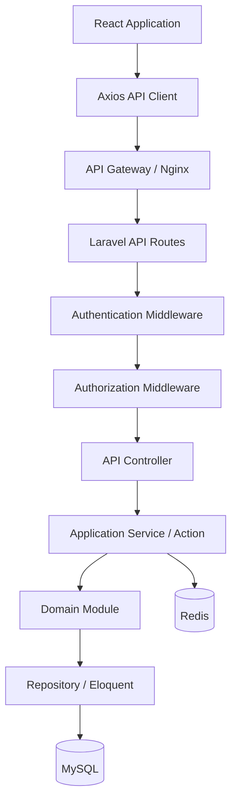

# API_SPECIFICATION.md

## Enterprise System Starter Kit

| Attribute | Specification |
|---|---|
| Document Type | API Technical Specification |
| Architecture | Modular Monolith |
| API Style | RESTful API |
| API Format | JSON |
| API Version | v1 |
| Backend | Laravel 13.x |
| Language | PHP 8.4.x |
| Authentication | Laravel Sanctum |
| Authorization | Spatie Permission + Laravel Policies |
| Frontend | React + TypeScript |
| Database | MySQL 8.x |
| Cache & Queue | Redis |
| API Documentation | OpenAPI 3.x |
| Status | Draft – Foundation Specification |

---

> **Base v1:** Cakupan implementasi awal dan endpoint yang ditunda tercantum di `README.md`.

# 1. Introduction

## 1.1 Purpose

Dokumen ini mendefinisikan standar API untuk Enterprise System Starter Kit.

API menjadi communication layer antara frontend, backend, dan sistem eksternal.

Spesifikasi ini mencakup:

- API architecture.
- API naming convention.
- Authentication.
- Authorization.
- Request dan response format.
- Validation.
- Error handling.
- Pagination, filtering, dan sorting.
- Core module endpoints.
- API versioning.
- Integration standards.
- API security.
- Testing standards.
- OpenAPI documentation.

## 1.2 API Objectives

1. Menyediakan standar API yang konsisten.
2. Memisahkan frontend dan backend.
3. Mendukung pengembangan modular.
4. Mendukung integrasi sistem eksternal.
5. Menjamin keamanan akses API.
6. Mempermudah maintenance dan debugging.
7. Mendukung contract-first development.
8. Menyediakan dokumentasi API terstandarisasi.

## 1.3 API Design Principles

| Principle | Description |
|---|---|
| RESTful | Menggunakan HTTP methods sesuai fungsi |
| Stateless | Setiap request membawa konteks autentikasinya sendiri (session cookie SPA atau Bearer token) |
| Consistent | Format response konsisten |
| Secure | Authentication dan authorization wajib |
| Versioned | API memiliki versi |
| Documented | Semua endpoint terdokumentasi |
| Validated | Input divalidasi backend |
| Reusable | API dapat digunakan oleh berbagai client |
| Modular | Endpoint mengikuti domain module |

---

# 2. API Architecture

## 2.1 High-Level Architecture



## 2.2 API Communication

| Component | Responsibility |
|---|---|
| React | User interface |
| Axios | HTTP communication |
| Nginx | Reverse proxy |
| Laravel Routes | Endpoint registration |
| Middleware | Authentication dan authorization |
| Controller | Request handling |
| Action / Service | Business logic |
| Model | Data persistence |
| MySQL | Primary database |
| Redis | Cache, queue, dan rate limiting |

## 2.3 API Base URL

Development:

```text
http://localhost:8000/api/v1
```

Staging:

```text
https://staging.example.com/api/v1
```

Production:

```text
https://example.com/api/v1
```

Base URL harus disimpan dalam environment configuration frontend.

---

# 3. API Naming Convention

## 3.1 URL Structure

Format:

```text
/api/{version}/{resource}
```

Contoh:

```text
/api/v1/users
/api/v1/workflows
/api/v1/documents
```

## 3.2 Resource Naming

Gunakan plural noun dan lowercase.

| Correct | Incorrect |
|---|---|
| /users | /getUsers |
| /workflow-instances | /workflowInstances |
| /audit-logs | /auditLogs |

## 3.3 HTTP Methods

| Method | Purpose | Example |
|---|---|---|
| GET | Retrieve data | GET /users |
| POST | Create resource / execute action | POST /users |
| PUT | Replace entire list | PUT /users/{id}/roles |
| PATCH | Partial update | PATCH /users/{id} |
| DELETE | Delete resource | DELETE /users/{id} |

## 3.4 HTTP Status Codes

| Status | Description |
|---|---|
| 200 | Request successful |
| 201 | Resource created |
| 202 | Request accepted for asynchronous processing |
| 204 | Successful request without response body |
| 400 | Bad request |
| 401 | Unauthenticated |
| 403 | Forbidden |
| 404 | Resource not found |
| 409 | Conflict |
| 413 | Payload too large |
| 415 | Unsupported media type |
| 422 | Validation error |
| 429 | Too many requests |
| 500 | Internal server error |
| 503 | Service unavailable |

---

# 4. Standard Request Format

## 4.1 Headers

General API headers:

```http
Accept: application/json
Content-Type: application/json
Authorization: Bearer {token}
```

Untuk aplikasi first-party SPA berbasis Sanctum cookie authentication, gunakan mekanisme cookie session dan CSRF sesuai dokumentasi Sanctum. Header Bearer token digunakan untuk client yang memang menggunakan personal access token.

## 4.2 Request Body

Contoh:

```json
{
  "name": "Ahmad Krisdiantoro",
  "email": "ahmad@example.com",
  "status": "active"
}
```

## 4.3 Date Format

Gunakan ISO 8601:

```text
2026-11-09T10:30:00Z
```

Standar:

- Database menyimpan timestamp dalam UTC.
- API mengirim timestamp dengan timezone yang jelas.
- Frontend melakukan konversi sesuai timezone pengguna.
- Tanggal bisnis tanpa waktu dapat menggunakan `YYYY-MM-DD`.

---

# 5. Standard Response Format

## 5.1 Success Response

Contoh:

```json
{
  "success": true,
  "message": "User retrieved successfully",
  "data": {
    "id": "01932f5e-1234-7000-8000-123456789abc",
    "name": "Ahmad Krisdiantoro",
    "email": "ahmad@example.com",
    "status": "active",
    "created_at": "2026-11-09T10:30:00Z"
  },
  "meta": null
}
```

## 5.2 Collection Response

```json
{
  "success": true,
  "message": "Users retrieved successfully",
  "data": [
    {
      "id": "01932f5e-1234-7000-8000-123456789abc",
      "name": "User A",
      "email": "usera@example.com"
    },
    {
      "id": "01932f5e-1234-7000-8000-123456789def",
      "name": "User B",
      "email": "userb@example.com"
    }
  ],
  "meta": {
    "pagination": {
      "current_page": 1,
      "per_page": 20,
      "total": 100,
      "last_page": 5,
      "from": 1,
      "to": 20
    }
  }
}
```

## 5.3 Error Response

```json
{
  "success": false,
  "message": "The given data was invalid.",
  "code": "VALIDATION_FAILED",
  "data": null,
  "errors": {
    "email": [
      "The email has already been taken."
    ]
  },
  "meta": null
}
```

## 5.4 Error Structure

| Field | Type | Description |
|---|---|---|
| success | Boolean | Request status |
| message | String | Human-readable message |
| code | String | Application error code, hanya pada error response |
| data | Object / Array / Null | Response data |
| errors | Object / Null | Validation or business errors |
| meta | Object / Null | Pagination or metadata |

Error response tidak boleh menampilkan stack trace, SQL query, credential, atau informasi internal server pada production.

## 5.5 Identifier & Field Mapping

| API Field | Database | Rule |
|---|---|---|
| `id` dan relasi `*_id` | Kolom `uuid` | Semua resource, kecuali `roles`, `permissions`, dan `audit-logs` yang memakai ID bawaan paket |
| `status` pada user | `is_active` | `active` = true, `inactive` = false |
| `subject_type`, `subject_id` | `reference_type`, `reference_id` | `subject_type` divalidasi terhadap allowlist; UUID di-resolve menjadi ID internal |
| `workflow_id` | `workflow_definitions.uuid` | Instance baru memakai versi `published` terbaru |

Model yang diekspos melalui API harus mengembalikan `uuid` dari `getRouteKeyName()`.

---

# 6. Pagination, Filtering & Sorting

## 6.1 Pagination

Endpoint:

```http
GET /api/v1/users?page=1&per_page=20
```

Parameter:

| Parameter | Type | Default | Description |
|---|---|---|---|
| page | Integer | 1 | Current page |
| per_page | Integer | 20 | Items per page |

Batas default maksimum `per_page` adalah 100.

## 6.2 Filtering

Contoh:

```http
GET /api/v1/users?status=active
```

Filter yang didukung harus didefinisikan per endpoint. Jangan menerima nama kolom SQL secara bebas dari client.

## 6.3 Search

```http
GET /api/v1/users?search=ahmad
```

Search hanya mencakup field yang diizinkan.

## 6.4 Sorting

```http
GET /api/v1/users?sort_by=created_at&sort_direction=desc
```

Parameter:

| Parameter | Allowed Values |
|---|---|
| sort_by | Whitelisted field |
| sort_direction | asc / desc |

## 6.5 Combined Query

```http
GET /api/v1/users?page=1&per_page=20&search=ahmad&status=active&sort_by=created_at&sort_direction=desc
```

---

# 7. Authentication API

Authentication menggunakan Laravel Sanctum.

## 7.1 Authentication Endpoints

| Method | Endpoint | Description | Auth |
|---|---|---|---|
| GET | /auth/user | Current user | Required |
| GET | /auth/sessions | List own active sessions | Required |
| DELETE | /auth/sessions/{id} | Revoke own session | Required |
| POST | /auth/email/verification-notification | Resend email verification | Required |
| GET | /auth/email/verify/{id}/{hash} | Verify email (signed URL) | Required |
| POST | /auth/tokens | Create API token | Required |
| GET | /auth/tokens | List own API tokens | Required |
| DELETE | /auth/tokens/{id} | Revoke own API token | Required |
| POST | /auth/forgot-password | Request password reset | Public |
| POST | /auth/reset-password | Reset password | Public |
| POST | /auth/change-password | Change password | Required |

### SPA Authentication

Untuk first-party React SPA:

```text
GET /sanctum/csrf-cookie
POST /login
GET /api/v1/auth/user
POST /logout
```

Login dan logout menggunakan session-based authentication yang dikelola Sanctum.

Route `/login` dan `/logout` berada di luar prefix `/api/v1` dan hanya digunakan oleh SPA. Client token mengakhiri akses dengan `DELETE /auth/tokens/{id}`.

### API Token Authentication

Untuk integrasi eksternal:

```http
Authorization: Bearer {personal_access_token}
```

Token wajib:

- Memiliki nama dan owner.
- Memiliki abilities yang sesuai.
- Memiliki masa berlaku jika kebijakan mengharuskan.
- Dapat dicabut.
- Tidak ditampilkan kembali setelah dibuat.

Izin efektif sebuah token adalah irisan antara permission pemilik token dan abilities token. Middleware `permission:` hanya memeriksa permission user, sehingga endpoint yang dapat diakses token juga harus memeriksa abilities (`tokenCan()` atau middleware `abilities`).

## 7.2 Current User

```http
GET /api/v1/auth/user
```

Response:

```json
{
  "success": true,
  "message": "Authenticated user",
  "data": {
    "id": "01932f5e-1234-7000-8000-123456789abc",
    "name": "Ahmad Krisdiantoro",
    "email": "ahmad@example.com",
    "roles": [
      "Admin"
    ],
    "permissions": [
      "user.view",
      "user.create",
      "user.update"
    ]
  },
  "meta": null
}
```

Response harus mengikuti scope dan informasi yang boleh dilihat oleh user tersebut.

## 7.3 Login & Password

| Endpoint | Body | Response |
|---|---|---|
| POST /login | `identifier` (email atau username), `password`, `remember` (opsional, boolean) | 200 berisi data user seperti bagian 7.2; 401 `AUTH_INVALID_CREDENTIALS` |
| POST /logout | - | 204 |
| POST /auth/forgot-password | `email` | Selalu 200, baik email terdaftar maupun tidak |
| POST /auth/reset-password | `email`, `token`, `password`, `password_confirmation` | 200; 422 `AUTH_PASSWORD_RESET_INVALID` |
| POST /auth/change-password | `current_password`, `password`, `password_confirmation` | 200; 422 per field |

- Email atau username salah, password salah, akun nonaktif, dan akun terhapus menghasilkan error login yang sama.
- `identifier` yang mengandung `@` dicocokkan sebagai email, selain itu sebagai username.
- Email dan username dinormalisasi dengan membuang spasi di awal dan akhir lalu mengubahnya ke huruf kecil, pada pembuatan akun, perubahan akun, login, dan reset password. Keunikan berlaku setelah normalisasi. Password tidak dinormalisasi dan membedakan huruf besar dan kecil.
- `remember: true` membuat sesi dapat dipulihkan selama 30 hari lewat cookie HttpOnly. Token dirotasi saat logout, ubah password, reset password, dan penonaktifan akun.
- Password baru minimal 12 karakter dan tidak boleh terdapat pada data kebocoran.
- Link reset berbentuk `/reset-password#token={token}&email={email}`. Token berada di URL fragment agar tidak tercatat di log server, berlaku 60 menit, dan hanya dapat dipakai sekali.
- Reset password mengakhiri semua session user. Ubah password mengakhiri session lain dan meregenerasi session yang sedang dipakai.
- Login, permintaan reset, dan ubah password dibatasi 5 percobaan per menit.

---

# 8. Core Module API Specification

Seluruh endpoint di bawah merupakan baseline. Modul bisnis spesifik dapat menambahkan endpoint sesuai `MODULE_SPECIFICATION.md`.

## 8.1 User Management

Base resource:

```text
/api/v1/users
```

| Method | Endpoint | Permission | Description |
|---|---|---|---|
| GET | /users | user.view | List users |
| POST | /users | user.create | Create user |
| GET | /users/{id} | user.view | User detail |
| PATCH | /users/{id} | user.update | Update user data |
| DELETE | /users/{id} | user.delete | Deactivate/delete user |
| GET | /users/{id}/roles | user.view | Get user roles |
| PUT | /users/{id}/roles | user.assign_role | Assign roles |

### Create User

```http
POST /api/v1/users
```

Request:

```json
{
  "name": "John Doe",
  "email": "john@example.com",
  "password": "StrongPassword123!",
  "status": "active"
}
```

Validation:

| Field | Rule |
|---|---|
| name | Required, string, max 150 |
| email | Required, valid email, unique |
| username | Optional, 3 sampai 50 karakter huruf, angka, titik, garis bawah, atau tanda hubung, unique, disimpan dalam huruf kecil |
| password | Required, password policy |
| status | Allowed enum |
| roles | Optional, daftar nama role yang valid |

Password tidak boleh dikembalikan dalam response.

`roles` pada `POST /users` dan `PATCH /users/{id}` memerlukan permission `user.assign_role` dan aturan yang sama dengan `PUT /users/{id}/roles`. Data pengguna dan role disimpan dalam satu transaksi, sehingga role yang ditolak membatalkan seluruh perubahan.

### Update User

```http
PATCH /api/v1/users/{id}
```

Request:

```json
{
  "name": "John Doe Updated",
  "status": "active"
}
```

Field yang dapat diubah: `name`, `email`, `username`, dan `status`. Password tidak dapat diubah melalui endpoint ini.

### Aturan Pengelolaan User

- `DELETE /users/{id}` menonaktifkan akun tanpa menghapusnya dan mengakhiri semua session user. `PATCH` dengan `status: inactive` memiliki efek yang sama. Akun diaktifkan kembali dengan `status: active`.
- User tidak dapat menonaktifkan akunnya sendiri (`USER_SELF_DEACTIVATION`), dan Super Admin aktif terakhir tidak dapat dinonaktifkan (`USER_LAST_SUPER_ADMIN`). Keduanya mengembalikan HTTP 409.
- Actor hanya dapat mengubah, menonaktifkan, atau mengatur role user yang seluruh role-nya berada dalam kewenangan actor. Pengecualian: actor boleh mengubah profilnya sendiri.
- Role selain Super Admin, System Admin, dan Admin hanya dapat melihat akunnya sendiri; pengguna lain mengembalikan HTTP 404.
- `GET /users/{id}/roles` mengembalikan `data.roles` berupa daftar nama role.
- `PUT /users/{id}/roles` menerima `roles` berupa daftar nama role dan mengganti seluruh role user. Actor tidak dapat mengubah role-nya sendiri.
- `GET /users` mendukung `search` pada nama dan email, filter `status`, serta `sort_by` untuk `name`, `email`, dan `created_at`.

---

## 8.2 Role & Permission Management

Base resources:

```text
/api/v1/roles
/api/v1/permissions
```

| Method | Endpoint | Permission |
|---|---|---|
| GET | /roles | role.view |
| POST | /roles | role.create |
| GET | /roles/{id} | role.view |
| PATCH | /roles/{id} | role.update |
| DELETE | /roles/{id} | role.delete |
| GET | /permissions | permission.view |
| PUT | /roles/{id}/permissions | permission.assign |
| GET | /roles/{id}/permissions | role.view |

### Assign Role Permissions

```http
PUT /api/v1/roles/{id}/permissions
```

Request:

```json
{
  "permissions": [
    "user.view",
    "user.create",
  ],
  "version": 3
}
```

Backend harus memeriksa:

- Permission yang diminta memang terdaftar.
- Actor berwenang mengubah role tersebut.
- Actor tidak dapat memberikan privilege di luar batasnya.
- Perubahan tercatat dalam audit log.
- Permission cache diinvalidasi.

Aturan tambahan:

- Body `POST /roles` adalah `name` dan `permissions` (opsional). Body `PATCH /roles/{id}` adalah `name` dan `permissions`, keduanya opsional, dan `version` wajib jika `permissions` dikirim.
- `permissions` pada `POST /roles` dan `PATCH /roles/{id}` memerlukan permission `permission.assign`. Nama dan permission disimpan dalam satu transaksi, sehingga permission yang ditolak atau `version` yang usang membatalkan seluruh perubahan.
- `GET /roles/{id}` memuat `permissions`, sedangkan `GET /roles` tidak.
- Role bawaan (Super Admin, Admin, Staff, Viewer) tidak dapat diganti nama atau dihapus, dengan code `ROLE_PROTECTED`. Permission role Super Admin tidak dapat diubah melalui API.
- Role yang masih terpasang pada user, termasuk user yang di-soft delete, tidak dapat dihapus, dengan code `ROLE_IN_USE`.
- Actor hanya dapat menambahkan permission yang dimilikinya sendiri. Pelanggaran mengembalikan HTTP 403 dengan code `AUTH_PRIVILEGE_ESCALATION`.
- `GET /permissions` mengembalikan seluruh permission tanpa pagination agar dapat dipakai sebagai daftar pilihan.
- Permission diperiksa sebelum resource dicari, sehingga user tanpa izin selalu menerima HTTP 403.

---

## 8.3 Workflow Management

Base resources:

```text
/api/v1/workflows
/api/v1/workflow-instances
/api/v1/workflow-tasks
```

| Method | Endpoint | Permission |
|---|---|---|
| GET | /workflows | workflow.view |
| POST | /workflows | workflow.create |
| GET | /workflows/{id} | workflow.view |
| PATCH | /workflows/{id} | workflow.update |
| POST | /workflows/{id}/versions | workflow.update |
| POST | /workflows/{id}/publish | workflow.publish |
| POST | /workflow-instances | workflow.submit |
| GET | /workflow-instances | workflow.view |
| GET | /workflow-instances/{id} | workflow.view |
| POST | /workflow-instances/{id}/cancel | workflow.cancel |
| POST | /workflow-instances/{id}/resubmit | workflow.submit |
| GET | /workflow-tasks | workflow.view |
| POST | /workflow-tasks/{id}/approve | workflow.approve |
| POST | /workflow-tasks/{id}/reject | workflow.reject |
| POST | /workflow-tasks/{id}/request-revision | workflow.request_revision |
| POST | /workflow-tasks/{id}/delegate | workflow.delegate |

`GET /workflow-tasks` hanya mengembalikan task yang ditugaskan kepada user aktif.

### Submit Workflow

```http
POST /api/v1/workflow-instances
```

Request:

```json
{
  "workflow_id": "01932f5e-1234-7000-8000-123456789abc",
  "subject_type": "purchase_request",
  "subject_id": "01932f5e-1234-7000-8000-123456789def",
  "notes": "Please review this request."
}
```

Backend harus memvalidasi workflow yang aktif, hak akses terhadap subject, dan aturan submission.

### Approve Workflow

```http
POST /api/v1/workflow-tasks/{id}/approve
```

Request:

```json
{
  "notes": "Approved."
}
```

### Reject Workflow

```http
POST /api/v1/workflow-tasks/{id}/reject
```

Request:

```json
{
  "reason": "Incomplete supporting documents."
}
```

### Request Revision

```http
POST /api/v1/workflow-tasks/{id}/request-revision
```

Request:

```json
{
  "reason": "Please attach the supplier quotation."
}
```

Field `reason` wajib diisi. Instance berubah menjadi `revision_required` dan pengajuan kembali ke requester.

### Resubmit Workflow

```http
POST /api/v1/workflow-instances/{id}/resubmit
```

Request:

```json
{
  "notes": "Quotation has been attached."
}
```

Hanya requester yang dapat mengajukan ulang. Approval dimulai lagi dari step pertama dengan workflow version yang sama.

### Cancel Workflow

```http
POST /api/v1/workflow-instances/{id}/cancel
```

Request:

```json
{
  "reason": "Request is no longer needed."
}
```

Requester dapat membatalkan selama belum ada task `approved` atau `rejected` pada pengajuan berjalan. Jika sudah ada, backend mengembalikan HTTP 409 dengan code `WORKFLOW_CANCEL_NOT_ALLOWED`.

Approval, rejection, revision, resubmit, dan cancel harus diproses secara transaksional. Periksa status dan assignment saat eksekusi untuk mencegah double processing atau race condition.

---

## 8.4 Document Management

Base resource:

```text
/api/v1/documents
```

| Method | Endpoint | Permission |
|---|---|---|
| GET | /documents | document.view |
| POST | /documents | document.upload |
| GET | /documents/{id} | document.view |
| PATCH | /documents/{id} | document.update |
| DELETE | /documents/{id} | document.delete |
| GET | /documents/{id}/download | document.download |
| GET | /documents/{id}/versions | document.view |
| POST | /documents/{id}/versions | document.upload |

### Upload Document

```http
POST /api/v1/documents
Content-Type: multipart/form-data
```

Fields:

| Field | Type | Required |
|---|---|---|
| file | File | Yes |
| title | String | Yes |
| description | String | No |
| document_type | String | No |
| related_type | String | No |
| related_id | UUID | No |

Upload wajib melewati:

- File size validation.
- MIME validation berdasarkan isi file.
- File extension allowlist.
- Authorization.
- Private storage.
- Randomized storage filename.
- Malware scanning sesuai infrastruktur.
- Audit log.

### Download Document

```http
GET /api/v1/documents/{id}/download
```

Download harus melewati pemeriksaan akses resource. Jangan mengekspos storage path atau membuat file privat tersedia melalui public URL permanen.

---

## 8.5 Master Data Management

Base resource:

```text
/api/v1/master-data
```

| Method | Endpoint | Permission |
|---|---|---|
| GET | /master-data/{type} | master_data.view |
| POST | /master-data/{type} | master_data.create |
| GET | /master-data/{type}/{id} | master_data.view |
| PATCH | /master-data/{type}/{id} | master_data.update |
| DELETE | /master-data/{type}/{id} | master_data.delete |
| POST | /master-data/{type}/import | master_data.import |
| GET | /master-data/{type}/export | master_data.export |

`{type}` harus divalidasi terhadap daftar master data yang terdaftar. Jangan langsung menggunakan parameter tersebut untuk menentukan nama tabel SQL.

### Import Master Data

```http
POST /api/v1/master-data/materials/import
Content-Type: multipart/form-data
```

Request fields:

```text
file: materials.xlsx
mode: validate
```

Recommended import workflow:

```text
Upload
  |
  v
Validate File
  |
  v
Parse Data
  |
  v
Preview Validation Results
  |
  v
Confirm Import
  |
  v
Process Import Job
  |
  v
Import Summary
```

Untuk file besar, gunakan asynchronous job.

---

## 8.6 Notification Management

Base resource:

```text
/api/v1/notifications
```

| Method | Endpoint | Description |
|---|---|---|
| GET | /notifications | List notifications |
| GET | /notifications/unread-count | Unread count |
| PATCH | /notifications/{id}/read | Mark as read |
| POST | /notifications/read-all | Mark all as read |
| DELETE | /notifications/{id} | Delete notification |
| GET | /notification-preferences | Get own preferences |
| PUT | /notification-preferences | Update own preferences |

Notification harus dibatasi berdasarkan penerima. User tidak boleh membaca atau mengubah notification milik user lain.

---

## 8.7 Reporting & Dashboard

Base resource:

```text
/api/v1/dashboard
/api/v1/reports
```

| Method | Endpoint | Permission |
|---|---|---|
| GET | /dashboard/summary | dashboard.view |
| GET | /dashboard/activities | dashboard.view |
| GET | /reports | report.view |
| GET | /reports/{id} | report.view |
| POST | /reports/{id}/export | report.export |
| GET | /reports/exports/{id} | report.export |

Filter laporan harus menerapkan scope data dan permission yang sesuai.

Export dengan waktu pemrosesan panjang sebaiknya menggunakan background job.

---

## 8.8 Audit Log

Base resource:

```text
/api/v1/audit-logs
```

| Method | Endpoint | Permission |
|---|---|---|
| GET | /audit-logs | audit.view |
| GET | /audit-logs/{id} | audit.view |
| POST | /audit-logs/export | audit.export |

Audit log bersifat read-only melalui API operasional. Tidak menyediakan endpoint edit atau delete untuk user biasa.

`GET /audit-logs` diurutkan dari yang terbaru dan mendukung parameter berikut:

| Parameter | Keterangan |
|---|---|
| `user_id` | UUID user yang melakukan aksi |
| `module` | `auth`, `user`, `role`, `permission`, atau `system` |
| `action` | Nama event lengkap, misalnya `user.created` |
| `date_from`, `date_to` | Format `YYYY-MM-DD` dalam UTC, inklusif |
| `search` | Pencarian pada nama event |

Setiap record berisi `id`, `event`, `actor`, `subject`, `properties`, dan `created_at`. `subject` berisi `type`, `id`, dan `label` (nama atau key objek, `null` jika objek sudah tidak ada). Actor dan subject yang sudah di-soft delete tetap ditampilkan. Record yang dapat dilihat mengikuti data scope di `AUTHORIZATION_MATRIX.md` bagian 5.9. `POST /audit-logs/export` tidak termasuk Base v1.

---

## 8.9 System Configuration

Base resource:

```text
/api/v1/system-configurations
```

| Method | Endpoint | Permission |
|---|---|---|
| GET | /system-configurations | system_config.view |
| GET | /system-configurations/{key} | system_config.view |
| PATCH | /system-configurations/{key} | system_config.update |
| GET | /system-configurations/public | Public |
| GET | /system-configurations/feature-flags | system_config.feature_flags |

Route statis `public` dan `feature-flags` harus didaftarkan sebelum route `{key}`.

Credential, secret, dan konfigurasi internal tidak boleh dikembalikan melalui endpoint umum.

Aturan tambahan:

- Konfigurasi diidentifikasi dengan `key`, misalnya `company.name`. Response berisi `key`, `value`, `is_public`, `is_sensitive`, `description`, `version`, dan `updated_at`.
- Nilai `is_sensitive` selalu dikembalikan sebagai `null`, disimpan terenkripsi, dan tidak ditulis ke audit log.
- `PATCH /system-configurations/{key}` menerima `value` dan `version`. Flag `is_public` dan `is_sensitive` tidak dapat diubah melalui API.
- Nilai divalidasi per key untuk `company.*`, `localization.*`, dan `feature.*`.
- `GET /system-configurations/public` mengembalikan objek `key: value` dari konfigurasi publik yang tidak sensitif.
- `GET /system-configurations/feature-flags` mengembalikan daftar `key` dan `enabled` dari key berawalan `feature.`.

### Branding

| Method | Endpoint | Permission |
|---|---|---|
| GET | /branding | Public |
| GET | /branding/{asset} | Public |
| POST | /branding/{asset} | system_config.update |
| DELETE | /branding/{asset} | system_config.update |

`{asset}` bernilai `logo`, `logo-dark`, atau `favicon`. Nilai lain mengembalikan HTTP 404. `logo-dark` dipakai di mode gelap dan panel login, dan bersifat opsional.

- `GET /branding` mengembalikan `logo`, `logo_dark`, dan `favicon` berupa `{ "version": 2 }` atau `null`, serta `display` berisi `show_name` (boolean), `background` (`transparent`, `white`, `primary`), dan `size` (`small`, `medium`, `large`). Client menambahkan `?v={version}` pada URL file agar file baru langsung dimuat.
- `GET /branding/{asset}` mengembalikan file gambar, atau HTTP 404 jika belum ada.
- `POST /branding/{asset}` menerima `multipart/form-data` dengan field `file` dan mengembalikan `version` baru. Gambar diubah ukurannya oleh server, sehingga client tidak perlu menyiapkan ukuran tertentu. File lama dihapus setelah transaksi berhasil.
- `DELETE /branding/{asset}` menghapus file dan mengembalikan HTTP 204. Aplikasi kembali memakai tampilan bawaan.
- File disimpan pada key `company.logo`, `company.logo_dark`, dan `company.favicon`, yang tidak dapat diubah melalui `PATCH /system-configurations/{key}`.
- Pengaturan tampilan disimpan pada key `company.logo_show_name`, `company.logo_background`, dan `company.logo_size`, dan diubah melalui `PATCH /system-configurations/{key}` dengan `version`.
- Aturan file dan header keamanan mengikuti `SECURITY_SPECIFICATION.md` bagian 10.5.

---

## 8.10 Health Check

| Method | Endpoint | Auth |
|---|---|---|
| GET | /health | Public |

Endpoint publik hanya mengembalikan status minimum, sesuai `DEPLOYMENT_GUIDE.md`.

---

# 9. API Validation Standards

## 9.1 Validation Rules

Gunakan Laravel Form Request.

Contoh:

```php
class StoreUserRequest extends FormRequest
{
    public function rules(): array
    {
        return [
            'name' => [
                'required',
                'string',
                'max:150',
            ],
            'email' => [
                'required',
                'email',
                'max:255',
                'unique:users,email',
            ],
            'password' => [
                'required',
                'string',
                'min:12',
            ],
        ];
    }
}
```

Password policy harus disesuaikan dengan kebijakan keamanan aplikasi. Gunakan Laravel Password Rule untuk kebijakan yang lebih lengkap.

## 9.2 Validation Response

HTTP 422:

```json
{
  "success": false,
  "message": "Validation failed",
  "code": "VALIDATION_FAILED",
  "data": null,
  "errors": {
    "name": [
      "The name field is required."
    ],
    "email": [
      "The email must be a valid email address."
    ]
  },
  "meta": null
}
```

## 9.3 Business Validation

Business validation harus dipisahkan dari validasi format input.

Contoh:

```text
Cannot approve a completed workflow task.
Cannot assign an unauthorized role.
```

Business rule violation dapat menggunakan HTTP 422 atau 409 sesuai jenis konfliknya.

---

# 10. API Error Handling

## 10.1 Error Categories

| Category | HTTP Status |
|---|---|
| Invalid Request | 400 |
| Unauthenticated | 401 |
| Unauthorized | 403 |
| Resource Not Found | 404 |
| Business Conflict | 409 |
| Validation Error | 422 |
| Rate Limit Exceeded | 429 |
| Internal Error | 500 |
| Service Unavailable | 503 |

Resource di luar data scope user dikembalikan sebagai 404 agar keberadaannya tidak terungkap. Resource di dalam scope yang tidak boleh diakses user dikembalikan sebagai 403.

## 10.2 Error Code Convention

Gunakan application-level error code yang stabil.

Contoh:

```text
AUTH_UNAUTHENTICATED
AUTH_FORBIDDEN
AUTH_INVALID_CREDENTIALS
AUTH_PASSWORD_RESET_INVALID
AUTH_PRIVILEGE_ESCALATION
ROLE_PROTECTED
ROLE_IN_USE
USER_SELF_DEACTIVATION
USER_LAST_SUPER_ADMIN
INVALID_REQUEST
RESOURCE_NOT_FOUND
RESOURCE_CONFLICT
METHOD_NOT_ALLOWED
PAYLOAD_TOO_LARGE
UNSUPPORTED_MEDIA_TYPE
CSRF_TOKEN_MISMATCH
TOO_MANY_REQUESTS
SERVICE_UNAVAILABLE
VALIDATION_FAILED
WORKFLOW_INVALID_STATE
WORKFLOW_ALREADY_PROCESSED
WORKFLOW_CANCEL_NOT_ALLOWED
IDEMPOTENCY_KEY_REQUIRED
IDEMPOTENCY_KEY_CONFLICT
IDEMPOTENCY_KEY_IN_PROGRESS
RESOURCE_VERSION_CONFLICT
DOCUMENT_INVALID_TYPE
SYSTEM_INTERNAL_ERROR
```

Contoh response:

```json
{
  "success": false,
  "message": "Workflow task has already been processed.",
  "code": "WORKFLOW_ALREADY_PROCESSED",
  "data": null,
  "errors": null,
  "meta": null
}
```

Jangan membuat client bergantung pada message yang dapat berubah. Gunakan `code` untuk menangani kondisi aplikasi.

Setiap response membawa header `X-Request-ID` yang sama dengan `request_id` pada log internal.

---

# 11. API Security Standards

## 11.1 Authentication

- Gunakan Sanctum.
- Gunakan HTTPS di staging dan production.
- Terapkan session security untuk SPA.
- Gunakan token abilities untuk integrasi API.
- Sediakan mekanisme revoke token.
- Jangan menyimpan token dalam source code atau log.

## 11.2 Authorization

- Gunakan Spatie Permission untuk permission.
- Gunakan Laravel Policies untuk resource authorization.
- Terapkan data scope.
- Terapkan resource ownership.
- Terapkan approval assignment.
- Gunakan deny-by-default.

## 11.3 Rate Limiting

Contoh policy awal:

| Endpoint Category | Suggested Limit |
|---|---|
| Authentication | 5 attempts/minute per account/IP policy |
| Standard API | 120 requests/minute/user |
| Export | 10 requests/minute/user |
| File Upload | 20 requests/minute/user |
| Sensitive Operations | Custom restrictive policy |

Angka tersebut merupakan baseline awal dan harus diuji berdasarkan trafik serta kebutuhan bisnis.

## 11.4 Input Security

- Validate seluruh input.
- Gunakan parameterized queries.
- Hindari dynamic SQL dari input pengguna.
- Batasi upload file.
- Terapkan allowlist untuk sorting dan filtering.
- Escape output sesuai konteks.
- Batasi ukuran request body.

## 11.5 CORS

Frontend dan API berada pada satu domain (`/` dan `/api`), sehingga production tidak memerlukan CORS. Pada local, Vite proxy meneruskan `/api`, `/login`, `/logout`, dan `/sanctum` ke Laravel.

Jika kelak API dibuka untuk origin lain, CORS harus memakai allowlist per environment.

Jangan menggunakan wildcard origin bersama credential-based authentication.

## 11.6 Sensitive Data

Data yang tidak boleh dikembalikan secara default:

- Password.
- Password hash.
- API token.
- Session token.
- Integration secret.
- Internal storage path.
- Database credentials.
- Private system configuration.

---

# 12. API Idempotency & Concurrency

Kontrol pada bagian ini hanya diterapkan pada endpoint yang memang berisiko. Endpoint di luar daftar tidak perlu memakainya.

## 12.1 Idempotency Key

Digunakan ketika pengiriman ulang request dapat menghasilkan data atau proses ganda.

```http
Idempotency-Key: 7d8e6b2a-4c20-4b1a-8f7a-123456789abc
```

| Endpoint | Module | Tahap | Risiko |
|---|---|---|---|
| POST /workflow-instances | Workflow | 2 | Pengajuan approval ganda |
| POST /workflow-instances/{id}/resubmit | Workflow | 2 | Task approval ganda |
| POST /documents | Document | 2 | Dokumen ganda |
| POST /documents/{id}/versions | Document | 2 | Versi ganda |
| POST /master-data/{type}/import | Master Data | 3 | Import ganda |
| POST /reports/{id}/export | Reporting | 3 | Job export ganda |
| POST /audit-logs/export | Audit Log | 3 | Job export ganda |

Modul bisnis wajib menambahkan endpoint-nya ke daftar ini bila operasinya berupa pembayaran, pengajuan transaksi, perubahan stok, atau transaksi ke sistem eksternal.

Endpoint berikut tidak memerlukan idempotency key:

| Endpoint | Perlindungan yang sudah ada |
|---|---|
| POST /workflow-tasks/{id}/approve, reject, delegate, request-revision | Pemeriksaan status dan `lockForUpdate`; request kedua mendapat HTTP 409 |
| POST /workflow-instances/{id}/cancel | Pemeriksaan status dan `lockForUpdate` |
| POST /users | Unique constraint pada email |

Aturan pemrosesan:

| Kondisi | Hasil |
|---|---|
| Header tidak dikirim pada endpoint yang wajib | HTTP 400, code `IDEMPOTENCY_KEY_REQUIRED` |
| Key dan body sama, proses sudah selesai | Response tersimpan dikembalikan dengan header `Idempotency-Replayed: true` |
| Key sama, body berbeda | HTTP 409, code `IDEMPOTENCY_KEY_CONFLICT` |
| Key sama, proses masih berjalan | HTTP 409, code `IDEMPOTENCY_KEY_IN_PROGRESS` |
| Proses berakhir dengan HTTP 5xx | Response tidak disimpan sehingga client dapat mencoba lagi |

Key berlaku per user dan endpoint selama 24 jam, serta diterapkan melalui route middleware. Frontend membuat satu key untuk setiap aksi submit dan memakai key yang sama saat retry.

## 12.2 Optimistic Locking

Digunakan ketika beberapa user dapat mengubah resource yang sama dan perubahan yang tertimpa berdampak nyata.

| Endpoint | Module | Tahap | Risiko |
|---|---|---|---|
| PUT /roles/{id}/permissions | Role & Permission | Base v1 | Seluruh daftar permission tertimpa |
| PATCH /system-configurations/{key} | System Configuration | Base v1 | Konfigurasi tertimpa |
| PATCH /workflows/{id} | Workflow | 2 | Definisi workflow tertimpa |
| PATCH /documents/{id} | Document | 2 | Metadata dokumen tertimpa |
| PATCH /master-data/{type}/{id} | Master Data | 3 | Data referensi tertimpa |

Modul bisnis wajib menambahkan endpoint-nya ke daftar ini bila draft transaksi dapat diedit oleh lebih dari satu user.

`PATCH /users/{id}` tidak memakainya karena perubahan jarang bersamaan dan tercatat di audit log. Workflow task memakai `lockForUpdate`, bukan optimistic locking.

Aturan pemrosesan:

1. Tabel memiliki kolom `version` (INT UNSIGNED, default 1) dan API Resource mengembalikan field `version`.
2. Client mengirim `version` yang terakhir diterima. Jika tidak dikirim, backend mengembalikan HTTP 422.
3. Update dijalankan secara atomik dengan syarat `version` sama, lalu nilainya dinaikkan.
4. Jika tidak ada baris yang berubah, backend mengembalikan HTTP 409 dengan code `RESOURCE_VERSION_CONFLICT`.
5. Frontend meminta user memuat ulang data sebelum menyimpan kembali.

Contoh:

```php
$updated = SystemConfiguration::query()
    ->whereKey($configuration->id)
    ->where('version', $validated['version'])
    ->update([
        'value' => $validated['value'],
        'version' => DB::raw('version + 1'),
    ]);

if ($updated === 0) {
    throw new ResourceVersionConflictException();
}
```

## 12.3 Transactional Processing

Operasi yang mengubah beberapa tabel terkait harus menggunakan database transaction.

Approval, role assignment, dan perubahan status transaksi wajib memiliki kontrol concurrency yang sesuai.

---

# 13. API Versioning

Format:

```text
/api/v1
/api/v2
```

Rules:

1. Breaking changes harus menggunakan versi baru.
2. Penambahan optional response field umumnya tidak membutuhkan versi baru.
3. Perubahan tipe field merupakan breaking change.
4. Penghapusan endpoint harus melalui deprecation period.
5. API version harus terdokumentasi.
6. Client harus mengetahui versi API yang digunakan.

## 13.1 Deprecation

Jika endpoint akan dihentikan, dokumentasikan:

- Endpoint lama.
- Pengganti endpoint.
- Tanggal deprecation.
- Target removal date.
- Migration instructions.

---

# 14. Laravel Backend Implementation

## 14.1 Recommended Folder Structure

```text
app/
├── Core/
│   ├── Api/
│   │   ├── Responses/
│   │   ├── Exceptions/
│   │   ├── Pagination/
│   │   └── Filters/
│   ├── Authentication/
│   ├── Authorization/
│   └── Security/
│
├── Modules/
│   ├── UserManagement/
│   │   ├── Controllers/
│   │   ├── Requests/
│   │   ├── Resources/
│   │   ├── Actions/
│   │   ├── Services/
│   │   ├── Models/
│   │   ├── Policies/
│   │   └── Routes/
│   │
│   ├── Workflow/
│   ├── Document/
│   ├── MasterData/
│   ├── Notification/
│   ├── Reporting/
│   └── Integration/
│
└── Shared/
    ├── Contracts/
    ├── DTOs/
    ├── Enums/
    └── Helpers/
```

## 14.2 API Routes

Contoh:

```php
Route::prefix('v1')
    ->middleware('auth:sanctum')
    ->group(function () {

        Route::prefix('users')
            ->group(function () {
                Route::get('/', [UserController::class, 'index'])
                    ->middleware('permission:user.view');

                Route::post(
                    '/',
                    [UserController::class, 'store']
                )->middleware('permission:user.create');

                Route::get(
                    '/{user}',
                    [UserController::class, 'show']
                )->middleware('permission:user.view');

                Route::patch(
                    '/{user}',
                    [UserController::class, 'update']
                )->middleware('permission:user.update');
            });
    });
```

Untuk endpoint dengan permission berbeda, hindari memasang permission read pada seluruh route group jika route di dalamnya memiliki kebutuhan permission yang berbeda. Setiap route harus memiliki middleware yang tepat dan Policy untuk resource terkait.

## 14.3 API Resource

Contoh:

```php
class UserResource extends JsonResource
{
    public function toArray(Request $request): array
    {
        return [
            'id' => $this->uuid,
            'name' => $this->name,
            'email' => $this->email,
            'status' => $this->is_active ? 'active' : 'inactive',
            'created_at' => $this->created_at,
        ];
    }
}
```

Gunakan API Resource untuk mengontrol field yang dikembalikan dan menghindari exposure kolom sensitif.

## 14.4 Controller

```php
class UserController extends Controller
{
    public function index(UserIndexRequest $request)
    {
        $this->authorize('viewAny', User::class);

        $users = User::query()
            ->visibleTo($request->user())
            ->paginate(
                min($request->integer('per_page', 20), 100)
            );

        return UserResource::collection($users);
    }
}
```

Implementasi response dapat diseragamkan melalui API response layer atau konfigurasi Laravel Resource wrapping. Pastikan format final tetap konsisten dengan kontrak pada dokumen ini.

---

# 15. React Frontend API Implementation

## 15.1 API Client

Contoh:

```typescript
import axios from "axios";

export const api = axios.create({
  baseURL: import.meta.env.VITE_API_BASE_URL,
  withCredentials: true,
  withXSRFToken: true,
  headers: {
    Accept: "application/json",
    "Content-Type": "application/json",
  },
});
```

Untuk Sanctum SPA authentication, konfigurasi cookie, CSRF, domain, dan credential harus mengikuti deployment environment.

Untuk Bearer-token client, gunakan konfigurasi token secara terpisah. Jangan mencampur dua pola autentikasi tanpa kebutuhan yang jelas.

## 15.2 Response Type

```typescript
export interface ApiResponse<T> {
  success: boolean;
  message: string;
  code?: string;
  data: T | null;
  errors?: Record<string, string[]> | null;
  meta?: Record<string, unknown> | null;
}

export interface PaginationMeta {
  current_page: number;
  per_page: number;
  total: number;
  last_page: number;
  from: number | null;
  to: number | null;
}
```

## 15.3 User API Service

```typescript
import { api } from "@/lib/api";

export interface User {
  id: string;
  name: string;
  email: string;
  status: string;
}

export const userService = {
  getAll: (params?: Record<string, unknown>) =>
    api.get("/users", { params }),

  getById: (id: string) =>
    api.get(`/users/${id}`),

  create: (payload: Partial<User>) =>
    api.post("/users", payload),

  update: (id: string, payload: Partial<User>) =>
    api.patch(`/users/${id}`, payload),

  delete: (id: string) =>
    api.delete(`/users/${id}`),
};
```

## 15.4 TanStack Query

```typescript
export const useUsers = (params: Record<string, unknown>) => {
  return useQuery({
    queryKey: ["users", params],
    queryFn: async () => {
      const response = await userService.getAll(params);
      return response.data;
    },
  });
};
```

Query key harus memasukkan parameter filter, sorting, dan pagination agar cache tidak tercampur.

---

# 16. API Documentation & OpenAPI

## 16.1 Documentation Standard

Gunakan OpenAPI 3.x sebagai format dokumentasi kontrak API.

Dokumentasi minimal mencakup:

- Endpoint.
- HTTP method.
- Authentication requirement.
- Permission requirement.
- Request headers.
- Query parameters.
- Path parameters.
- Request schema.
- Response schema.
- Error responses.
- Example payload.
- Deprecation information.

## 16.2 Recommended Tools

Backend:

- Laravel Scramble atau generator OpenAPI yang sesuai.
- Swagger UI / Redoc sebagai documentation viewer.

Frontend:

- OpenAPI-generated TypeScript types di `frontend/src/types/api.d.ts`. Setelah kontrak berubah, jalankan `php artisan scramble:export --path=storage/app/openapi.json` di `backend/`, lalu `npm run api:types` di `frontend/`. CI gagal jika file ini berbeda dari kontrak.
- Generated API client jika dibutuhkan.

Gunakan satu sumber kontrak yang jelas agar dokumentasi tidak berbeda dari implementasi.

## 16.3 Example OpenAPI Contract

```yaml
openapi: 3.1.0

info:
  title: Enterprise System API
  version: 1.0.0

servers:
  - url: https://example.com/api/v1

paths:
  /users:
    get:
      summary: Get users
      security:
        - sanctumSession: []
      parameters:
        - name: page
          in: query
          schema:
            type: integer
            default: 1
        - name: per_page
          in: query
          schema:
            type: integer
            default: 20
            maximum: 100
      responses:
        "200":
          description: Users retrieved successfully
        "401":
          description: Unauthenticated
        "403":
          description: Forbidden

components:
  securitySchemes:
    sanctumSession:
      type: apiKey
      in: cookie
      name: laravel_session
```

Untuk API token client, definisikan security scheme Bearer terpisah. Konfigurasi OpenAPI harus mencerminkan autentikasi aktual, bukan mengasumsikan semua client menggunakan cookie.

---

# 17. API Testing Strategy

## 17.1 Testing Tools

| Tool | Purpose |
|---|---|
| Pest / PHPUnit | Backend API testing |
| Laravel HTTP Tests | Endpoint integration tests |
| Postman | Manual API testing |
| OpenAPI Validator | Contract validation |
| React Testing Library | Frontend API integration tests |
| Playwright | End-to-end testing |

## 17.2 Required Test Cases

### Authentication

- [ ] Unauthenticated request receives 401.
- [ ] Valid authenticated request succeeds.
- [ ] Revoked token is rejected.
- [ ] Logout invalidates session.
- [ ] Expired or invalid token is rejected.

### Authorization

- [ ] User without permission receives 403.
- [ ] User cannot access a resource outside their data scope.
- [ ] User cannot access unauthorized documents.
- [ ] User cannot approve an unassigned task.
- [ ] User cannot assign unauthorized roles.

### Validation

- [ ] Invalid email is rejected.
- [ ] Duplicate email is rejected.
- [ ] Invalid status is rejected.
- [ ] Invalid file type is rejected.

### Performance & Reliability

- [ ] Pagination works.
- [ ] Filter and sorting are whitelisted.
- [ ] Rate limiting works.
- [ ] Duplicate idempotent request is handled correctly.
- [ ] Stale `version` receives HTTP 409 and does not change data.
- [ ] Concurrent approval does not process twice.
- [ ] Large exports use asynchronous processing where necessary.

### Contract

- [ ] Response matches documented schema.
- [ ] Error responses match standard structure.
- [ ] OpenAPI documentation is updated.
- [ ] Frontend types match API contracts.

---

# 18. API Non-Functional Requirements

Target awal berikut harus divalidasi melalui performance testing dan kebutuhan deployment.

| Attribute | Initial Target |
|---|---|
| API Response P95 | Below 500 ms for lightweight endpoints |
| API Availability | 99.5% monthly |
| Default Pagination | 20 records |
| Maximum Pagination | 100 records |
| API Format | JSON |
| Transport Security | HTTPS |
| API Version | /api/v1 |
| Authentication | Sanctum |
| Authorization | RBAC + Policy + Scope |
| Documentation | OpenAPI 3.x |
| Logging | Structured logging |
| Monitoring | Error rate, latency, throughput |

Endpoint laporan, file processing, dan operasi berat tidak harus memenuhi target latency endpoint ringan. Endpoint tersebut harus memiliki target terpisah.

---

# 19. Definition of Done

API dianggap siap digunakan apabila:

1. Endpoint terdaftar dalam API specification.
2. Request dan response schema terdokumentasi.
3. Authentication telah diterapkan.
4. Authorization telah diterapkan.
5. Data scope telah divalidasi.
6. Validation rules tersedia.
7. Error handling mengikuti standar.
8. API Resource tersedia.
9. API test telah dibuat.
10. OpenAPI documentation diperbarui.
11. Security test telah dilakukan.
12. Frontend dapat menggunakan kontrak API.
13. Logging dan monitoring tersedia untuk endpoint penting.

---

# 20. API Implementation Checklist

## Foundation

- [ ] Configure API versioning.
- [ ] Configure API response format.
- [ ] Configure exception handling.
- [ ] Configure Sanctum.
- [ ] Configure CORS.
- [ ] Configure rate limiting.
- [ ] Configure API logging.

## Core Modules

- [ ] Authentication API.
- [ ] User Management API.
- [ ] Role & Permission API.
- [ ] Workflow API.
- [ ] Document API.
- [ ] Master Data API.
- [ ] Notification API.
- [ ] Reporting API.
- [ ] Audit API.
- [ ] System Configuration API.

## Integration

- [ ] Configure OpenAPI.
- [ ] Create Postman collection.
- [ ] Create TypeScript API types.
- [ ] Configure Axios.
- [ ] Configure TanStack Query.
- [ ] Create API integration tests.
- [ ] Validate frontend-backend contract.

---

# 21. Future Extensions

API foundation dapat dikembangkan untuk:

- Webhook management.
- External API client management.
- API usage analytics.
- API gateway.
- GraphQL for specialized use cases.
- Event-driven integration.
- WebSocket / real-time notifications.
- API tenant isolation.
- External identity provider.
- API deprecation management.

Fitur tambahan harus mengikuti kebutuhan sistem dan tidak perlu diimplementasikan sekaligus.

---

# 22. Conclusion

API Specification menjadi kontrak utama komunikasi antara frontend, backend, dan sistem eksternal.

Dengan standar REST API, versioning, authentication, authorization, response format, validation, dan OpenAPI documentation, setiap modul dapat dikembangkan secara konsisten.

Setiap modul baru wajib mendefinisikan endpoint, request schema, response schema, permission, scope, error handling, dan test case sebelum masuk tahap implementasi.

**Prinsip utama: API contract harus menjadi sumber kesepakatan backend dan frontend, bukan sekadar dokumentasi setelah coding selesai.**