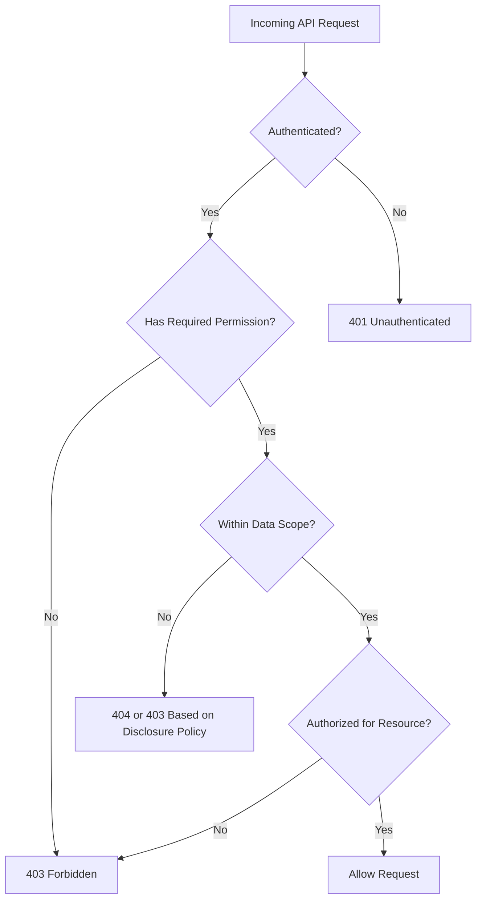
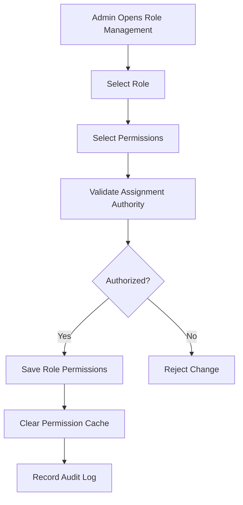

# AUTHORIZATION_MATRIX.md
## Enterprise System Starter Kit

**Document Type:** Security & Authorization Specification  
**Architecture:** Modular Monolith  
**Backend:** Laravel 13.x  
**Authorization:** Spatie Permission + Laravel Policies  
**Authentication:** Laravel Sanctum  
**Frontend:** React + TypeScript  
**Security Baseline:** OWASP ASVS Level 2  
**Status:** Draft – Foundation Specification

---

> **Base v1:** Cakupan implementasi awal dan bagian yang ditunda tercantum di `README.md`.

# 1. Introduction

## 1.1 Purpose

Dokumen ini mendefinisikan standar authorization dan access control untuk Enterprise System Starter Kit.

Authorization digunakan untuk memastikan bahwa setiap user hanya dapat mengakses fitur dan data sesuai dengan hak akses yang diberikan.

## 1.2 Objectives

1. Mendefinisikan role dan permission.
2. Menetapkan akses setiap role terhadap modul.
3. Mengatur akses berdasarkan departemen.
4. Mengatur akses terhadap data yang dimiliki user.
5. Menetapkan standar implementasi Laravel Policies.
6. Menetapkan standar permission untuk frontend.
7. Menghindari unauthorized access.
8. Menyediakan struktur yang reusable untuk modul bisnis baru.

## 1.3 Authorization Principles

| Principle | Description |
|---|---|
| Least Privilege | User hanya mendapatkan akses minimum yang diperlukan |
| Deny by Default | Akses ditolak jika tidak ada izin eksplisit |
| Separation of Duties | Fungsi kritis dapat dipisahkan antar-user |
| RBAC | Akses diberikan berdasarkan role |
| Resource-Level Access | Akses divalidasi terhadap data tertentu |
| Department Scope | Akses dibatasi berdasarkan departemen |
| Backend Enforcement | Semua otorisasi wajib diperiksa backend |
| Auditability | Perubahan hak akses harus tercatat |

---

# 2. Authorization Architecture

## 2.1 Authorization Layers

Sistem menggunakan empat lapisan authorization.

| Layer | Purpose | Implementation |
|---|---|---|
| Authentication | Memastikan identitas user | Laravel Sanctum |
| Role-Based Access | Menentukan hak akses berdasarkan role | Spatie Permission |
| Permission-Based Access | Menentukan akses fitur | Laravel Gate / Middleware |
| Resource-Level Access | Memeriksa akses terhadap data tertentu | Laravel Policies |

Department scope menjadi batas tambahan untuk membatasi data yang dapat diakses.

## 2.2 Authorization Flow



Setiap lapisan wajib diterapkan sesuai kebutuhan endpoint. Tidak semua endpoint membutuhkan pemeriksaan resource atau data scope, tetapi tidak boleh ada akses yang hanya mengandalkan frontend.

---

# 3. Default Role Definition

Role berikut menjadi baseline untuk aplikasi enterprise.

| Role | Description | Access Level |
|---|---|---|
| Super Admin | Administrator tertinggi aplikasi | System-wide |
| System Admin | Mengelola konfigurasi dan operasional sistem | System-wide, limited |
| Admin | Mengelola user dan departemen | Global |
| Manager | Monitoring dan approval | Assigned department |
| Supervisor | Monitoring operasional dan approval tertentu | Assigned department |
| Staff | Melaksanakan aktivitas operasional | Assigned resources |
| Viewer | Melihat data yang diizinkan | Read-only |

Role merupakan template awal. Setiap implementasi aplikasi dapat menambah, menghapus, atau menyesuaikan role berdasarkan struktur bisnis.

Base v1 melakukan seed untuk Super Admin, Admin, Staff, dan Viewer. Role lain ditambahkan sebagai data saat dibutuhkan.

Role berlaku global untuk seorang user dan Spatie teams tidak diaktifkan. Departemen membatasi data yang dapat diakses, bukan role yang dimiliki.

## 3.1 Role Responsibilities

### Super Admin

- Mengelola seluruh konfigurasi sistem.
- Mengelola seluruh departemen.
- Mengelola role dan permission.
- Mengelola seluruh user.
- Melihat audit log sistem.
- Mengelola integrasi.
- Mengakses monitoring administratif.

### System Admin

- Mengelola konfigurasi aplikasi.
- Mengelola operasional sistem.
- Mengelola user sesuai batas kewenangan.
- Mengakses monitoring dan audit tertentu.
- Tidak otomatis memiliki kewenangan menyetujui transaksi bisnis.

### Admin

- Mengelola user perusahaan.
- Mengelola departemen.
- Mengatur role dalam batas yang diizinkan.
- Melihat laporan perusahaan.
- Tidak dapat mengubah konfigurasi global.

### Manager

- Melihat data dalam scope kewenangannya.
- Melakukan approval jika ditugaskan.
- Melihat laporan departemennya.
- Memantau aktivitas operasional.

### Supervisor

- Mengelola aktivitas operasional yang menjadi tanggung jawabnya.
- Memantau staff.
- Melakukan approval tertentu jika memiliki permission.

### Staff

- Membuat transaksi.
- Mengubah transaksi miliknya sesuai status.
- Melihat data yang diizinkan.
- Mengirim transaksi untuk approval.

### Viewer

- Melihat data yang diizinkan.
- Tidak dapat membuat, mengubah, atau menghapus data.
- Tidak otomatis memiliki hak export atau download dokumen.

---

# 4. Permission Naming Convention

## 4.1 Standard Format

Format permission:

`{resource}.{action}`

Gunakan bentuk singular dan snake_case. Sub-resource ditulis sebagai segmen tambahan, misalnya `integration.logs.view`. Modul bisnis memakai nama modul sebagai resource, misalnya `procurement.view`.

Contoh:

```text
user.view
user.create
user.update
user.delete

department.view
department.create
department.update
department.delete

workflow.view
workflow.approve
workflow.reject

document.view
document.upload
document.download
document.delete
```

## 4.2 Supported Actions

| Action | Description |
|---|---|
| view | Melihat data |
| create | Membuat data |
| update | Mengubah data |
| delete | Menghapus atau menonaktifkan data |
| approve | Menyetujui transaksi |
| reject | Menolak transaksi |
| submit | Mengirim transaksi |
| cancel | Membatalkan transaksi |
| export | Export data |
| import | Import data |
| download | Download file |
| assign | Menetapkan user atau role |
| manage | Mengelola seluruh resource dalam scope |
| publish | Mempublikasikan konfigurasi |
| configure | Mengubah konfigurasi |

Permission `manage` harus digunakan secara hati-hati. Permission tersebut tidak boleh secara implisit melewati batas data scope atau resource-level authorization.

## 4.3 Permission Granularity

Hindari permission yang terlalu umum seperti:

```text
admin
manage_all
access_everything
```

Lebih baik:

```text
user.view
user.create
user.update

department.view
department.update

workflow.approve
workflow.reject
```

---

# 5. Permission Matrix

Keterangan:

- **A** = All access dalam scope yang ditentukan.
- **C** = Create.
- **R** = Read / View.
- **U** = Update.
- **D** = Delete / Deactivate.
- **P** = Approve / Reject.
- **S** = Submit.
- **X** = Cancel.
- **E** = Export.
- **-** = No access.

## 5.1 User Management

| Permission | Super Admin | System Admin | Admin | Manager | Supervisor | Staff | Viewer |
|---|---|---|---|---|---|---|---|
| user.view | A | A | R | R | R | R | R |
| user.create | A | A | C | - | - | - | - |
| user.update | A | A | U | - | - | - | - |
| user.delete | A | A | D | - | - | - | - |
| user.assign_role | A | A | C/U | - | - | - | - |
| user.export | A | A | E | - | - | - | - |

## 5.2 Department Management

| Permission | Super Admin | System Admin | Admin | Manager | Supervisor | Staff | Viewer |
|---|---|---|---|---|---|---|---|
| department.view | A | R | R | R | R | R | R |
| department.create | A | - | C | - | - | - | - |
| department.update | A | - | U | - | - | - | - |
| department.delete | A | - | D | - | - | - | - |

## 5.3 Authorization Management

| Permission | Super Admin | System Admin | Admin | Manager | Supervisor | Staff | Viewer |
|---|---|---|---|---|---|---|---|
| role.view | A | R | R | - | - | - | - |
| role.create | A | - | - | - | - | - | - |
| role.update | A | - | - | - | - | - | - |
| role.delete | A | - | - | - | - | - | - |
| permission.view | A | R | R | - | - | - | - |
| permission.assign | A | - | - | - | - | - | - |

Catatan: Admin hanya boleh menetapkan role yang telah diizinkan oleh administrator sistem. Mereka tidak boleh memberikan privilege di luar batas kewenangannya.

## 5.4 Workflow & Approval

| Permission | Super Admin | System Admin | Admin | Manager | Supervisor | Staff | Viewer |
|---|---|---|---|---|---|---|---|
| workflow.view | A | R | R | R | R | R | R |
| workflow.create | A | - | - | - | - | - | - |
| workflow.update | A | - | - | - | - | - | - |
| workflow.publish | A | - | - | - | - | - | - |
| workflow.submit | A | - | - | - | - | S | - |
| workflow.approve | A* | - | - | P* | P* | - | - |
| workflow.reject | A* | - | - | P* | P* | - | - |
| workflow.delegate | A* | - | - | P* | P* | - | - |
| workflow.request_revision | A* | - | - | P* | P* | - | - |
| workflow.cancel | A | - | - | - | - | X* | - |
| workflow.export | A | E | E | E | - | - | - |

`*` Approval tetap memerlukan validasi assignment, workflow state, separation of duties, dan data scope. Super Admin tidak boleh otomatis menyetujui transaksi hanya karena memiliki akses administratif.

`X*` Requester hanya dapat membatalkan instance miliknya selama belum ada task `approved` atau `rejected` pada pengajuan berjalan. Pengajuan ulang setelah revisi memakai `workflow.submit` dan hanya dapat dilakukan oleh requester.

## 5.5 Document Management

| Permission | Super Admin | System Admin | Admin | Manager | Supervisor | Staff | Viewer |
|---|---|---|---|---|---|---|---|
| document.view | A | R | R | R | R | R | R |
| document.upload | A | - | C | C | C | C | - |
| document.update | A | - | U | U* | U* | U* | - |
| document.download | A | R | R | R | R | R | - |
| document.delete | A | - | D* | - | - | - | - |
| document.export | A | - | E | E | - | - | - |

`*` Hak update dan delete dibatasi oleh ownership, status dokumen, dan kebijakan departemen.

## 5.6 Master Data

| Permission | Super Admin | System Admin | Admin | Manager | Supervisor | Staff | Viewer |
|---|---|---|---|---|---|---|---|
| master_data.view | A | R | R | R | R | R | R |
| master_data.create | A | C | C* | - | - | - | - |
| master_data.update | A | U | U* | - | - | - | - |
| master_data.delete | A | D | D* | - | - | - | - |
| master_data.import | A | C | C* | - | - | - | - |
| master_data.export | A | E | E* | E | - | - | - |

`*` Hanya master data milik departemen user jika master tersebut memang bersifat spesifik departemen.

## 5.7 Reporting

| Permission | Super Admin | System Admin | Admin | Manager | Supervisor | Staff | Viewer |
|---|---|---|---|---|---|---|---|
| report.view | A | R | R | R | R | R* | R |
| report.export | A | E | E | E | E* | - | - |
| dashboard.view | A | R | R | R | R | R* | R |
| report.configure | A | - | - | - | - | - | - |

`*` Data yang tampil tetap dibatasi sesuai kebutuhan tugas dan data scope user.

## 5.8 Integration Management

| Permission | Super Admin | System Admin | Admin | Manager | Supervisor | Staff | Viewer |
|---|---|---|---|---|---|---|---|
| integration.view | A | R | - | - | - | - | - |
| integration.create | A | C | - | - | - | - | - |
| integration.update | A | U | - | - | - | - | - |
| integration.delete | A | D | - | - | - | - | - |
| integration.execute | A | C | - | - | - | - | - |
| integration.logs.view | A | R | - | - | - | - | - |

## 5.9 System Configuration

| Permission | Super Admin | System Admin | Admin | Manager | Supervisor | Staff | Viewer |
|---|---|---|---|---|---|---|---|
| system_config.view | A | R | R* | - | - | - | - |
| system_config.update | A | U | U* | - | - | - | - |
| system_config.manage | A | - | - | - | - | - | - |
| system_config.feature_flags | A | U | - | - | - | - | - |

`*` Admin hanya dapat mengakses konfigurasi yang secara eksplisit diizinkan untuk Admin.

## 5.10 Audit Log

| Permission | Super Admin | System Admin | Admin | Manager | Supervisor | Staff | Viewer |
|---|---|---|---|---|---|---|---|
| audit.view | A | R | R* | - | - | - | - |
| audit.export | A | E | E* | - | - | - | - |
| audit.manage_retention | A | - | - | - | - | - | - |

Audit log harus bersifat read-only bagi pengguna operasional.

---

# 6. Data Access Scope

Permission menentukan fitur yang boleh digunakan. Data Access Scope menentukan data mana yang boleh diakses.

## 6.1 Scope Types

| Scope | Description |
|---|---|
| Global | Seluruh data sistem |
| Department | Data departemen tertentu |
| Own | Data milik user sendiri |
| Assigned | Data yang ditugaskan kepada user |
| Explicit Resource | Resource tertentu yang diberikan aksesnya |

## 6.2 Default Role Scope

| Role | Default Scope |
|---|---|
| Super Admin | Global |
| System Admin | Global untuk fungsi administratif yang diizinkan |
| Admin | Global |
| Manager | Department |
| Supervisor | Department / Assigned |
| Staff | Own / Assigned |
| Viewer | Explicitly granted scope |

Scope di atas merupakan default. Hak akses aktual ditentukan oleh permission, departemen, assignment, dan resource policy.

## 6.3 Scope Evaluation

Contoh:

User memiliki permission:

```text
procurement.view
```

Tetapi user hanya terdaftar pada:

```text
Department: Purchasing
```

Maka user hanya dapat melihat data procurement yang berada dalam scope tersebut.

## 6.4 Department Scope Rules

1. Sistem melayani satu perusahaan per instalasi.
2. User memiliki maksimal satu departemen.
3. Data bisnis menyimpan `department_id` jika perlu dibatasi per departemen.
4. Department scope harus diterapkan pada query backend.
5. Departemen user diambil dari data user, bukan dari request.

## 6.5 Resource-Level Rules

Contoh transaksi procurement:

| Condition | Access |
|---|---|
| User adalah requester | Own transaction |
| User ditugaskan sebagai approver | Assigned transaction |
| User adalah Admin | Seluruh transaksi perusahaan |
| User adalah Manager | Data sesuai department policy |
| User adalah Viewer | Read-only data sesuai scope |

---

# 7. Separation of Duties (SoD)

Separation of Duties digunakan untuk mencegah satu user menguasai seluruh proses transaksi yang kritis.

## 7.1 Recommended Rules

| Process | Restriction |
|---|---|
| Create User | Tidak otomatis dapat memberikan Super Admin |
| Assign Role | Tidak boleh memberikan role di atas kewenangannya |
| Create Transaction | Tidak otomatis dapat menyetujui transaksi sendiri |
| Submit Transaction | Tidak otomatis dapat melakukan approval |
| Approve Transaction | Harus sesuai assignment |
| Publish Workflow | Tidak boleh dilakukan user tanpa privilege |
| Manage Integration | Credential hanya dapat diakses oleh role khusus |

## 7.2 Four-Eyes Principle

Untuk transaksi tertentu, sistem dapat menerapkan:

```text
Requester != Approver
```

Contoh:

```text
User A creates Purchase Request.
User A submits Purchase Request.
User B reviews the request.
User C approves the request.
```

Penerapan dapat dikonfigurasi berdasarkan risiko dan nilai transaksi.

## 7.3 Approval Constraints

Approval wajib memeriksa:

- User terautentikasi.
- User memiliki permission approval.
- User merupakan approver yang ditugaskan.
- Workflow masih dalam status yang dapat diproses.
- User tidak melanggar aturan self-approval.
- User memiliki akses ke departemen transaksi.
- Task belum diselesaikan oleh proses lain.

---

# 8. Laravel Authorization Implementation

## 8.1 Package

Gunakan:

- Laravel Sanctum.
- Spatie Laravel Permission.
- Laravel Policies.
- Laravel Gates.

## 8.2 Middleware

Contoh:

```php
Route::middleware([
    'auth:sanctum',
    'permission:user.view',
])->get('/users', [UserController::class, 'index']);
```

Untuk beberapa permission:

```php
Route::middleware([
    'auth:sanctum',
    'permission:dashboard.view|report.view',
])->get(
    '/dashboard/activities',
    [DashboardController::class, 'activities']
);
```

Pastikan format middleware sesuai versi Spatie Permission yang digunakan. Seluruh permission memakai guard `web`. Untuk request dengan personal access token, abilities token tetap harus diperiksa (lihat `API_SPECIFICATION.md` bagian 7.1).

## 8.3 Laravel Policy

Contoh UserPolicy:

```php
class UserPolicy
{
    public function viewAny(User $user): bool
    {
        return $user->can('user.view');
    }

    public function view(User $user, User $target): bool
    {
        if (!$user->can('user.view')) {
            return false;
        }

        return app(DepartmentAccessService::class)
            ->canAccessUser($user, $target);
    }

    public function update(User $user, User $target): bool
    {
        if (!$user->can('user.update')) {
            return false;
        }

        return app(DepartmentAccessService::class)
            ->canManageUser($user, $target);
    }

    public function delete(User $user, User $target): bool
    {
        return $user->can('user.delete')
            && app(DepartmentAccessService::class)
                ->canManageUser($user, $target);
    }
}
```

## 8.4 Workflow Policy

```php
class WorkflowTaskPolicy
{
    public function approve(User $user, WorkflowTask $task): bool
    {
        if (!$user->can('workflow.approve')) {
            return false;
        }

        if ($task->status !== 'pending') {
            return false;
        }

        if ($task->assigned_to !== $user->id) {
            return false;
        }

        if ($task->workflowInstance->initiated_by === $user->id) {
            return false;
        }

        return app(DepartmentAccessService::class)
            ->canAccessWorkflow($user, $task->workflowInstance);
    }
}
```

Catatan: Aturan self-approval pada contoh ini merupakan default ilustratif. Implementasi sebenarnya harus membaca kebijakan SoD yang berlaku pada workflow atau jenis transaksi tersebut.

Contoh pembatalan:

```php
class WorkflowInstancePolicy
{
    public function cancel(User $user, WorkflowInstance $instance): bool
    {
        if (!$user->can('workflow.cancel') || !$instance->isActive()) {
            return false;
        }

        if ($user->hasRole('Super Admin')) {
            return true;
        }

        return $instance->initiated_by === $user->id
            && !$instance->hasDecisionInCurrentSubmission();
    }
}
```

## 8.5 Department Access Service

```php
class DepartmentAccessService
{
    public function canAccessDepartment(
        User $user,
        Department $department
    ): bool {
        if ($user->hasAnyRole(['Super Admin', 'System Admin', 'Admin'])) {
            return true;
        }

        return $user->department_id === $department->id;
    }
}
```

Jangan menganggap pemeriksaan departemen saja cukup untuk seluruh kebutuhan authorization. Permission, status resource, dan resource ownership tetap perlu diperiksa.

---

# 9. Query-Level Data Authorization

Authorization harus diterapkan sebelum data dikirim ke frontend.

Contoh query:

```php
$query = PurchaseRequest::query()
    ->where('department_id', auth()->user()->department_id);
```

Untuk data milik user:

```php
$query->where('created_by', auth()->id());
```

Untuk approval task:

```php
$query = WorkflowTask::query()
    ->where('assigned_to', auth()->id())
    ->where('status', 'pending');
```

Gunakan query scope atau service yang konsisten agar developer tidak lupa menerapkan pembatasan data.

Contoh:

```php
PurchaseRequest::query()
    ->visibleTo(auth()->user())
    ->paginate();
```

Scope harus memiliki pengujian khusus untuk memastikan tidak terjadi kebocoran data lintas departemen.

---

# 10. Frontend Authorization

Frontend menggunakan permission dari backend untuk mengatur tampilan dan navigasi.

Frontend tidak menjadi sumber kebenaran authorization.

## 10.1 Permission Response

Contoh response:

```json
{
  "success": true,
  "message": "Authenticated user",
  "data": {
    "id": "01932f5e-1234-7000-8000-123456789abc",
    "name": "Example User",
    "email": "user@example.com",
    "roles": [
      "Admin"
    ],
    "permissions": [
      "user.view",
      "user.create",
      "user.update",
      "department.view",
      "document.view"
    ],
    "department": {
      "id": "01932f5e-1234-7000-8000-123456789def",
      "name": "Information Technology"
    }
  },
  "meta": null
}
```

Response tidak boleh berisi secret, credential, atau informasi internal yang tidak dibutuhkan frontend.

## 10.2 React Permission Hook

```tsx
import { useAuthStore } from "@/stores/auth-store";

export function usePermission() {
  const permissions = useAuthStore(
    (state) => state.permissions
  );

  const can = (permission: string) => {
    return permissions.includes(permission);
  };

  const canAny = (items: string[]) => {
    return items.some((item) => can(item));
  };

  const canAll = (items: string[]) => {
    return items.every((item) => can(item));
  };

  return {
    can,
    canAny,
    canAll,
  };
}
```

## 10.3 Component Authorization

```tsx
function UserActions() {
  const { can } = usePermission();

  return (
    <div>
      {can("user.create") && (
        <button>Create User</button>
      )}

      {can("user.update") && (
        <button>Edit User</button>
      )}
    </div>
  );
}
```

## 10.4 Route Authorization

```tsx
<ProtectedRoute
  requiredPermission="user.view"
>
  <UserListPage />
</ProtectedRoute>
```

Jika permission tidak tersedia, frontend menampilkan halaman 403 atau mengarahkan user ke halaman yang sesuai.

Semua endpoint tetap harus memeriksa authorization secara independen.

---

# 11. Role Assignment & Permission Management

## 11.1 Role Assignment Rules

1. Role hanya dapat diberikan oleh user yang memiliki permission.
2. User tidak boleh memberikan role yang tidak boleh dikelolanya.
3. Admin hanya dapat mengelola role yang diizinkan untuknya.
4. Perubahan role harus dicatat dalam audit log.
5. Penghapusan role harus mempertimbangkan user yang masih menggunakannya.

## 11.2 Privilege Escalation Prevention

Contoh:

```text
Super Admin
    |
    +-- Can assign: Super Admin
    +-- Can assign: System Admin
    +-- Can assign: Admin
    +-- Can assign: Manager
    +-- Can assign: Supervisor
    +-- Can assign: Staff
    +-- Can assign: Viewer

Admin
    |
    +-- Can assign: Manager
    +-- Can assign: Supervisor
    +-- Can assign: Staff
    +-- Can assign: Viewer
```

Matriks di atas merupakan contoh kebijakan assignment. Role yang boleh diberikan harus disimpan atau dikonfigurasi secara eksplisit, bukan hanya mengandalkan nama role. Konfigurasinya berada di `backend/config/authorization.php`. Super Admin dapat memberikan semua role, termasuk role custom dan Super Admin. Role tanpa entri tidak dapat memberikan role apa pun.

## 11.3 Permission Change Flow



Setelah permission berubah, cache permission harus diinvalidasi sesuai mekanisme package dan aplikasi.

---

# 12. API Authorization Standards

Setiap endpoint harus memiliki definisi authorization.

Contoh:

| Endpoint | Authentication | Permission | Scope |
|---|---|---|---|
| GET /users | Required | user.view | Global untuk Super Admin, System Admin, dan Admin; Department untuk role lain |
| POST /users | Required | user.create | Global |
| PATCH /users/{id} | Required | user.update | Resource |
| DELETE /users/{id} | Required | user.delete | Resource |
| POST /workflow-instances | Required | workflow.submit | Business scope |
| POST /workflow-tasks/{id}/approve | Required | workflow.approve | Assigned |
| POST /workflow-tasks/{id}/request-revision | Required | workflow.request_revision | Assigned |
| POST /workflow-instances/{id}/resubmit | Required | workflow.submit | Own |
| POST /workflow-instances/{id}/cancel | Required | workflow.cancel | Own |
| POST /documents | Required | document.upload | Department |
| GET /documents/{id}/download | Required | document.download | Resource |

Endpoint yang sensitif harus memiliki authorization test.

---

# 13. Audit & Security Monitoring

Aktivitas authorization yang wajib dicatat:

```text
role.created
role.updated
role.deleted

permission.assigned
permission.revoked

user.role_assigned
user.role_removed

user.department_changed

authorization.denied
authorization.privilege_changed
```

Audit log minimal mencatat:

- Actor.
- Action.
- Target resource.
- Timestamp.
- Department context jika relevan.
- IP address jika sesuai kebijakan privasi.
- Metadata perubahan yang aman.

Jangan mencatat password, session token, API secret, atau credential.

---

# 14. Authorization Testing Strategy

## 14.1 Test Categories

| Test | Purpose |
|---|---|
| Authentication Test | User tanpa autentikasi ditolak |
| Permission Test | User tanpa permission ditolak |
| Role Test | Role mendapatkan permission yang tepat |
| Department Scope Test | Data departemen lain tidak dapat diakses tanpa hak |
| Resource Ownership Test | User tidak dapat mengakses resource milik pihak lain |
| Approval Test | Hanya approver yang ditugaskan dapat menyetujui |
| SoD Test | Self-approval diblokir jika kebijakan melarang |
| Privilege Escalation Test | User tidak dapat memberikan privilege lebih tinggi |
| Frontend Guard Test | Menu dan route mengikuti permission |
| API Security Test | Endpoint tidak bergantung pada frontend |

## 14.2 Mandatory Test Scenarios

- [ ] Unauthenticated user tidak dapat mengakses protected endpoint.
- [ ] User tanpa permission menerima 403.
- [ ] User tidak dapat melihat transaksi departemen lain tanpa hak.
- [ ] Manager tidak dapat mengelola data di luar departemennya.
- [ ] Staff tidak dapat mengubah transaksi user lain tanpa izin.
- [ ] Viewer tidak dapat membuat transaksi.
- [ ] User yang bukan approver tidak dapat melakukan approval.
- [ ] Requester tidak dapat melakukan self-approval jika dilarang.
- [ ] Requester tidak dapat membatalkan pengajuan yang sudah memiliki keputusan approve atau reject.
- [ ] User selain requester tidak dapat mengajukan ulang pengajuan.
- [ ] User tidak dapat menetapkan Super Admin jika tidak memiliki kewenangan.
- [ ] Permission change menginvalidasi cache.
- [ ] Direct API request tetap ditolak walaupun frontend dimanipulasi.

## 14.3 Definition of Done

Authorization dianggap selesai apabila:

1. Semua role telah didefinisikan.
2. Semua permission telah didaftarkan.
3. Permission matrix telah disetujui.
4. Department scope sudah diterapkan.
5. Laravel Policies tersedia untuk resource penting.
6. Semua endpoint terlindungi.
7. Frontend permission guard tersedia.
8. Audit perubahan permission tersedia.
9. Pengujian privilege escalation lulus.
10. Pengujian akses lintas departemen lulus.

---

# 15. Implementation Checklist

## Foundation

- [ ] Install Laravel Sanctum.
- [ ] Install Spatie Permission.
- [ ] Publish package migrations.
- [ ] Configure permission guard.
- [ ] Configure permission cache.
- [ ] Register Laravel Policies.

## Role & Permission

- [ ] Create default roles.
- [ ] Create permission registry.
- [ ] Assign permissions to roles.
- [ ] Implement role assignment policy.
- [ ] Implement permission management.
- [ ] Implement privilege escalation prevention.

## Department Scope

- [ ] Implement user department validation.
- [ ] Implement department scope.
- [ ] Implement resource-level authorization.
- [ ] Implement query scope.
- [ ] Test cross-department access.

## Frontend

- [ ] Create permission store.
- [ ] Create usePermission hook.
- [ ] Create ProtectedRoute.
- [ ] Implement menu filtering.
- [ ] Implement component-level authorization.
- [ ] Handle 401 and 403 responses.

## Security & Audit

- [ ] Implement authorization audit log.
- [ ] Implement role change audit.
- [ ] Implement permission change audit.
- [ ] Implement approval SoD.
- [ ] Test privilege escalation.
- [ ] Test unauthorized API access.

---

# 16. Future Extensions

Authorization foundation dapat dikembangkan untuk mendukung:

- Attribute-Based Access Control (ABAC).
- Policy-based data access.
- Multi-tenant isolation.
- Single Sign-On (SSO).
- LDAP / Active Directory.
- Temporary role assignment.
- Delegated administration.
- Dynamic permission policies.
- Field-level access control.
- Data classification.
- Approval-based privilege changes.

Implementasikan hanya jika kebutuhan bisnis dan tingkat risiko memang memerlukannya.

---

# 17. Conclusion

Authorization merupakan komponen keamanan fundamental dalam Enterprise System Starter Kit.

Kombinasi RBAC, Laravel Policies, Department Scope, dan Resource-Level Authorization memberikan kontrol yang lebih baik dibandingkan sistem yang hanya menggunakan role untuk mengatur akses menu.

Setiap modul baru wajib mendefinisikan permission, scope, resource policy, dan test authorization sebelum dinyatakan siap digunakan.

**Prinsip utama: Permission menentukan apa yang boleh dilakukan, sedangkan data scope menentukan data mana yang boleh diakses.**