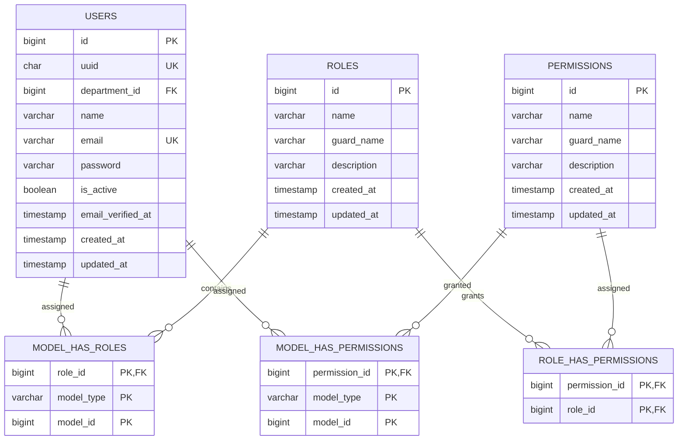
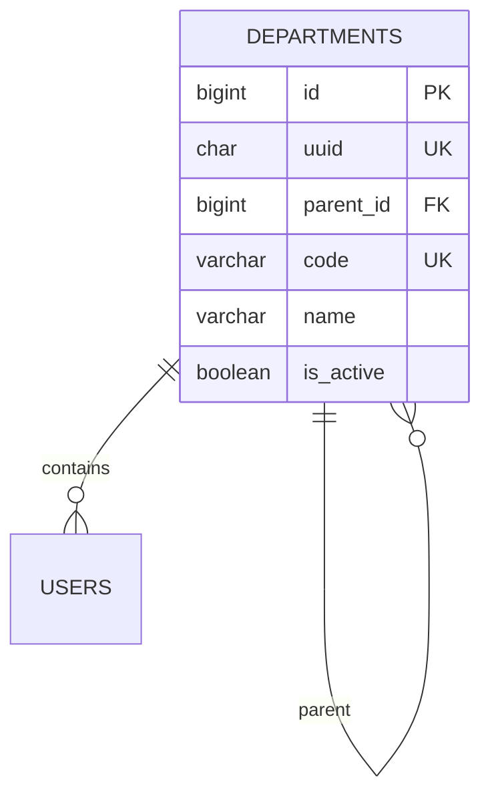
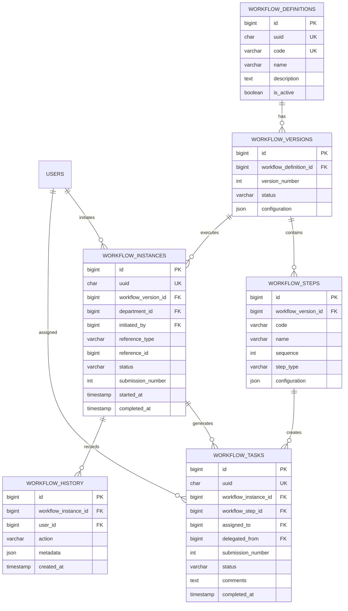
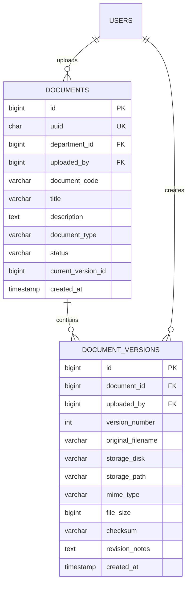
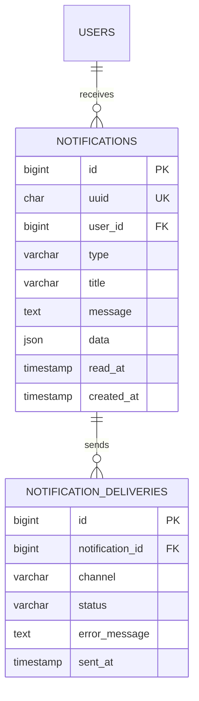
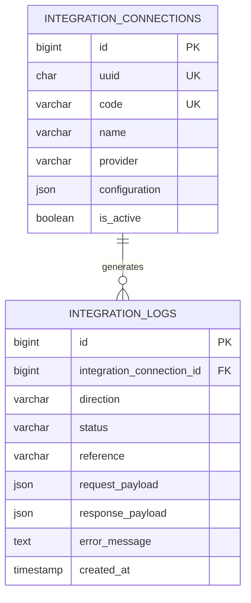

# DATABASE DESIGN
## Enterprise System Starter Kit

**Document Type:** Technical Design Document  
**Architecture:** Modular Monolith  
**Backend:** Laravel 13.x  
**Database:** MySQL 8.x  
**Storage Engine:** InnoDB  
**Character Set:** utf8mb4  
**API Architecture:** REST API  
**Status:** Draft – Foundation Design

---

> **Base v1:** Cakupan implementasi awal dan tabel yang ditunda tercantum di `README.md`.

# 1. Introduction

## 1.1 Purpose

Dokumen ini menjelaskan rancangan database sebagai fondasi untuk pengembangan berbagai sistem enterprise.

Database dirancang agar dapat digunakan kembali untuk berbagai kebutuhan aplikasi, seperti:

- ERP System
- Procurement System
- Inventory Management
- Human Resource Management
- Quality Management System
- Document Management System
- Workflow & Approval System
- Finance & Accounting System

## 1.2 Design Objectives

1. Modular dan mudah dikembangkan.
2. Konsisten dalam penamaan tabel dan kolom.
3. Mendukung role-based access control.
4. Mendukung struktur departemen perusahaan.
5. Mendukung workflow dan approval.
6. Memiliki audit trail untuk aktivitas penting.
7. Mendukung versioning dokumen.
8. Memiliki integritas referensial menggunakan foreign key.
9. Mendukung performa melalui indexing yang tepat.
10. Memudahkan implementasi Laravel Migration.

## 1.3 Database Design Principles

| Principle | Description |
|---|---|
| Modular Design | Tabel dikelompokkan berdasarkan domain |
| Referential Integrity | Relasi dijaga menggunakan foreign key |
| Normalization | Menghindari redundansi data yang tidak diperlukan |
| Auditability | Aktivitas penting dapat ditelusuri |
| Scalability | Struktur dapat dikembangkan untuk modul baru |
| Security | Data sensitif dan akses pengguna dikontrol |
| Consistency | Standar penamaan dan tipe data konsisten |

---

# 2. Database Naming Convention

## 2.1 Table Naming

Menggunakan format `snake_case`, plural, dan lowercase.

Contoh:

- users
- roles
- permissions
- departments
- workflow_instances
- document_versions
- activity_log

Pengecualian bentuk plural: `activity_log` (nama bawaan Spatie Activitylog) dan `workflow_history`.

## 2.2 Column Naming

| Column | Convention |
|---|---|
| Primary Key | id |
| Foreign Key | user_id, department_id |
| UUID | uuid |
| Created At | created_at |
| Updated At | updated_at |
| Deleted At | deleted_at |
| Status | status |
| Boolean | is_active, is_default |
| Date | effective_date |
| Timestamp | approved_at |

## 2.3 Primary Key Strategy

Menggunakan kombinasi:

- `id`: BIGINT UNSIGNED sebagai primary key internal.
- `uuid`: UUID sebagai identifier eksternal yang tidak mengekspos urutan ID internal.

Contoh:

```text
users
- id: 1
- uuid: 019...
- name: Ahmad
```

UUID digunakan untuk kebutuhan API, integrasi eksternal, dan referensi yang tidak perlu memperlihatkan ID internal. Field `id` pada API selalu berisi nilai kolom `uuid`, kecuali `roles` dan `permissions` yang memakai ID bawaan Spatie.

## 2.4 Standard Data Types

| Data | MySQL Type |
|---|---|
| Internal ID | BIGINT UNSIGNED |
| UUID | CHAR(36) |
| Name | VARCHAR(150) |
| Email | VARCHAR(255) |
| Description | TEXT |
| Status | VARCHAR(30) |
| Boolean | BOOLEAN |
| Date | DATE |
| Datetime | DATETIME |
| Amount | DECIMAL(18,2) |
| Percentage | DECIMAL(8,4) |
| JSON | JSON |

**Catatan:** Untuk UUID, gunakan format UUID yang konsisten. Jika menggunakan UUID binary untuk efisiensi storage, implementasikan konversi secara konsisten di seluruh aplikasi. Desain awal ini menggunakan CHAR(36) agar lebih mudah dibaca dan diintegrasikan.

---

# 3. Database Domain Structure

Database dibagi menjadi beberapa domain utama.

| Domain | Prefix / Group | Description |
|---|---|---|
| Authentication | auth | User authentication |
| Authorization | auth | Roles and permissions |
| Department | department | Company department structure |
| Workflow | workflow | Approval and business process |
| Audit | audit | Activity and audit trail |
| Document | document | Document storage and versioning |
| Notification | notification | Notification management |
| Master Data | master | Shared reference data |
| Integration | integration | External system integration |
| System | system | Application configuration |

Semua tabel menggunakan satu database MySQL, tetapi kepemilikan tabel dan business logic dipisahkan berdasarkan modul Laravel.

---

# 4. Entity Relationship Diagram (ERD)

## 4.1 Authentication & Authorization ERD



**Catatan:** Tabel authorization mengikuti struktur Spatie Laravel Permission. Kolom dan relasi perlu disesuaikan dengan konfigurasi package yang digunakan.

## 4.2 Department ERD



## 4.3 Workflow & Approval ERD



## 4.4 Document Management ERD



## 4.5 Notification ERD



## 4.6 Integration ERD



---

# 5. Table Specification

## 5.1 Authentication Module

### users

| Column | Type | Constraint | Description |
|---|---|---|---|
| id | BIGINT UNSIGNED | PK | Internal identifier |
| uuid | CHAR(36) | UNIQUE | External identifier |
| department_id | BIGINT UNSIGNED | FK, NULL | Departemen user |
| name | VARCHAR(150) | NOT NULL | User name |
| email | VARCHAR(255) | UNIQUE | Login email |
| password | VARCHAR(255) | NOT NULL | Hashed password |
| email_verified_at | TIMESTAMP | NULL | Verification timestamp |
| is_active | BOOLEAN | DEFAULT TRUE | Account status |
| last_login_at | TIMESTAMP | NULL | Last login |
| created_at | TIMESTAMP | | Creation time |
| updated_at | TIMESTAMP | | Update time |
| deleted_at | TIMESTAMP | NULL | Soft delete |

Migration `users` bawaan Laravel harus ditambah kolom `uuid`, `is_active`, `last_login_at`, dan `deleted_at`.

Unique `email` juga berlaku untuk user yang di-soft delete. Mengaktifkan kembali akun dilakukan dengan restore, bukan membuat user baru dengan email yang sama.

### personal_access_tokens

Digunakan oleh Laravel Sanctum untuk personal access token.

Struktur mengikuti migration resmi Laravel Sanctum, termasuk `tokenable_type`, `tokenable_id`, `name`, `token`, `abilities`, `last_used_at`, `expires_at`, dan timestamps.

### password_reset_tokens

Digunakan untuk kebutuhan reset password.

Struktur mengikuti migration bawaan Laravel.

### sessions

Digunakan oleh `SESSION_DRIVER=database` dan menjadi sumber data untuk daftar serta pencabutan sesi aktif.

Struktur mengikuti migration bawaan Laravel.

### roles, permissions, role_has_permissions, model_has_roles, model_has_permissions

Mengikuti migration resmi Spatie Laravel Permission.

Gunakan satu `guard_name`, yaitu `web`, termasuk untuk request yang memakai Sanctum token.

Tabel `roles` ditambah kolom `version` (INT UNSIGNED, default 1) untuk optimistic locking.

## 5.2 Department Module

Sistem melayani satu perusahaan per instalasi. Tidak ada tabel company, branch, atau organisasi; profil perusahaan disimpan di `system_configurations`.

### departments

| Column | Type | Constraint |
|---|---|---|
| id | BIGINT UNSIGNED | PK |
| uuid | CHAR(36) | UNIQUE |
| parent_id | BIGINT UNSIGNED | FK, NULL |
| code | VARCHAR(50) | UNIQUE |
| name | VARCHAR(150) | NOT NULL |
| description | TEXT | NULL |
| is_active | BOOLEAN | DEFAULT TRUE |
| created_at | TIMESTAMP | |
| updated_at | TIMESTAMP | |
| deleted_at | TIMESTAMP | NULL |

Data yang perlu dibatasi per departemen menyimpan `department_id`. Nilai NULL berarti data berlaku untuk seluruh perusahaan.

## 5.3 Workflow Module

### workflow_definitions

| Column | Type | Constraint |
|---|---|---|
| id | BIGINT UNSIGNED | PK |
| uuid | CHAR(36) | UNIQUE |
| code | VARCHAR(50) | UNIQUE |
| name | VARCHAR(150) | NOT NULL |
| description | TEXT | NULL |
| is_active | BOOLEAN | DEFAULT TRUE |
| version | INT UNSIGNED | DEFAULT 1 |
| created_at | TIMESTAMP | |
| updated_at | TIMESTAMP | |

### workflow_versions

| Column | Type | Constraint |
|---|---|---|
| id | BIGINT UNSIGNED | PK |
| workflow_definition_id | BIGINT UNSIGNED | FK |
| version_number | INT UNSIGNED | NOT NULL |
| status | VARCHAR(30) | NOT NULL |
| configuration | JSON | NULL |
| published_at | TIMESTAMP | NULL |
| created_at | TIMESTAMP | |
| updated_at | TIMESTAMP | |

Unique: `(workflow_definition_id, version_number)`.

Workflow yang sudah dipublikasikan sebaiknya immutable. Perubahan konfigurasi dibuat sebagai versi baru agar workflow yang sedang berjalan tetap konsisten.

### workflow_steps

| Column | Type | Constraint |
|---|---|---|
| id | BIGINT UNSIGNED | PK |
| workflow_version_id | BIGINT UNSIGNED | FK |
| code | VARCHAR(50) | NOT NULL |
| name | VARCHAR(150) | NOT NULL |
| sequence | INT UNSIGNED | NOT NULL |
| step_type | VARCHAR(30) | NOT NULL |
| configuration | JSON | NULL |
| created_at | TIMESTAMP | |
| updated_at | TIMESTAMP | |

Unique: `(workflow_version_id, code)` dan `(workflow_version_id, sequence)`.

### workflow_instances

| Column | Type | Constraint |
|---|---|---|
| id | BIGINT UNSIGNED | PK |
| uuid | CHAR(36) | UNIQUE |
| workflow_version_id | BIGINT UNSIGNED | FK |
| department_id | BIGINT UNSIGNED | FK, NULL |
| initiated_by | BIGINT UNSIGNED | FK |
| reference_type | VARCHAR(100) | NOT NULL |
| reference_id | BIGINT UNSIGNED | NOT NULL |
| status | VARCHAR(30) | NOT NULL |
| submission_number | INT UNSIGNED | DEFAULT 1 |
| started_at | TIMESTAMP | NULL |
| completed_at | TIMESTAMP | NULL |
| created_at | TIMESTAMP | |
| updated_at | TIMESTAMP | |

`reference_type` dan `reference_id` merupakan polymorphic business reference. Relasi ke dokumen bisnis tidak dapat dijaga dengan foreign key biasa. Validasi dilakukan di application layer.

API menerima `subject_type` dan `subject_id` (UUID). Backend memvalidasi `subject_type` terhadap allowlist, lalu menyimpan ID internal subject ke `reference_id`.

### workflow_tasks

| Column | Type | Constraint |
|---|---|---|
| id | BIGINT UNSIGNED | PK |
| uuid | CHAR(36) | UNIQUE |
| workflow_instance_id | BIGINT UNSIGNED | FK |
| workflow_step_id | BIGINT UNSIGNED | FK |
| assigned_to | BIGINT UNSIGNED | FK, NULL |
| delegated_from | BIGINT UNSIGNED | FK, NULL |
| submission_number | INT UNSIGNED | DEFAULT 1 |
| status | VARCHAR(30) | NOT NULL |
| comments | TEXT | NULL |
| assigned_at | TIMESTAMP | NULL |
| completed_at | TIMESTAMP | NULL |
| created_at | TIMESTAMP | |
| updated_at | TIMESTAMP | |

### workflow_history

| Column | Type | Constraint |
|---|---|---|
| id | BIGINT UNSIGNED | PK |
| workflow_instance_id | BIGINT UNSIGNED | FK |
| user_id | BIGINT UNSIGNED | FK, NULL |
| action | VARCHAR(50) | NOT NULL |
| metadata | JSON | NULL |
| created_at | TIMESTAMP | |

History bersifat append-only melalui kebijakan aplikasi.

## 5.4 Document Module

### documents

| Column | Type | Constraint |
|---|---|---|
| id | BIGINT UNSIGNED | PK |
| uuid | CHAR(36) | UNIQUE |
| department_id | BIGINT UNSIGNED | FK, NULL |
| uploaded_by | BIGINT UNSIGNED | FK |
| document_code | VARCHAR(100) | NULL |
| title | VARCHAR(255) | NOT NULL |
| description | TEXT | NULL |
| document_type | VARCHAR(100) | NULL |
| status | VARCHAR(30) | NOT NULL |
| current_version_id | BIGINT UNSIGNED | NULL |
| version | INT UNSIGNED | DEFAULT 1 |
| created_at | TIMESTAMP | |
| updated_at | TIMESTAMP | |
| deleted_at | TIMESTAMP | NULL |

### document_versions

| Column | Type | Constraint |
|---|---|---|
| id | BIGINT UNSIGNED | PK |
| document_id | BIGINT UNSIGNED | FK |
| uploaded_by | BIGINT UNSIGNED | FK |
| version_number | INT UNSIGNED | NOT NULL |
| original_filename | VARCHAR(255) | NOT NULL |
| storage_disk | VARCHAR(50) | NOT NULL |
| storage_path | VARCHAR(500) | NOT NULL |
| mime_type | VARCHAR(150) | NOT NULL |
| file_size | BIGINT UNSIGNED | NOT NULL |
| checksum | VARCHAR(128) | NULL |
| revision_notes | TEXT | NULL |
| created_at | TIMESTAMP | |

Unique: `(document_id, version_number)`.

**Penting:** `documents.current_version_id` merupakan referensi ke `document_versions.id`. Karena terdapat relasi dua arah antara dokumen dan versinya, foreign key ini dapat ditambahkan setelah kedua tabel dibuat. Application layer harus memastikan versi yang dipilih berasal dari dokumen yang sama.

### document_references

Menghubungkan dokumen dengan transaksi bisnis (kontrak `attachToBusiness`).

| Column | Type | Constraint |
|---|---|---|
| id | BIGINT UNSIGNED | PK |
| document_id | BIGINT UNSIGNED | FK |
| reference_type | VARCHAR(100) | NOT NULL |
| reference_id | BIGINT UNSIGNED | NOT NULL |
| attached_by | BIGINT UNSIGNED | FK |
| created_at | TIMESTAMP | |

Unique: `(document_id, reference_type, reference_id)`. Index: `(reference_type, reference_id)`.

## 5.5 Notification Module

Tahap awal memakai tabel bawaan Laravel Database Notifications (`make:notifications-table`). Tabel custom pada bagian ini hanya digunakan jika pelacakan delivery per channel benar-benar dibutuhkan. Jangan memakai keduanya sekaligus.

### notifications

| Column | Type | Constraint |
|---|---|---|
| id | BIGINT UNSIGNED | PK |
| uuid | CHAR(36) | UNIQUE |
| user_id | BIGINT UNSIGNED | FK |
| type | VARCHAR(100) | NOT NULL |
| title | VARCHAR(255) | NOT NULL |
| message | TEXT | NULL |
| data | JSON | NULL |
| read_at | TIMESTAMP | NULL |
| created_at | TIMESTAMP | |

### notification_deliveries

| Column | Type | Constraint |
|---|---|---|
| id | BIGINT UNSIGNED | PK |
| notification_id | BIGINT UNSIGNED | FK |
| channel | VARCHAR(30) | NOT NULL |
| status | VARCHAR(30) | NOT NULL |
| error_message | TEXT | NULL |
| sent_at | TIMESTAMP | NULL |
| created_at | TIMESTAMP | |

## 5.6 Integration Module

### integration_connections

| Column | Type | Constraint |
|---|---|---|
| id | BIGINT UNSIGNED | PK |
| uuid | CHAR(36) | UNIQUE |
| code | VARCHAR(50) | UNIQUE |
| name | VARCHAR(150) | NOT NULL |
| provider | VARCHAR(100) | NOT NULL |
| configuration | JSON | NULL |
| is_active | BOOLEAN | DEFAULT TRUE |
| created_at | TIMESTAMP | |
| updated_at | TIMESTAMP | |

### integration_logs

| Column | Type | Constraint |
|---|---|---|
| id | BIGINT UNSIGNED | PK |
| integration_connection_id | BIGINT UNSIGNED | FK |
| direction | VARCHAR(20) | NOT NULL |
| status | VARCHAR(30) | NOT NULL |
| reference | VARCHAR(150) | NULL |
| request_payload | JSON | NULL |
| response_payload | JSON | NULL |
| error_message | TEXT | NULL |
| created_at | TIMESTAMP | |

Payload sensitif harus disanitasi sebelum disimpan. Terapkan retensi dan pembatasan akses untuk log integrasi.

## 5.7 System & Security Module

### system_configurations

| Column | Type | Constraint |
|---|---|---|
| id | BIGINT UNSIGNED | PK |
| key | VARCHAR(150) | NOT NULL |
| value | JSON | NULL |
| is_public | BOOLEAN | DEFAULT FALSE |
| is_sensitive | BOOLEAN | DEFAULT FALSE |
| description | TEXT | NULL |
| updated_by | BIGINT UNSIGNED | FK, NULL |
| version | INT UNSIGNED | DEFAULT 1 |
| created_at | TIMESTAMP | |
| updated_at | TIMESTAMP | |

Unique: `key`. Nilai `is_sensitive` wajib dienkripsi dan tidak boleh dikirim ke frontend.

### security_events

| Column | Type | Constraint |
|---|---|---|
| id | BIGINT UNSIGNED | PK |
| event_type | VARCHAR(100) | NOT NULL |
| severity | VARCHAR(20) | NOT NULL |
| user_id | BIGINT UNSIGNED | FK, NULL |
| ip_address | VARCHAR(45) | NULL |
| user_agent | VARCHAR(500) | NULL |
| metadata | JSON | NULL |
| created_at | TIMESTAMP | |

Index: `(event_type, created_at)` dan `(user_id, created_at)`. Tabel bersifat append-only melalui kebijakan aplikasi.

### idempotency_keys

| Column | Type | Constraint |
|---|---|---|
| id | BIGINT UNSIGNED | PK |
| user_id | BIGINT UNSIGNED | FK |
| endpoint | VARCHAR(191) | NOT NULL |
| idempotency_key | VARCHAR(100) | NOT NULL |
| request_hash | CHAR(64) | NOT NULL |
| response_status | SMALLINT UNSIGNED | NULL |
| response_body | JSON | NULL |
| expires_at | TIMESTAMP | NOT NULL |
| created_at | TIMESTAMP | |

Unique: `(user_id, endpoint, idempotency_key)`. Key yang sama dengan `request_hash` berbeda harus ditolak dengan HTTP 409. Record disimpan selama 24 jam. Tabel ini dibuat bersama modul pertama yang memakai idempotency key.

---

# 6. Cardinality & Relationship Mapping

| Parent Table | Child Table | Cardinality | Description |
|---|---|---|---|
| users | model_has_roles | 1 : N | User dapat memiliki beberapa role |
| permissions | model_has_permissions | 1 : N | Permission dapat diberikan langsung ke user |
| roles | role_has_permissions | 1 : N | Role memiliki banyak permission |
| departments | departments | 1 : N | Departemen memiliki sub-departemen |
| departments | users | 1 : N | Departemen memiliki banyak user |
| workflow_definitions | workflow_versions | 1 : N | Workflow memiliki beberapa versi |
| workflow_versions | workflow_steps | 1 : N | Versi workflow memiliki beberapa step |
| workflow_versions | workflow_instances | 1 : N | Versi workflow digunakan banyak instance |
| workflow_instances | workflow_tasks | 1 : N | Instance memiliki banyak task |
| workflow_instances | workflow_history | 1 : N | Instance memiliki banyak histori |
| users | workflow_tasks | 1 : N | User dapat menerima banyak task |
| users | documents | 1 : N | User dapat mengunggah banyak dokumen |
| documents | document_versions | 1 : N | Dokumen memiliki banyak versi |
| users | notifications | 1 : N | User menerima banyak notifikasi |
| notifications | notification_deliveries | 1 : N | Notifikasi dapat dikirim melalui beberapa channel |
| integration_connections | integration_logs | 1 : N | Koneksi memiliki banyak log |

## 6.1 Relationship Rules

1. Setiap user memiliki satu internal ID.
2. User dapat memiliki lebih dari satu role.
3. Role dapat memiliki banyak permission.
4. User terhubung dengan maksimal satu departemen.
5. Departemen dapat memiliki struktur parent-child.
6. Workflow instance wajib menggunakan satu workflow version.
7. Workflow task harus terhubung dengan satu workflow instance dan satu workflow step.
8. Dokumen dapat memiliki beberapa versi.
9. Notification dimiliki oleh satu user.
10. Integration log harus mengacu pada satu integration connection.

---

# 7. Index Strategy

Index dibuat berdasarkan pola pencarian, join, filtering, sorting, dan kebutuhan laporan.

## 7.1 Recommended Index

| Table | Index | Type | Purpose |
|---|---|---|---|
| users | email | UNIQUE | Login lookup |
| users | uuid | UNIQUE | External lookup |
| users | is_active | INDEX | Filter active users |
| departments | code | UNIQUE | Department lookup |
| departments | parent_id | INDEX | Department hierarchy |
| users | department_id | INDEX | Department membership |
| workflow_definitions | code | UNIQUE | Workflow lookup |
| workflow_versions | workflow_definition_id, version_number | UNIQUE | Version lookup |
| workflow_steps | workflow_version_id, sequence | UNIQUE | Ordered workflow steps |
| workflow_instances | uuid | UNIQUE | External lookup |
| workflow_instances | department_id, status, created_at | INDEX | Department scope |
| workflow_instances | status, created_at | INDEX | Monitoring |
| workflow_instances | reference_type, reference_id | INDEX | Business reference |
| workflow_tasks | assigned_to, status | INDEX | User task list |
| workflow_tasks | workflow_instance_id, status | INDEX | Workflow task lookup |
| workflow_history | workflow_instance_id, created_at | INDEX | Timeline |
| documents | uuid | UNIQUE | Document lookup |
| documents | department_id, status | INDEX | Department scope |
| documents | uploaded_by, created_at | INDEX | User document history |
| document_versions | document_id, version_number | UNIQUE | Version lookup |
| notifications | user_id, read_at, created_at | INDEX | Notification inbox |
| notification_deliveries | notification_id, channel | INDEX | Delivery lookup |
| integration_logs | integration_connection_id, created_at | INDEX | Integration monitoring |
| integration_logs | status, created_at | INDEX | Error monitoring |

## 7.2 Indexing Guidelines

- Jangan membuat index pada setiap kolom secara otomatis.
- Prioritaskan kolom yang sering digunakan dalam `WHERE`, `JOIN`, `ORDER BY`, dan `GROUP BY`.
- Gunakan composite index berdasarkan urutan filter query yang dominan.
- Hindari index redundant.
- Evaluasi menggunakan `EXPLAIN` dan `EXPLAIN ANALYZE`.
- Pertimbangkan biaya write operation akibat terlalu banyak index.
- Lakukan evaluasi ulang berdasarkan query log dan data produksi.

## 7.3 Composite Index Example

Contoh query:

```sql
SELECT *
FROM workflow_tasks
WHERE assigned_to = 10
  AND status = 'pending'
ORDER BY created_at DESC;
```

Index yang direkomendasikan:

```sql
CREATE INDEX idx_workflow_tasks_assignee_status_created
ON workflow_tasks (assigned_to, status, created_at);
```

Urutan kolom harus divalidasi berdasarkan pola query aktual dan execution plan.

---

# 8. Foreign Key Strategy

## 8.1 General Rules

1. Semua primary key internal menggunakan BIGINT UNSIGNED.
2. Foreign key harus memiliki tipe data dan signedness yang sama dengan parent key.
3. Foreign key harus memiliki index.
4. Gunakan InnoDB.
5. Gunakan constraint secara eksplisit.
6. Hindari cascade delete pada data bisnis penting.
7. Pertimbangkan soft delete untuk master data.
8. Data audit dan histori tidak boleh terhapus karena penghapusan parent secara tidak sengaja.

## 8.2 Referential Actions

| Relationship | ON DELETE | Reason |
|---|---|---|
| departments → users | RESTRICT | Mencegah departemen dihapus saat masih memiliki user |
| workflow_definitions → workflow_versions | RESTRICT | Menjaga histori versi workflow |
| workflow_instances → workflow_tasks | RESTRICT | Menjaga histori approval |
| workflow_instances → workflow_history | RESTRICT | Menjaga audit workflow |
| documents → document_versions | RESTRICT | Menjaga histori dokumen |
| users → notifications | RESTRICT / retention process | Menjaga histori notifikasi |
| integration_connections → integration_logs | RESTRICT | Menjaga log integrasi |

Penghapusan data dilakukan melalui business process yang eksplisit, bukan cascade delete secara luas.

## 8.3 Polymorphic Relationships

Beberapa relasi menggunakan pasangan `reference_type` dan `reference_id`, misalnya:

- Workflow instance ke dokumen bisnis.
- Activity log ke model yang dicatat.
- Permission ke model tertentu.

Relasi polymorphic tidak dapat menggunakan foreign key biasa untuk menjamin keberadaan target record. Karena itu, validasi harus dilakukan melalui application layer.

---

# 9. Laravel Migration Architecture

## 9.1 Migration Folder Structure

```text
database/
├── migrations/
│   ├── 0001_01_01_000000_create_users_table.php
│   ├── 0001_01_01_000001_create_cache_table.php
│   ├── 0001_01_01_000002_create_jobs_table.php
│   ├── 2026_01_01_000001_create_departments_table.php
│   ├── 2026_01_01_000002_add_department_id_to_users_table.php
│   ├── 2026_01_01_000004_create_workflow_definitions_table.php
│   ├── 2026_01_01_000005_create_workflow_versions_table.php
│   ├── 2026_01_01_000006_create_workflow_steps_table.php
│   ├── 2026_01_01_000007_create_workflow_instances_table.php
│   ├── 2026_01_01_000008_create_workflow_tasks_table.php
│   ├── 2026_01_01_000009_create_workflow_history_table.php
│   ├── 2026_01_01_000010_create_documents_table.php
│   ├── 2026_01_01_000011_create_document_versions_table.php
│   ├── 2026_01_01_000012_add_current_version_fk_to_documents.php
│   ├── 2026_01_01_000013_create_notifications_table.php
│   ├── 2026_01_01_000014_create_notification_deliveries_table.php
│   ├── 2026_01_01_000015_create_integration_connections_table.php
│   ├── 2026_01_01_000016_create_integration_logs_table.php
│   ├── 2026_01_01_000017_create_document_references_table.php
│   ├── 2026_01_01_000018_create_system_configurations_table.php
│   ├── 2026_01_01_000019_create_security_events_table.php
│   ├── 2026_01_01_000020_create_idempotency_keys_table.php
│   └── 2026_01_01_000021_add_version_to_roles_table.php
├── seeders/
│   ├── DatabaseSeeder.php
│   ├── RolePermissionSeeder.php
│   └── DepartmentSeeder.php
└── factories/
```

Daftar di atas adalah rancangan lengkap. Migration dibuat bertahap sesuai modul yang sedang diimplementasikan (lihat `README.md`).

Migration package pihak ketiga, seperti Sanctum dan Spatie Permission, sebaiknya menggunakan migration bawaan package agar kompatibel dengan versi yang dipasang.

## 9.2 Migration: Departments

```php
Schema::create('departments', function (Blueprint $table) {
    $table->id();
    $table->uuid('uuid')->unique();

    $table->foreignId('parent_id')
        ->nullable()
        ->constrained('departments')
        ->restrictOnDelete();

    $table->string('code', 50)->unique();
    $table->string('name', 150);
    $table->text('description')->nullable();

    $table->boolean('is_active')->default(true);

    $table->timestamps();
    $table->softDeletes();

    $table->index(['parent_id', 'is_active']);
});
```

## 9.3 Migration: Add Department to Users

Tabel `users` dibuat sebelum `departments`, sehingga kolom ini ditambahkan melalui migration terpisah.

```php
Schema::table('users', function (Blueprint $table) {
    $table->foreignId('department_id')
        ->nullable()
        ->after('uuid')
        ->constrained('departments')
        ->restrictOnDelete();
});
```

## 9.4 Migration: Workflow Definitions

```php
Schema::create('workflow_definitions', function (Blueprint $table) {
    $table->id();
    $table->uuid('uuid')->unique();

    $table->string('code', 50)->unique();
    $table->string('name', 150);
    $table->text('description')->nullable();

    $table->boolean('is_active')->default(true);
    $table->unsignedInteger('version')->default(1);

    $table->timestamps();
});
```

## 9.5 Migration: Workflow Versions

```php
Schema::create('workflow_versions', function (Blueprint $table) {
    $table->id();

    $table->foreignId('workflow_definition_id')
        ->constrained('workflow_definitions')
        ->restrictOnDelete();

    $table->unsignedInteger('version_number');
    $table->string('status', 30)->default('draft');
    $table->json('configuration')->nullable();
    $table->timestamp('published_at')->nullable();

    $table->timestamps();

    $table->unique([
        'workflow_definition_id',
        'version_number'
    ]);
});
```

## 9.6 Migration: Workflow Steps

```php
Schema::create('workflow_steps', function (Blueprint $table) {
    $table->id();

    $table->foreignId('workflow_version_id')
        ->constrained('workflow_versions')
        ->restrictOnDelete();

    $table->string('code', 50);
    $table->string('name', 150);
    $table->unsignedInteger('sequence');
    $table->string('step_type', 30);
    $table->json('configuration')->nullable();

    $table->timestamps();

    $table->unique(['workflow_version_id', 'code']);
    $table->unique(['workflow_version_id', 'sequence']);
});
```

## 9.7 Migration: Workflow Instances

```php
Schema::create('workflow_instances', function (Blueprint $table) {
    $table->id();
    $table->uuid('uuid')->unique();

    $table->foreignId('workflow_version_id')
        ->constrained('workflow_versions')
        ->restrictOnDelete();

    $table->foreignId('department_id')
        ->nullable()
        ->constrained('departments')
        ->restrictOnDelete();

    $table->foreignId('initiated_by')
        ->constrained('users')
        ->restrictOnDelete();

    $table->string('reference_type', 100);
    $table->unsignedBigInteger('reference_id');

    $table->string('status', 30)->default('pending');
    $table->unsignedInteger('submission_number')->default(1);
    $table->timestamp('started_at')->nullable();
    $table->timestamp('completed_at')->nullable();

    $table->timestamps();

    $table->index(['reference_type', 'reference_id']);
    $table->index(['department_id', 'status', 'created_at']);
    $table->index(['status', 'created_at']);
});
```

## 9.8 Migration: Workflow Tasks

```php
Schema::create('workflow_tasks', function (Blueprint $table) {
    $table->id();
    $table->uuid('uuid')->unique();

    $table->foreignId('workflow_instance_id')
        ->constrained('workflow_instances')
        ->restrictOnDelete();

    $table->foreignId('workflow_step_id')
        ->constrained('workflow_steps')
        ->restrictOnDelete();

    $table->foreignId('assigned_to')
        ->nullable()
        ->constrained('users')
        ->restrictOnDelete();

    $table->foreignId('delegated_from')
        ->nullable()
        ->constrained('users')
        ->restrictOnDelete();

    $table->unsignedInteger('submission_number')->default(1);
    $table->string('status', 30)->default('pending');
    $table->text('comments')->nullable();

    $table->timestamp('assigned_at')->nullable();
    $table->timestamp('completed_at')->nullable();

    $table->timestamps();

    $table->index(['assigned_to', 'status', 'created_at']);
    $table->index(['workflow_instance_id', 'status']);
});
```

## 9.9 Migration: Workflow History

```php
Schema::create('workflow_history', function (Blueprint $table) {
    $table->id();

    $table->foreignId('workflow_instance_id')
        ->constrained('workflow_instances')
        ->restrictOnDelete();

    $table->foreignId('user_id')
        ->nullable()
        ->constrained('users')
        ->restrictOnDelete();

    $table->string('action', 50);
    $table->json('metadata')->nullable();

    $table->timestamp('created_at')->useCurrent();

    $table->index(['workflow_instance_id', 'created_at']);
});
```

## 9.10 Migration: Documents

```php
Schema::create('documents', function (Blueprint $table) {
    $table->id();
    $table->uuid('uuid')->unique();

    $table->foreignId('department_id')
        ->nullable()
        ->constrained('departments')
        ->restrictOnDelete();

    $table->foreignId('uploaded_by')
        ->constrained('users')
        ->restrictOnDelete();

    $table->string('document_code', 100)->nullable();
    $table->string('title', 255);
    $table->text('description')->nullable();
    $table->string('document_type', 100)->nullable();
    $table->string('status', 30)->default('active');

    // FK current_version_id ditambahkan setelah document_versions dibuat.
    $table->unsignedBigInteger('current_version_id')->nullable();
    $table->unsignedInteger('version')->default(1);

    $table->timestamps();
    $table->softDeletes();

    $table->index(['department_id', 'status']);
    $table->index(['uploaded_by', 'created_at']);
});
```

## 9.11 Migration: Document Versions

```php
Schema::create('document_versions', function (Blueprint $table) {
    $table->id();

    $table->foreignId('document_id')
        ->constrained('documents')
        ->restrictOnDelete();

    $table->foreignId('uploaded_by')
        ->constrained('users')
        ->restrictOnDelete();

    $table->unsignedInteger('version_number');

    $table->string('original_filename', 255);
    $table->string('storage_disk', 50);
    $table->string('storage_path', 500);
    $table->string('mime_type', 150);
    $table->unsignedBigInteger('file_size');
    $table->string('checksum', 128)->nullable();
    $table->text('revision_notes')->nullable();

    $table->timestamp('created_at')->useCurrent();

    $table->unique(['document_id', 'version_number']);
});
```

## 9.12 Migration: Current Document Version FK

Migration ini dijalankan setelah `documents` dan `document_versions` dibuat.

```php
Schema::table('documents', function (Blueprint $table) {
    $table->foreign('current_version_id')
        ->references('id')
        ->on('document_versions')
        ->restrictOnDelete();
});
```

Validasi bahwa current version benar-benar milik dokumen yang bersangkutan tetap dilakukan pada application layer. Jika integritas ini perlu dijamin sepenuhnya di database, gunakan desain composite key atau pendekatan constraint tambahan yang sesuai.

## 9.13 Migration: Notifications

```php
Schema::create('notifications', function (Blueprint $table) {
    $table->id();
    $table->uuid('uuid')->unique();

    $table->foreignId('user_id')
        ->constrained('users')
        ->restrictOnDelete();

    $table->string('type', 100);
    $table->string('title', 255);
    $table->text('message')->nullable();
    $table->json('data')->nullable();

    $table->timestamp('read_at')->nullable();
    $table->timestamp('created_at')->useCurrent();

    $table->index(['user_id', 'read_at', 'created_at']);
});
```

Migration ini hanya digunakan jika pelacakan delivery per channel dibutuhkan, dan menggantikan tabel bawaan Laravel. Nama tabelnya sama, sehingga keduanya tidak dapat digunakan bersamaan.

## 9.14 Migration: Notification Deliveries

```php
Schema::create('notification_deliveries', function (Blueprint $table) {
    $table->id();

    $table->foreignId('notification_id')
        ->constrained('notifications')
        ->restrictOnDelete();

    $table->string('channel', 30);
    $table->string('status', 30)->default('pending');
    $table->text('error_message')->nullable();

    $table->timestamp('sent_at')->nullable();
    $table->timestamps();

    $table->index(['notification_id', 'channel']);
});
```

## 9.15 Migration: Integration Connections

```php
Schema::create('integration_connections', function (Blueprint $table) {
    $table->id();
    $table->uuid('uuid')->unique();

    $table->string('code', 50)->unique();
    $table->string('name', 150);
    $table->string('provider', 100);
    $table->json('configuration')->nullable();

    $table->boolean('is_active')->default(true);

    $table->timestamps();
});
```

Jangan menyimpan credential atau secret dalam JSON biasa tanpa enkripsi. Gunakan encrypted cast atau secret manager.

## 9.16 Migration: Integration Logs

```php
Schema::create('integration_logs', function (Blueprint $table) {
    $table->id();

    $table->foreignId('integration_connection_id')
        ->constrained('integration_connections')
        ->restrictOnDelete();

    $table->string('direction', 20);
    $table->string('status', 30);
    $table->string('reference', 150)->nullable();

    $table->json('request_payload')->nullable();
    $table->json('response_payload')->nullable();
    $table->text('error_message')->nullable();

    $table->timestamp('created_at')->useCurrent();

    $table->index(['integration_connection_id', 'created_at']);
    $table->index(['status', 'created_at']);
});
```

---

# 10. Laravel Package Database Integration

Beberapa kebutuhan database sebaiknya tidak dibuat ulang karena telah disediakan oleh package Laravel.

| Package | Tables | Purpose |
|---|---|---|
| Laravel Framework | users, password_reset_tokens, sessions, jobs, job_batches, failed_jobs, cache | Core framework |
| Laravel Sanctum | personal_access_tokens | API tokens |
| Spatie Permission | roles, permissions, model_has_roles, model_has_permissions, role_has_permissions | RBAC |
| Spatie Activitylog | activity_log | Activity tracking |

Sebelum menjalankan migration, pastikan tidak terdapat tabel yang dibuat ganda oleh migration custom dan package.

## 10.1 Activity Log

Gunakan migration bawaan Spatie Activitylog.

Konfigurasi aktivitas minimal mencakup:

- Causer
- Subject
- Event
- Description
- Properties
- Created At

Untuk aktivitas yang membutuhkan audit kuat, tambahkan kontrol retensi, pembatasan akses, serta mekanisme proteksi terhadap perubahan atau penghapusan log.

---

# 11. Database Seeding Strategy

Seeder digunakan untuk menyiapkan data awal sistem.

## 11.1 Recommended Seeders

```text
database/seeders/
├── DatabaseSeeder.php
├── RolePermissionSeeder.php
├── DepartmentSeeder.php
├── SystemConfigurationSeeder.php
└── DevelopmentUserSeeder.php
```

## 11.2 Default Roles

| Role | Description |
|---|---|
| Super Admin | Administrator tertinggi aplikasi |
| System Admin | Konfigurasi dan operasional sistem |
| Admin | Pengelolaan user dan departemen |
| Manager | Monitoring dan approval |
| Supervisor | Monitoring operasional dan approval tertentu |
| Staff | Aktivitas operasional |
| Viewer | Read-only access |

Definisi dan hak akses role mengikuti `AUTHORIZATION_MATRIX.md`. Base v1 hanya melakukan seed untuk Super Admin, Admin, Staff, dan Viewer.

## 11.3 Permission Naming Convention

Gunakan format `{resource}.{action}` sesuai `AUTHORIZATION_MATRIX.md`:

```text
{resource}.{action}
```

Contoh:

```text
user.view
user.create
user.update
user.delete

department.view
department.create
department.update

workflow.view
workflow.approve
workflow.reject

document.view
document.upload
document.download
document.delete
```

---

# 12. Data Integrity & Business Rules

## 12.1 User

- Email harus unik.
- Password harus disimpan dalam bentuk hash.
- User nonaktif tidak dapat melakukan autentikasi.
- User yang sudah memiliki histori transaksi tidak dihapus secara fisik tanpa proses yang terkontrol.

## 12.2 Department

- Kode departemen harus unik.
- Parent department tidak boleh membentuk circular hierarchy.
- Departemen yang masih memiliki user tidak boleh dihapus.
- User hanya boleh mengakses data departemen sesuai scope otorisasi.

## 12.3 Workflow

- Workflow definition dapat memiliki banyak versi.
- Workflow instance harus mengacu pada versi yang sudah dipublikasikan.
- Workflow version yang sudah dipublikasikan tidak boleh diubah secara langsung.
- Task hanya dapat diselesaikan oleh pihak yang berwenang.
- Setiap perubahan status harus menghasilkan histori.

## 12.4 Document

- Dokumen dapat memiliki banyak versi.
- Nomor versi harus unik per dokumen.
- Current version harus merupakan versi dari dokumen yang sama.
- File disimpan di private storage.
- File harus melalui validasi tipe, ukuran, dan keamanan.

## 12.5 Audit

- Audit log tidak boleh diubah oleh user biasa.
- Aktivitas sensitif harus dicatat.
- Informasi credential, token, dan password tidak boleh masuk ke log.

---

# 13. Transaction & Concurrency Strategy

Gunakan database transaction untuk operasi yang melibatkan lebih dari satu perubahan data yang harus konsisten.

Contoh:

- Membuat workflow instance dan task.
- Approval workflow.
- Membuat dokumen dan versi pertama.
- Mengubah current document version.
- Memproses integrasi yang memerlukan update status dan pencatatan log.

Contoh approval:

```php
DB::transaction(function () use ($taskId, $userId) {
    $task = WorkflowTask::query()
        ->lockForUpdate()
        ->findOrFail($taskId);

    // Validate authorization and task status.

    $task->update([
        'status' => 'approved',
        'completed_at' => now(),
    ]);

    WorkflowHistory::create([
        'workflow_instance_id' => $task->workflow_instance_id,
        'user_id' => $userId,
        'action' => 'approved',
        'metadata' => [
            'task_id' => $task->id,
        ],
    ]);
});
```

Implementasikan validasi permission, state transition, dan idempotency sebelum menjalankan perubahan. Untuk operasi lintas service atau pengiriman event, pertimbangkan transactional outbox pattern.

---

# 14. Soft Delete Strategy

Soft delete digunakan pada data master atau data operasional yang masih membutuhkan histori.

| Table | Soft Delete |
|---|---|
| users | Yes |
| departments | Yes |
| documents | Yes |
| workflow_definitions | Optional |
| workflow_versions | No |
| workflow_instances | No |
| workflow_tasks | No |
| workflow_history | No |
| document_versions | No |
| integration_logs | No |

Tabel histori dan transaksi sebaiknya tidak menggunakan soft delete sebagai pengganti kebijakan retensi. Penghapusan data harus mengikuti kebutuhan audit, legal, dan data retention.

---

# 15. Database Security

## 15.1 Access Control

- Gunakan database user berbeda untuk application runtime dan migration.
- Batasi akses database berdasarkan kebutuhan.
- Jangan menggunakan root account untuk koneksi aplikasi.
- Gunakan koneksi terenkripsi jika database berada di jaringan terpisah.
- Batasi akses database dari jaringan publik.

## 15.2 Sensitive Data

Data yang perlu perlindungan khusus:

- Password
- API tokens
- Integration credentials
- Personal information
- Confidential document metadata
- Sensitive business payload

Gunakan hashing untuk password dan encryption untuk data rahasia yang perlu dapat dibaca kembali.

## 15.3 Backup

Rekomendasi:

- Full database backup.
- Binary log backup untuk point-in-time recovery.
- Backup file storage.
- Encryption at rest.
- Offsite backup.
- Retention policy.
- Periodic restore testing.

Target RPO dan RTO ditentukan berdasarkan kebutuhan bisnis dan kemampuan infrastruktur.

---

# 16. Database Migration Best Practices

1. Satu migration untuk satu perubahan database yang jelas.
2. Jangan mengedit migration yang sudah diterapkan di production.
3. Gunakan migration baru untuk perubahan struktur.
4. Jangan menghapus kolom secara langsung tanpa mempertimbangkan versi aplikasi yang masih menggunakannya.
5. Gunakan expand-and-contract migration untuk perubahan yang berisiko.
6. Hindari operasi locking besar pada tabel dengan volume tinggi.
7. Lakukan backup sebelum perubahan production yang berisiko.
8. Jalankan migration pada staging terlebih dahulu.
9. Evaluasi rollback dan data recovery.
10. Pisahkan migration schema dengan data migration yang kompleks.

Contoh:

```bash
php artisan make:migration create_workflow_instances_table

php artisan migrate

php artisan migrate:status
```

Untuk production:

```bash
php artisan migrate --force
```

Jalankan deployment migration melalui pipeline yang terkontrol dan pastikan backup serta rollback strategy tersedia.

---

# 17. Database Performance Guidelines

| Area | Recommendation |
|---|---|
| Query | Hindari N+1 |
| Index | Berdasarkan query pattern |
| Pagination | Gunakan pagination atau cursor pagination |
| Transactions | Gunakan transaksi sesingkat mungkin |
| Connection | Konfigurasi connection pooling sesuai kapasitas |
| Cache | Redis untuk data yang sesuai |
| Reporting | Pertimbangkan read replica atau tabel agregasi |
| Logs | Retention dan archival |
| Large Tables | Evaluasi partitioning berdasarkan workload |
| Monitoring | Slow query log dan query performance analysis |

Partitioning bukan kebutuhan default. Implementasikan hanya jika volume dan pola akses data menunjukkan manfaat yang terukur.

---

# 18. ERD Scope Summary

## Core Foundation Tables

| Module | Tables |
|---|---|
| Authentication | users, sessions, personal_access_tokens, password_reset_tokens |
| Authorization | roles, permissions, role_has_permissions, model_has_roles, model_has_permissions |
| Department | departments |
| Workflow | workflow_definitions, workflow_versions, workflow_steps, workflow_instances, workflow_tasks, workflow_history |
| Document | documents, document_versions, document_references |
| Notification | notifications, notification_deliveries |
| Integration | integration_connections, integration_logs |
| Audit | activity_log, security_events |
| System | system_configurations, idempotency_keys, cache, jobs, job_batches, failed_jobs |

Daftar ini merupakan foundation schema, bukan seluruh database aplikasi enterprise. Modul bisnis seperti procurement, inventory, finance, HRM, dan ERP akan memiliki database tables tersendiri yang terhubung ke foundation melalui foreign key atau business reference yang sesuai.

---

# 19. Implementation Checklist

## Database Foundation

- [ ] Setup MySQL 8.x
- [ ] Configure database connection
- [ ] Define naming conventions
- [ ] Setup Laravel migrations
- [ ] Create users table
- [ ] Setup Laravel Sanctum
- [ ] Setup Spatie Permission
- [ ] Setup Spatie Activitylog

## Department

- [ ] Create departments table
- [ ] Add department_id to users
- [ ] Implement department hierarchy
- [ ] Implement department data scope

## Workflow

- [ ] Create workflow_definitions
- [ ] Create workflow_versions
- [ ] Create workflow_steps
- [ ] Create workflow_instances
- [ ] Create workflow_tasks
- [ ] Create workflow_history
- [ ] Implement workflow transaction
- [ ] Implement approval authorization

## Document

- [ ] Create documents table
- [ ] Create document_versions table
- [ ] Implement private storage
- [ ] Implement document versioning
- [ ] Implement file validation

## Notification & Integration

- [ ] Create notifications table
- [ ] Create notification_deliveries
- [ ] Create integration_connections
- [ ] Create integration_logs
- [ ] Implement asynchronous processing

## Quality Assurance

- [ ] Verify all foreign keys
- [ ] Verify unique constraints
- [ ] Verify indexes
- [ ] Test cascade and restrict behavior
- [ ] Test migration rollback
- [ ] Test concurrent transactions
- [ ] Test database backup and restore
- [ ] Review slow queries

---

# 20. Next Technical Documents

Dokumen lanjutan yang direkomendasikan:

| Document | Purpose |
|---|---|
| SYSTEM_ARCHITECTURE.md | Overall system architecture |
| DATABASE_DESIGN.md | Database structure and relationships |
| MODULE_SPECIFICATION.md | Detailed module definitions |
| API_SPECIFICATION.md | REST API contracts |
| AUTHORIZATION_MATRIX.md | Role and permission mapping |
| WORKFLOW_ENGINE.md | Workflow and approval engine |
| AUDIT_LOG_SPECIFICATION.md | Audit logging standards |
| SECURITY_SPECIFICATION.md | Security implementation |
| DEVELOPMENT_GUIDELINE.md | Coding standards |
| DEPLOYMENT_GUIDE.md | Deployment and infrastructure |

---

# 21. Conclusion

Database foundation ini dirancang sebagai reusable schema untuk berbagai aplikasi enterprise.

Fokus utama adalah menjaga konsistensi struktur data, integritas relasi, kontrol akses, workflow, auditability, dan kemudahan pengembangan modul bisnis.

Implementasi dilakukan secara bertahap dimulai dari Authentication, Authorization, Department, kemudian Workflow, Document Management, Notification, dan Integration.

**Prinsip utama:** Foundation database harus stabil, tetapi tetap fleksibel untuk dikembangkan sesuai kebutuhan bisnis tanpa harus mengubah seluruh struktur inti sistem.