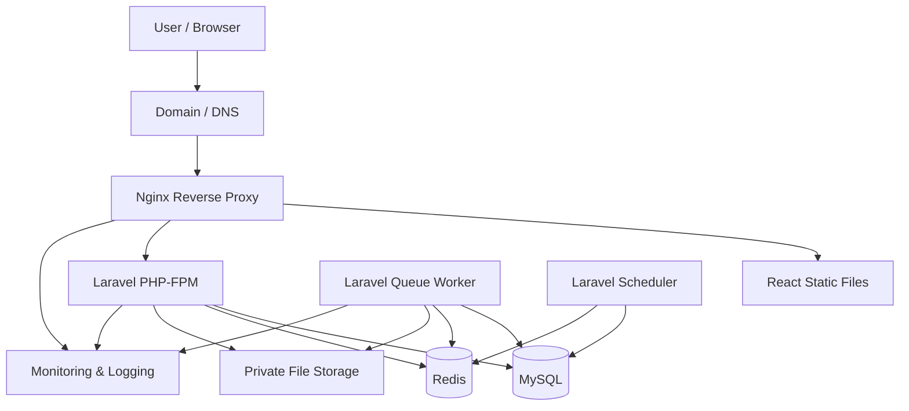
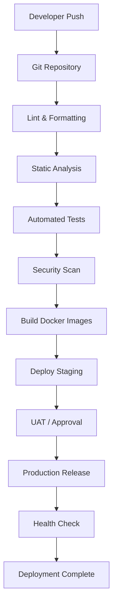
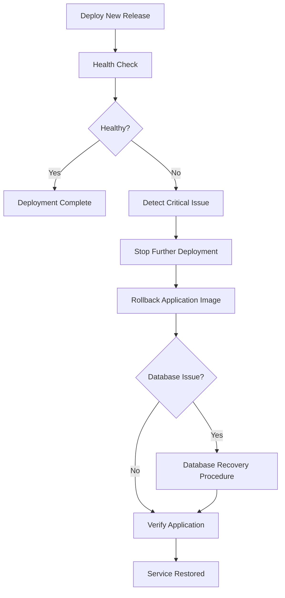

# DEPLOYMENT_GUIDE.md

# Enterprise System Starter Kit
## Deployment Guide

**Document Type:** Technical Documentation  
**Architecture:** Modular Monolith  
**Backend:** Laravel 13.x  
**Frontend:** React + TypeScript + Vite  
**Database:** MySQL 8.x  
**Cache & Queue:** Redis  
**Containerization:** Docker  
**Web Server:** Nginx  

---

> **Base v1:** Cakupan implementasi awal dan bagian yang ditunda tercantum di `README.md`.

## 1. Introduction

### 1.1 Purpose

Dokumen ini menjadi panduan standar deployment Enterprise System Starter Kit, mulai dari environment development, staging, hingga production.

Panduan ini mencakup:

- Deployment architecture.
- Docker configuration.
- Backend deployment.
- Frontend deployment.
- Database configuration.
- Redis and queue worker.
- Nginx reverse proxy.
- Environment and secret management.
- SSL/TLS configuration.
- CI/CD pipeline.
- Monitoring and logging.
- Backup and disaster recovery.
- Rollback strategy.
- Production deployment checklist.

### 1.2 Deployment Objectives

1. Memastikan proses deployment konsisten antar-environment.
2. Memisahkan konfigurasi development, staging, dan production.
3. Memastikan keamanan aplikasi dan infrastruktur.
4. Meminimalkan downtime saat deployment.
5. Memastikan database dan file dapat dipulihkan.
6. Mempermudah monitoring dan troubleshooting.

---

# 2. Deployment Architecture

## 2.1 High-Level Architecture

Aplikasi menggunakan Docker sebagai container runtime dengan Nginx sebagai reverse proxy.



## 2.2 Infrastructure Components

| Component | Responsibility |
|---|---|
| Nginx | Reverse proxy, HTTPS termination, static file serving |
| React | Frontend application |
| Laravel | Backend REST API |
| PHP-FPM | PHP application process manager |
| MySQL | Relational database |
| Redis | Cache, queue, session (optional) |
| Queue Worker | Background job processing |
| Scheduler | Scheduled task execution |
| Storage | Uploaded documents and application files |
| Monitoring | Application and infrastructure monitoring |

## 2.3 Recommended Deployment Topology

Untuk tahap awal, aplikasi dapat berjalan pada satu server menggunakan Docker Compose.

```text
Production Server
│
├── Nginx
│
├── Frontend Container
│   └── React Build
│
├── Backend Container
│   └── Laravel + PHP-FPM
│
├── Queue Worker Container
│   └── Laravel Queue
│
├── Scheduler Container
│   └── Laravel Scheduler
│
├── MySQL Container / Managed Database
│
├── Redis Container / Managed Redis
│
└── Persistent Storage
    ├── Database Data
    ├── Redis Data (if persistence required)
    └── Laravel Storage
```

**Catatan:** Untuk sistem enterprise dengan kebutuhan availability tinggi, database, Redis, dan file storage sebaiknya dipertimbangkan sebagai layanan terpisah atau managed services. Satu server merupakan baseline deployment, bukan high-availability architecture.

---

# 3. Environment Management

## 3.1 Environment Classification

| Environment | Purpose | Configuration |
|---|---|---|
| Local | Development programmer | Local database, debug enabled |
| Development | Integrasi development | Shared development services |
| Staging | Testing sebelum production | Mendekati production |
| Production | Operasional aplikasi | Debug disabled, secure configuration |

## 3.2 Environment Configuration

Setiap environment harus memiliki konfigurasi sendiri.

Contoh `.env` Laravel:

```env
APP_NAME="Enterprise System"
APP_ENV=production
APP_KEY=
APP_DEBUG=false
APP_URL=https://example.com

LOG_CHANNEL=stack
LOG_LEVEL=warning

DB_CONNECTION=mysql
DB_HOST=mysql
DB_PORT=3306
DB_DATABASE=enterprise_db
DB_USERNAME=enterprise_user
DB_PASSWORD=

CACHE_STORE=redis
QUEUE_CONNECTION=redis
SESSION_DRIVER=database
SESSION_SECURE_COOKIE=true
SANCTUM_STATEFUL_DOMAINS=example.com
HASH_DRIVER=argon2id

REDIS_CLIENT=phpredis
REDIS_HOST=redis
REDIS_PASSWORD=
REDIS_PORT=6379

FILESYSTEM_DISK=local
```

Contoh environment frontend:

```env
VITE_APP_NAME="Enterprise System"
VITE_API_BASE_URL=/api/v1
```

**Penting:**

- Jangan commit `.env` ke repository.
- Jangan menyimpan credential production di source code.
- Jangan menggunakan `APP_DEBUG=true` pada production.
- Jangan memasukkan secret ke variabel `VITE_*`, karena nilainya akan terekspos di frontend build.
- Gunakan secret manager atau environment variable dari deployment platform.
- Pisahkan credential untuk setiap environment.

## 3.3 Secret Management

Secret yang perlu dikelola:

- `APP_KEY`.
- Database username dan password.
- Redis password.
- SMTP credentials.
- Third-party API keys.
- Cloud storage credentials.
- Private signing keys.

Rekomendasi:

1. Simpan secret di secret manager atau sistem deployment yang memiliki akses terbatas.
2. Batasi akses berdasarkan role.
3. Rotasi credential secara berkala dan ketika terjadi indikasi kebocoran.
4. Hindari menampilkan secret pada log atau pipeline output.
5. Siapkan prosedur rotasi tanpa mengganggu layanan sejauh memungkinkan.

---

# 4. Docker Configuration

## 4.1 Docker Directory Structure

Contoh struktur direktori:

```text
enterprise-system/
│
├── backend/
│   ├── app/
│   ├── bootstrap/
│   ├── config/
│   ├── database/
│   ├── public/
│   ├── routes/
│   ├── storage/
│   ├── composer.json
│   └── Dockerfile
│
├── frontend/
│   ├── src/
│   ├── public/
│   ├── package.json
│   ├── vite.config.ts
│   └── Dockerfile
│
├── docker/
│   ├── nginx/
│   │   └── default.conf
│   └── php/
│       └── php.ini
│
├── docker-compose.yml
├── .dockerignore
└── README.md
```

## 4.2 Backend Dockerfile

Contoh Dockerfile untuk Laravel menggunakan PHP-FPM.

```dockerfile
FROM php:8.4-fpm

WORKDIR /var/www/html

RUN apt-get update && apt-get install -y \
    git \
    unzip \
    libzip-dev \
    libpng-dev \
    libjpeg62-turbo-dev \
    libwebp-dev \
    libfreetype6-dev \
    libicu-dev \
    && docker-php-ext-configure gd \
        --with-freetype \
        --with-jpeg \
        --with-webp \
    && docker-php-ext-install \
        pdo_mysql \
        intl \
        bcmath \
        zip \
        gd \
        opcache \
    && pecl install redis \
    && docker-php-ext-enable redis \
    && rm -rf /var/lib/apt/lists/*

COPY --from=composer:2 /usr/bin/composer /usr/bin/composer

COPY . .

RUN composer install \
    --no-dev \
    --no-interaction \
    --prefer-dist \
    --optimize-autoloader

RUN chown -R www-data:www-data storage bootstrap/cache

EXPOSE 9000

CMD ["php-fpm"]
```

**Catatan implementasi:**

- Sesuaikan ekstensi PHP dengan kebutuhan aplikasi.
- Extension `redis` wajib karena konfigurasi memakai `REDIS_CLIENT=phpredis`.
- Untuk production, gunakan image yang dipin ke versi atau digest tertentu.
- Hindari menjalankan container sebagai root jika tidak diperlukan.
- Terapkan multi-stage build atau build pipeline terpisah untuk mengurangi ukuran image.
- Pastikan file `.env`, `.git`, dan file sensitif tidak masuk ke Docker build context.

## 4.3 Frontend Dockerfile

Contoh multi-stage build React + Vite.

```dockerfile
FROM node:22-alpine AS builder

WORKDIR /app

COPY package*.json ./

RUN npm ci

COPY . .

ARG VITE_API_BASE_URL

ENV VITE_API_BASE_URL=${VITE_API_BASE_URL}

RUN npm run build

FROM nginx:alpine

COPY --from=builder /app/dist /usr/share/nginx/html
COPY nginx.conf /etc/nginx/conf.d/default.conf

EXPOSE 80

CMD ["nginx", "-g", "daemon off;"]
```

**Catatan:**

- Sesuaikan Node.js dengan versi yang didukung project.
- Gunakan `npm ci` untuk instalasi berdasarkan lockfile.
- Environment `VITE_*` masuk ke hasil build sehingga tidak boleh berisi secret.
- Frontend perlu dibuild ulang ketika konfigurasi build-time berubah.

## 4.4 Docker Compose

Contoh baseline `docker-compose.yml`:

```yaml
services:
  nginx:
    image: nginx:1.27-alpine
    ports:
      - "80:80"
      - "443:443"
    volumes:
      - ./docker/nginx/default.conf:/etc/nginx/conf.d/default.conf:ro
      - ./docker/certs:/etc/nginx/certs:ro
    depends_on:
      - frontend
      - backend
    networks:
      - public
      - internal
    restart: unless-stopped

  frontend:
    image: ${REGISTRY}/enterprise-frontend:${RELEASE_TAG}
    build:
      context: ./frontend
      args:
        VITE_API_BASE_URL: ${VITE_API_BASE_URL}
    networks:
      - internal
    restart: unless-stopped

  backend:
    image: ${REGISTRY}/enterprise-backend:${RELEASE_TAG}
    build:
      context: ./backend
    env_file:
      - ./backend/.env
    volumes:
      - laravel_storage:/var/www/html/storage
    depends_on:
      mysql:
        condition: service_healthy
      redis:
        condition: service_healthy
    networks:
      - internal
      - egress
    restart: unless-stopped

  queue:
    image: ${REGISTRY}/enterprise-backend:${RELEASE_TAG}
    build:
      context: ./backend
    command: php artisan queue:work redis --sleep=3 --tries=3 --timeout=90
    env_file:
      - ./backend/.env
    volumes:
      - laravel_storage:/var/www/html/storage
    depends_on:
      - backend
      - redis
    networks:
      - internal
      - egress
    restart: unless-stopped

  scheduler:
    image: ${REGISTRY}/enterprise-backend:${RELEASE_TAG}
    build:
      context: ./backend
    command: php artisan schedule:work
    env_file:
      - ./backend/.env
    volumes:
      - laravel_storage:/var/www/html/storage
    depends_on:
      - backend
    networks:
      - internal
      - egress
    restart: unless-stopped

  mysql:
    image: mysql:8.4
    environment:
      MYSQL_DATABASE: ${DB_DATABASE}
      MYSQL_USER: ${DB_USERNAME}
      MYSQL_PASSWORD: ${DB_PASSWORD}
      MYSQL_ROOT_PASSWORD: ${DB_ROOT_PASSWORD}
    volumes:
      - mysql_data:/var/lib/mysql
    networks:
      - internal
    healthcheck:
      test:
        - CMD
        - mysqladmin
        - ping
        - -h
        - localhost
      interval: 10s
      timeout: 5s
      retries: 5
    restart: unless-stopped

  redis:
    image: redis:7-alpine
    command: redis-server --appendonly yes
    volumes:
      - redis_data:/data
    networks:
      - internal
    healthcheck:
      test: ["CMD", "redis-cli", "ping"]
      interval: 10s
      timeout: 5s
      retries: 5
    restart: unless-stopped

networks:
  public:
  egress:
  internal:
    internal: true

volumes:
  mysql_data:
  redis_data:
  laravel_storage:
```

Contoh di atas merupakan baseline yang perlu disesuaikan sebelum digunakan. Perhatikan beberapa hal:

- Network `internal` memutus akses internet. Network `egress` diperlukan agar backend, queue, dan scheduler dapat menjangkau SMTP dan API eksternal; MySQL dan Redis tetap hanya berada di `internal`.
- Pastikan Nginx memiliki konfigurasi DNS resolver/upstream yang sesuai untuk nama service Docker.
- Nginx membutuhkan akses ke frontend dan backend pada network internal.
- Tambahkan autentikasi Redis dan konfigurasi koneksi jika diperlukan.
- Jangan expose port MySQL dan Redis ke public network.
- Gunakan image digest atau versi yang telah diuji.
- Untuk production, jangan menyimpan secret langsung di file Compose yang masuk repository.
- Jika database menggunakan managed service, hapus service MySQL lokal dan arahkan `DB_HOST` ke layanan tersebut.
- Jalankan migration sebagai deployment job terkontrol, bukan otomatis dari setiap container backend.

## 4.5 Docker Commands

Build image:

```bash
docker compose build
```

Start services:

```bash
docker compose up -d
```

Check containers:

```bash
docker compose ps
```

View logs:

```bash
docker compose logs -f
```

View backend logs:

```bash
docker compose logs -f backend
```

Restart service:

```bash
docker compose restart backend
```

Stop services:

```bash
docker compose down
```

**Peringatan:** Jangan menggunakan `docker compose down -v` pada production tanpa prosedur penghapusan data yang disetujui. Opsi tersebut dapat menghapus persistent volumes.

---

# 5. Nginx Configuration

## 5.1 Nginx Responsibilities

Nginx bertanggung jawab untuk:

- Reverse proxy ke Laravel.
- Menyediakan static frontend.
- HTTPS termination.
- Request size limit.
- Security headers.
- Routing API.
- SPA fallback.

## 5.2 Nginx Configuration Example

**Penting:** Laravel PHP-FPM menggunakan protokol FastCGI, bukan HTTP. Karena itu, request API tidak boleh menggunakan `proxy_pass` ke port PHP-FPM.

Frontend dan API dilayani dari satu domain. Nginx edge meneruskan route Laravel ke PHP-FPM melalui FastCGI dan route lainnya ke container frontend.

Contoh `docker/nginx/default.conf`:

```nginx
server {
    listen 80;
    server_name example.com;

    client_max_body_size 20M;

    location ~ ^/(api|login|logout|sanctum)(/|$) {
        include fastcgi_params;
        fastcgi_pass backend:9000;
        fastcgi_param SCRIPT_FILENAME /var/www/html/public/index.php;
        fastcgi_param SCRIPT_NAME /index.php;
    }

    location / {
        proxy_pass http://frontend:80;
        proxy_set_header Host $host;
        proxy_set_header X-Real-IP $remote_addr;
        proxy_set_header X-Forwarded-For $proxy_add_x_forwarded_for;
        proxy_set_header X-Forwarded-Proto $scheme;
    }
}
```

Karena `SCRIPT_FILENAME` ditetapkan langsung ke `public/index.php`, Nginx tidak memerlukan salinan source code Laravel.

Nilai `client_max_body_size` harus selaras dengan `upload_max_filesize` dan `post_max_size` pada `php.ini`.

Container frontend memakai `frontend/nginx.conf` dengan SPA fallback ke `index.html`.

```nginx
server {
    listen 80;
    server_name _;

    root /usr/share/nginx/html;
    index index.html;

    location / {
        try_files $uri $uri/ /index.html;
    }

    location ~* \.(js|css|png|jpg|jpeg|svg|ico|woff2)$ {
        expires 30d;
        add_header Cache-Control "public, immutable";
        try_files $uri =404;
    }
}
```

## 5.3 HTTPS / SSL

Production wajib menggunakan HTTPS.

Rekomendasi:

- Gunakan sertifikat SSL yang valid.
- Aktifkan HTTP to HTTPS redirect.
- Perbarui sertifikat sebelum kedaluwarsa.
- Gunakan TLS 1.2 atau lebih baru.
- Batasi akses ke endpoint administrasi.
- Terapkan HSTS setelah konfigurasi HTTPS tervalidasi.

Contoh redirect:

```nginx
server {
    listen 80;
    server_name example.com;

    return 301 https://$host$request_uri;
}
```

Security headers perlu dikonfigurasi sesuai kebutuhan aplikasi, misalnya:

- `X-Content-Type-Options: nosniff`
- `Referrer-Policy`
- `Content-Security-Policy`
- `Strict-Transport-Security` setelah HTTPS siap.

Pastikan konfigurasi Content Security Policy tidak memblokir resource aplikasi yang memang diperlukan.

---

# 6. Laravel Deployment

## 6.1 Production Optimization

Setelah source code tersedia di environment production, jalankan optimasi Laravel.

```bash
php artisan optimize
```

Perintah tersebut mengoptimalkan konfigurasi, route, event, dan view sesuai dukungan versi Laravel.

Perintah tambahan yang dapat digunakan:

```bash
php artisan config:cache
php artisan route:cache
php artisan view:cache
```

Jangan meng-cache konfigurasi ketika environment belum lengkap atau konfigurasi yang dibutuhkan belum tersedia.

Cache tersebut tersimpan di filesystem masing-masing container, sehingga backend, queue, dan scheduler harus menjalankan `php artisan optimize` sendiri, sebaiknya melalui entrypoint saat container start.

## 6.2 Database Migration

Migration dilakukan sebagai bagian dari release process.

```bash
php artisan migrate --force
```

Ketentuan:

- Backup database sebelum migration yang berisiko.
- Review perubahan schema.
- Gunakan migration yang kompatibel dengan aplikasi versi sebelumnya jika deployment menggunakan rolling strategy.
- Hindari perubahan destructive secara langsung.
- Uji migration pada staging.
- Pastikan migration tidak mengunci tabel terlalu lama.

Untuk perubahan database besar, gunakan pola expand-and-contract:

1. Tambahkan kolom atau struktur baru tanpa menghapus struktur lama.
2. Deploy aplikasi yang mendukung struktur lama dan baru.
3. Lakukan backfill data jika diperlukan.
4. Alihkan aplikasi ke struktur baru.
5. Hapus struktur lama setelah seluruh versi aplikasi tidak lagi menggunakannya.

## 6.3 Database Seeder

Seeder production hanya digunakan untuk data referensi atau data sistem yang memang diperlukan.

```bash
php artisan db:seed --class=SystemConfigurationSeeder --force
```

Hindari menjalankan seeder development atau dummy data pada production.

## 6.4 Queue Worker

Laravel Queue Worker harus dijalankan sebagai service terpisah.

```bash
php artisan queue:work redis \
    --sleep=3 \
    --tries=3 \
    --timeout=90
```

Setelah deployment aplikasi:

```bash
php artisan queue:restart
```

Supervisor atau container orchestrator harus memastikan worker berjalan kembali setelah restart.

Perhatikan:

- `retry_after` harus lebih besar dari timeout worker. Dengan `--timeout=90`, nilai default `retry_after` (90) pada `config/queue.php` harus dinaikkan, misalnya menjadi 120.
- Job harus memiliki retry strategy.
- Job yang gagal perlu dipantau.
- Job penting harus dirancang idempotent.
- Jangan memasukkan secret atau data sensitif berlebihan ke payload queue.

## 6.5 Scheduler

Laravel scheduler digunakan untuk menjalankan tugas berkala.

Untuk deployment berbasis container, satu scheduler service dapat menjalankan:

```bash
php artisan schedule:work
```

Pastikan hanya ada jumlah scheduler instance yang sesuai. Untuk beberapa instance aplikasi, gunakan mekanisme `onOneServer()` dan distributed lock bila dibutuhkan.

Contoh scheduler:

```php
use Illuminate\Support\Facades\Schedule;

Schedule::command('reports:generate')
    ->dailyAt('01:00')
    ->withoutOverlapping();
```

---

# 7. Database Deployment

## 7.1 MySQL Configuration

Rekomendasi baseline:

| Configuration | Recommendation |
|---|---|
| Engine | InnoDB |
| Character Set | utf8mb4 |
| Collation | utf8mb4_unicode_ci |
| Timezone | UTC |
| Connection | Private network |
| Backup | Automated |
| Access | Least privilege |

## 7.2 Database Security

- Jangan expose port database ke internet.
- Gunakan database account khusus aplikasi.
- Hindari penggunaan root account oleh aplikasi.
- Batasi hak akses database.
- Gunakan credential berbeda untuk staging dan production.
- Aktifkan TLS untuk koneksi database lintas host jika didukung dan diperlukan.
- Monitor koneksi aktif dan slow queries.

## 7.3 Database Connection Pooling

Untuk baseline Laravel dengan MySQL, gunakan konfigurasi koneksi yang sesuai kapasitas PHP-FPM dan database.

Jika menggunakan persistent connections atau proxy database, evaluasi dampaknya terhadap koneksi, session state, dan resource limit.

Jangan mengasumsikan bahwa menambah jumlah PHP-FPM workers akan selalu meningkatkan throughput. Kapasitas database harus diperhitungkan.

---

# 8. Redis Deployment

Redis digunakan untuk:

- Application cache.
- Queue processing.
- Distributed lock.
- Session storage jika dipilih.

Rekomendasi:

1. Redis tidak boleh diekspos ke public network.
2. Gunakan autentikasi dan ACL bila sesuai.
3. Atur memory limit dan eviction policy berdasarkan penggunaan.
4. Pisahkan namespace atau prefix cache per environment.
5. Monitor memory usage dan connected clients.
6. Tentukan kebutuhan persistence berdasarkan jenis data.

Cache yang dapat dibuat ulang dan queue yang harus bertahan memiliki kebutuhan durability berbeda. Konfigurasi persistence Redis harus disesuaikan dengan kebutuhan operasional, bukan diterapkan secara seragam tanpa evaluasi.

---

# 9. File Storage Deployment

## 9.1 Storage Strategy

File aplikasi dapat disimpan menggunakan:

- Local persistent volume.
- Object storage.
- Private cloud storage.

Rekomendasi untuk enterprise:

Gunakan object storage untuk dokumen dan file bisnis apabila kebutuhan kapasitas, availability, atau distribusi file meningkat.

## 9.2 Laravel Storage

Pastikan direktori berikut memiliki permission yang benar:

```text
storage/
bootstrap/cache/
```

Contoh:

```bash
chown -R www-data:www-data storage bootstrap/cache
chmod -R 775 storage bootstrap/cache
```

Hindari memberikan permission `777`.

## 9.3 File Security

- Gunakan private storage untuk dokumen internal.
- Validasi MIME berdasarkan konten file.
- Terapkan allowlist extension.
- Terapkan batas ukuran file.
- Gunakan nama file acak saat penyimpanan.
- Validasi hak akses sebelum download.
- Gunakan malware scanning jika infrastruktur mendukung.
- Hindari mengeksekusi file upload.
- Pastikan backup mencakup file yang diperlukan.

`php artisan storage:link` hanya digunakan jika memang dibutuhkan untuk file yang boleh diakses publik. Jangan menjadikan seluruh dokumen bisnis dapat diakses langsung melalui public storage.

---

# 10. CI/CD Pipeline

## 10.1 Pipeline Overview



## 10.2 Backend Pipeline

| Stage | Tool / Command | Purpose |
|---|---|---|
| Dependency | Composer | Install dependencies |
| Formatting | Laravel Pint | Code formatting |
| Static Analysis | Larastan / PHPStan | Static analysis |
| Unit Test | Pest / PHPUnit | Unit testing |
| Feature Test | Pest / PHPUnit | Integration testing |
| Security | Composer Audit | Dependency vulnerability check |
| Build | Docker | Build backend image |

Contoh command:

```bash
composer install --no-interaction
vendor/bin/pint --test
vendor/bin/phpstan analyse
php artisan test
composer audit
```

Sesuaikan command dan konfigurasi dengan tool yang benar-benar dipasang pada project.

## 10.3 Frontend Pipeline

| Stage | Tool | Purpose |
|---|---|---|
| Dependency | npm ci | Install dependencies |
| Lint | ESLint | Code quality |
| Format | Prettier | Code formatting |
| Type Check | TypeScript | Type validation |
| Test | Vitest | Unit/component testing |
| Build | Vite | Production build |
| Security | npm audit | Dependency vulnerability check |

Contoh:

```bash
npm ci
npm run lint
npm run type-check
npm run test
npm run build
npm audit
```

Nama script harus disesuaikan dengan `package.json`.

## 10.4 Release Strategy

Gunakan release artifact yang sama untuk staging dan production. Karena frontend memakai URL API relatif (`/api/v1`), image frontend tidak perlu dibuild per environment.

Rekomendasi:

1. Build image dari commit yang telah lolos CI.
2. Tag image dengan commit SHA atau release version.
3. Deploy image ke staging.
4. Jalankan automated tests dan UAT.
5. Dapatkan approval production.
6. Deploy image yang sama ke production.
7. Jalankan health check.
8. Simpan informasi versi deployment.

Contoh tag:

```text
enterprise-backend:2026.11.09
enterprise-backend:commit-a1b2c3d

enterprise-frontend:2026.11.09
enterprise-frontend:commit-a1b2c3d
```

Hindari menggunakan tag `latest` sebagai satu-satunya identitas release production.

---

# 11. Deployment Procedure

## 11.1 Pre-Deployment Checklist

Sebelum deployment:

- [ ] Source code sudah di-review.
- [ ] CI pipeline berhasil.
- [ ] Automated test berhasil.
- [ ] Security scan selesai.
- [ ] Docker image berhasil dibangun.
- [ ] Environment variable sudah tersedia.
- [ ] Database backup tersedia.
- [ ] Migration telah diuji di staging.
- [ ] File storage telah diverifikasi.
- [ ] Release dan rollback plan tersedia.
- [ ] Jadwal deployment telah disetujui.

## 11.2 Standard Deployment Steps

### Step 1 — Pull Release Image

```bash
docker compose pull
```

### Step 2 — Start Infrastructure

Pastikan MySQL dan Redis sehat sebelum aplikasi dijalankan.

```bash
docker compose up -d mysql redis
docker compose ps
```

### Step 3 — Run Database Migration

Jalankan migration melalui satu deployment task yang terkontrol.

```bash
docker compose run --rm backend php artisan migrate --force
```

### Step 4 — Deploy Application

```bash
docker compose up -d backend frontend queue scheduler nginx
```

### Step 5 — Clear and Rebuild Cache

Lewati langkah ini jika entrypoint container sudah menjalankan `php artisan optimize`.

```bash
docker compose exec backend php artisan optimize
docker compose exec queue php artisan optimize
docker compose exec scheduler php artisan optimize
```

### Step 6 — Restart Queue Worker

```bash
docker compose exec backend php artisan queue:restart
```

Jika menggunakan worker container terpisah, pastikan worker sudah memakai image release terbaru dan berjalan kembali.

### Step 7 — Verify Application

Periksa:

- Login.
- Dashboard.
- API endpoint.
- Database connection.
- Redis connection.
- Queue processing.
- File upload/download.
- Notification.
- Scheduled jobs.
- Application logs.

---

# 12. Health Check & Monitoring

## 12.1 Application Health Check

Sediakan endpoint health check yang tidak membocorkan informasi internal.

Contoh:

```text
GET /api/v1/health
```

Contoh response:

```json
{
  "status": "ok",
  "service": "enterprise-api"
}
```

Health check dapat dibagi menjadi:

| Endpoint / Check | Purpose |
|---|---|
| Liveness | Memastikan proses aplikasi hidup |
| Readiness | Memastikan aplikasi siap menerima request |
| Database check | Memastikan koneksi database |
| Redis check | Memastikan koneksi Redis |
| Queue monitoring | Memastikan job diproses |

Jangan membuka detail konfigurasi, credential, stack trace, atau informasi sensitif melalui endpoint health check publik.

## 12.2 Monitoring Metrics

| Category | Metrics |
|---|---|
| Server | CPU, RAM, Disk |
| Nginx | Request, status code, latency |
| Laravel | Error rate, response time |
| MySQL | Connections, slow query, replication |
| Redis | Memory, hit rate, connected clients |
| Queue | Pending jobs, failed jobs, processing time |
| Storage | Usage, availability |
| Security | Failed login, unauthorized access, suspicious activity |

## 12.3 Logging

Gunakan structured logging jika memungkinkan.

Log penting:

- Application error.
- Authentication failure.
- Authorization failure.
- Database error.
- Queue failure.
- Integration failure.
- Deployment event.
- Security event.

Setiap log operasional idealnya memiliki:

- Timestamp.
- Environment.
- Application version.
- Severity.
- Request/correlation ID.
- Module.
- Context yang relevan.

Jangan mencatat password, access token, API secret, session identifier, atau data pribadi secara berlebihan.

## 12.4 Monitoring Tools

Contoh opsi:

| Tool | Purpose |
|---|---|
| Laravel Log | Application logging |
| Sentry | Error tracking |
| Prometheus | Metrics collection |
| Grafana | Monitoring dashboard |
| Uptime Kuma | Availability monitoring |
| Loki | Log aggregation |
| OpenTelemetry | Observability instrumentation |

Pemilihan tool disesuaikan dengan kebutuhan, anggaran, dan infrastruktur.

---

# 13. Backup & Disaster Recovery

## 13.1 Backup Strategy

Backup harus mencakup:

1. Database.
2. Uploaded documents.
3. Application configuration yang diperlukan.
4. Infrastructure configuration.
5. Encryption keys dan secret melalui mekanisme penyimpanan aman.

Jangan menganggap source code repository sebagai satu-satunya backup aplikasi.

## 13.2 Database Backup

Contoh backup menggunakan `mysqldump`:

```bash
mysqldump \
  --single-transaction \
  --routines \
  --triggers \
  --events \
  -u backup_user \
  -p \
  enterprise_db > enterprise_backup.sql
```

Untuk database besar atau kebutuhan point-in-time recovery, pertimbangkan:

- MySQL binary logs.
- Automated snapshots.
- Backup incremental.
- Managed database backup.

Backup harus dienkripsi dan disimpan di lokasi terpisah dari server utama.

## 13.3 File Backup

Backup file storage harus mempertahankan:

- Struktur direktori.
- File metadata.
- Permission yang relevan.
- Hubungan antara database record dan file.
- Versi dokumen jika fitur versioning digunakan.

## 13.4 Backup Schedule

Contoh baseline yang perlu disesuaikan:

| Backup | Schedule | Retention |
|---|---|---|
| Database full | Daily | 30 days |
| Database incremental / binlog | Berdasarkan kebutuhan RPO | Sesuai kebijakan |
| File storage | Daily | 30 days |
| Configuration | Saat perubahan release | Sesuai kebijakan |

## 13.5 RPO & RTO

Contoh target awal:

| Metric | Initial Target |
|---|---|
| RPO | 15 minutes |
| RTO | 4 hours |

**RPO (Recovery Point Objective):** Batas maksimum kehilangan data yang dapat diterima.

**RTO (Recovery Time Objective):** Target waktu maksimum untuk memulihkan layanan.

Target tersebut bukan jaminan. Kelayakannya harus diuji berdasarkan infrastruktur, volume data, backup frequency, dan prosedur pemulihan.

## 13.6 Restore Testing

Backup dianggap valid apabila dapat dipulihkan.

Lakukan pengujian berkala:

1. Ambil backup dari storage.
2. Restore database ke environment terisolasi.
3. Restore file storage.
4. Validasi jumlah record dan integritas data.
5. Jalankan aplikasi menggunakan hasil restore.
6. Catat durasi pemulihan.
7. Dokumentasikan hasil pengujian.

---

# 14. Rollback Strategy

## 14.1 Rollback Objectives

Rollback digunakan ketika release baru menyebabkan masalah kritis.

Contoh kondisi:

- Aplikasi tidak dapat diakses.
- Login gagal secara luas.
- API utama mengalami error.
- Queue processing berhenti.
- Performa mengalami degradasi berat.
- Terdapat masalah keamanan pada release.

## 14.2 Application Rollback

Gunakan image release sebelumnya.

Arahkan `RELEASE_TAG` ke tag release sebelumnya, lalu jalankan:

```bash
docker compose pull
docker compose up -d backend frontend queue scheduler
```

Kemudian:

```bash
docker compose ps
docker compose logs -f backend
```

## 14.3 Database Rollback

Database rollback harus dilakukan secara hati-hati.

Prinsip:

- Jangan mengandalkan `migrate:rollback` sebagai satu-satunya strategi pemulihan production.
- Gunakan backward-compatible migration.
- Siapkan backup sebelum migration berisiko.
- Gunakan restore atau recovery procedure jika terjadi kerusakan data.
- Evaluasi dampak kehilangan transaksi setelah backup dibuat.

Rollback aplikasi tidak selalu berarti database harus di-rollback.

## 14.4 Rollback Flow



---

# 15. Production Security Checklist

## 15.1 Server Security

- [ ] SSH menggunakan key-based authentication.
- [ ] Root login dibatasi atau dinonaktifkan sesuai kebijakan.
- [ ] Firewall hanya membuka port yang diperlukan.
- [ ] Database dan Redis tidak terbuka ke internet.
- [ ] Server mendapatkan security updates.
- [ ] Docker daemon tidak diekspos ke jaringan publik.
- [ ] Container menggunakan non-root user jika memungkinkan.
- [ ] Image menggunakan versi yang dipin.

## 15.2 Application Security

- [ ] `APP_DEBUG=false`.
- [ ] HTTPS aktif.
- [ ] `.env` tidak tersedia secara publik.
- [ ] Authentication menggunakan konfigurasi production.
- [ ] Authorization menggunakan Laravel Policies.
- [ ] Rate limiting aktif.
- [ ] CORS dibatasi.
- [ ] File upload tervalidasi.
- [ ] Error response tidak membocorkan stack trace.
- [ ] Secret tidak tercatat di log.
- [ ] Dependency security scan dilakukan.

## 15.3 Database Security

- [ ] Database hanya dapat diakses melalui private network.
- [ ] Application user tidak menggunakan root.
- [ ] Credential berbeda antar-environment.
- [ ] Backup terenkripsi.
- [ ] Restore test dilakukan.
- [ ] Database monitoring aktif.

---

# 16. Deployment Troubleshooting

| Problem | Possible Cause | Recommended Action |
|---|---|---|
| 502 Bad Gateway | PHP-FPM tidak berjalan | Periksa container backend dan Nginx |
| 500 Internal Server Error | Application exception | Periksa Laravel log |
| Database connection failed | Credential atau host salah | Periksa `.env` dan network |
| Redis connection failed | Redis belum aktif | Periksa Redis container |
| Queue tidak berjalan | Worker berhenti | Periksa worker logs |
| Permission denied | Storage permission salah | Periksa ownership dan permission |
| Frontend blank | Build atau routing error | Periksa browser console dan Nginx |
| CORS error | Origin tidak diizinkan | Periksa Laravel CORS configuration |
| Migration failed | Schema conflict | Periksa migration dan database state |
| File upload failed | Size limit atau permission | Periksa Nginx, PHP, dan storage |

## 16.1 Useful Commands

Check running containers:

```bash
docker compose ps
```

Check backend logs:

```bash
docker compose logs --tail=100 backend
```

Check Laravel application status:

```bash
docker compose exec backend php artisan about
```

Check database connection:

```bash
docker compose exec backend php artisan migrate:status
```

Check queue:

```bash
docker compose exec backend php artisan queue:failed
```

Check disk:

```bash
df -h
```

Check memory:

```bash
free -h
```

Check Docker resource usage:

```bash
docker stats
```

---

# 17. Deployment Acceptance Criteria

Deployment dinyatakan berhasil apabila:

| No | Criteria | Expected Result |
|---|---|---|
| 1 | Application accessible | Aplikasi dapat diakses |
| 2 | HTTPS | SSL valid |
| 3 | Authentication | Login dan logout berhasil |
| 4 | Authorization | Role dan permission berjalan |
| 5 | API | Endpoint utama berhasil |
| 6 | Database | Koneksi dan transaksi berhasil |
| 7 | Redis | Cache dan queue berjalan |
| 8 | Queue Worker | Background job diproses |
| 9 | Scheduler | Scheduled task berjalan |
| 10 | File Storage | Upload dan download sesuai authorization |
| 11 | Logging | Error tercatat |
| 12 | Monitoring | Health check berjalan |
| 13 | Backup | Backup berhasil dibuat |
| 14 | Recovery | Restore procedure tersedia |
| 15 | Security | Production security checklist terpenuhi |

---

# 18. Deployment Roadmap

| Phase | Activities | Output |
|---|---|---|
| Phase 1 | Docker setup | Containerized application |
| Phase 2 | Environment setup | Development, staging, production |
| Phase 3 | Nginx and SSL | Secure application access |
| Phase 4 | Database and Redis | Infrastructure ready |
| Phase 5 | CI/CD pipeline | Automated build and deployment |
| Phase 6 | Monitoring | Application observability |
| Phase 7 | Backup and recovery | Disaster recovery readiness |
| Phase 8 | Production release | Production-ready system |

---

# 19. Related Documentation

Dokumen ini merupakan bagian dari Enterprise System Starter Kit.

| Document | Description |
|---|---|
| SYSTEM_ARCHITECTURE.md | System architecture |
| DATABASE_DESIGN.md | Database design and ERD |
| MODULE_SPECIFICATION.md | Module specification |
| AUTHORIZATION_MATRIX.md | Role and permission matrix |
| API_SPECIFICATION.md | REST API contract |
| DEVELOPMENT_GUIDELINE.md | Development standards |
| TESTING_STRATEGY.md | Testing standards |
| SECURITY_SPECIFICATION.md | Security requirements |
| DEPLOYMENT_GUIDE.md | Deployment and infrastructure |

---

# 20. Official References

Gunakan dokumentasi resmi sebagai referensi implementasi dan verifikasi kompatibilitas versi.

- Docker Documentation: https://docs.docker.com/
- Docker Compose: https://docs.docker.com/compose/
- Laravel Deployment: https://laravel.com/docs/deployment
- Laravel Configuration: https://laravel.com/docs/configuration
- Laravel Queues: https://laravel.com/docs/queues
- Laravel Scheduling: https://laravel.com/docs/scheduling
- MySQL Documentation: https://dev.mysql.com/doc/
- Redis Documentation: https://redis.io/docs/
- Nginx Documentation: https://nginx.org/en/docs/
- OWASP Cheat Sheet Series: https://cheatsheetseries.owasp.org/

---

# 21. Conclusion

Deployment architecture Enterprise System Starter Kit dirancang menggunakan Docker dan Modular Monolith untuk memastikan proses deployment lebih konsisten, terukur, dan mudah dikelola.

Implementasi production harus memperhatikan:

1. Environment isolation.
2. Secure configuration and secret management.
3. Database and Redis isolation.
4. Automated CI/CD.
5. Health check and monitoring.
6. Backup and recovery.
7. Controlled release and rollback.

Seluruh konfigurasi pada dokumen ini merupakan baseline. Parameter seperti kapasitas server, resource limit, jumlah worker, backup frequency, RPO, dan RTO harus ditetapkan melalui pengujian serta kebutuhan operasional aktual.

**End of Document**