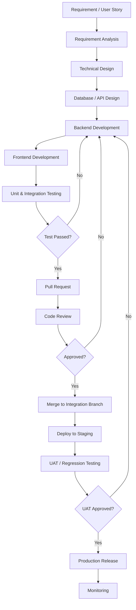

# DEVELOPMENT_GUIDELINE.md

# Enterprise System Starter Kit
## Development Guideline

**Document Type:** Technical Development Standard  
**Architecture:** Modular Monolith  
**Backend:** Laravel 13.x / PHP 8.4.x  
**Frontend:** React / TypeScript  
**Database:** MySQL 8.x  
**Cache & Queue:** Redis  
**API Style:** REST API  
**Security Baseline:** OWASP ASVS Level 2

---

> **Base v1:** Cakupan implementasi awal dan bagian yang ditunda tercantum di `README.md`.

# 1. Introduction

## 1.1 Purpose

Dokumen ini mendefinisikan standar dan pedoman pengembangan aplikasi Enterprise System Starter Kit.

Tujuannya adalah memastikan seluruh proses development memiliki pola yang konsisten, mencakup:

- Coding convention Backend dan Frontend.
- Struktur folder dan penamaan file.
- Arsitektur modul dan pemisahan tanggung jawab.
- Repository, Service, dan Action pattern.
- Database transaction dan query optimization.
- API development standard.
- Authentication dan authorization.
- Error handling dan logging.
- Git workflow dan code review.
- Unit testing dan integration testing.
- Code quality dan Definition of Done.

## 1.2 Development Principles

Prinsip utama pengembangan:

| Principle | Description |
|---|---|
| Consistency | Menggunakan standar penulisan kode yang sama |
| Separation of Concerns | Setiap komponen memiliki tanggung jawab spesifik |
| Modularity | Fitur dikelompokkan berdasarkan domain bisnis |
| Reusability | Menghindari duplikasi logic |
| Security by Design | Keamanan diterapkan sejak awal development |
| Testability | Logic bisnis dapat diuji secara terpisah |
| Maintainability | Kode mudah dipahami dan dikembangkan |
| Simplicity | Menghindari abstraksi dan kompleksitas yang tidak diperlukan |

---

# 2. General Development Standards

## 2.1 Naming Convention

Standar penamaan harus konsisten antara Backend, Frontend, dan Database.

| Component | Convention | Example |
|---|---|---|
| PHP Class | PascalCase | `UserService` |
| PHP Method | camelCase | `getUserList()` |
| PHP Variable | camelCase | `$userData` |
| PHP Constant | UPPER_SNAKE_CASE | `MAX_LOGIN_ATTEMPTS` |
| Database Table | snake_case, plural | `users`, `roles` |
| Database Column | snake_case | `created_at` |
| React Component | PascalCase | `UserTable.tsx` |
| React Hook | camelCase with use prefix | `useUsers.ts` |
| TypeScript Interface/Type | PascalCase | `UserResponse` |
| JavaScript Variable | camelCase | `userData` |
| CSS Class | kebab-case | `user-profile` |
| API Resource | plural kebab-case | `/api/v1/user-profiles` |
| Environment Variable | UPPER_SNAKE_CASE | `APP_ENV` |

## 2.2 General Rules

1. Gunakan nama yang menjelaskan tujuan dan tanggung jawab.
2. Hindari nama singkatan yang tidak umum.
3. Hindari penggunaan magic number.
4. Hindari hardcoded configuration.
5. Hindari duplikasi business logic.
6. Gunakan enum atau constant untuk nilai yang memiliki makna bisnis.
7. Hindari function atau method dengan terlalu banyak tanggung jawab.
8. Gunakan komentar untuk menjelaskan alasan atau konteks, bukan sekadar mengulang kode.

## 2.3 Code Language

- Source code menggunakan bahasa Inggris.
- Nama variable, class, method, table, dan API menggunakan bahasa Inggris.
- Dokumentasi teknis dapat menggunakan bahasa Indonesia atau Inggris.
- Pesan validasi kepada pengguna dapat menggunakan bahasa Indonesia sesuai kebutuhan aplikasi.
- Istilah bisnis harus konsisten dengan glossary domain.

---

# 3. Backend Development Guideline

## 3.1 Backend Architecture

Backend menggunakan Laravel dengan pendekatan Modular Monolith.

Setiap module memiliki batas domain dan tanggung jawab masing-masing.

Struktur utama:

```text
app/
├── Core/
│   ├── Authentication/
│   ├── Authorization/
│   ├── Security/
│   ├── Audit/
│   ├── Exceptions/
│   └── Logging/
│
├── Modules/
│   ├── UserManagement/
│   ├── Workflow/
│   ├── MasterData/
│   ├── Document/
│   ├── Notification/
│   ├── Reporting/
│   ├── Integration/
│   ├── Monitoring/
│   └── SystemConfiguration/
│
└── Shared/
    ├── Contracts/
    ├── DTOs/
    ├── Enums/
    ├── Helpers/
    └── Traits/
```

Contoh struktur satu module:

```text
Modules/
└── UserManagement/
    ├── Controllers/
    │   └── UserController.php
    ├── Actions/
    │   ├── CreateUserAction.php
    │   └── UpdateUserAction.php
    ├── Services/
    │   └── UserService.php
    ├── Models/
    │   └── User.php
    ├── Requests/
    │   ├── StoreUserRequest.php
    │   └── UpdateUserRequest.php
    ├── Resources/
    │   └── UserResource.php
    ├── Policies/
    │   └── UserPolicy.php
    ├── Events/
    ├── Listeners/
    ├── Jobs/
    ├── Routes/
    │   └── api.php
    └── Providers/
        └── UserManagementServiceProvider.php
```

Catatan: Struktur ini merupakan logical module boundary. Implementasinya dapat menggunakan namespace dan autoload Composer yang sesuai. Jangan membuat class kosong hanya untuk memenuhi struktur.

## 3.2 Layer Responsibilities

| Layer | Responsibility |
|---|---|
| Controller | Menerima HTTP request dan mengembalikan response |
| Request | Validasi input dan authorization awal |
| Action | Menjalankan satu use case atau business operation |
| Service | Mengelola business logic yang digunakan lintas use case |
| Repository | Mengabstraksi kebutuhan query dan persistence jika diperlukan |
| Model | Merepresentasikan entity dan relasi database |
| Resource | Mengatur format output API |
| Policy | Mengatur akses terhadap resource |
| Event | Merepresentasikan kejadian dalam sistem |
| Listener | Menangani reaksi terhadap event |
| Job | Menjalankan pekerjaan asynchronous |

### Controller Rule

Controller harus tipis dan tidak menjadi tempat utama business logic.

Contoh:

```php
class UserController extends Controller
{
    public function store(StoreUserRequest $request, CreateUserAction $action)
    {
        $user = $action->execute($request->validated());

        return new UserResource($user);
    }
}
```

Hindari:

- Query database kompleks langsung di controller.
- Business calculation di controller.
- Pengiriman email secara synchronous jika dapat menggunakan queue.
- Validasi manual yang seharusnya menggunakan Form Request.

## 3.3 Action Pattern

Action digunakan untuk merepresentasikan satu operasi bisnis.

Contoh:

```php
class CreateUserAction
{
    public function execute(array $data): User
    {
        return DB::transaction(function () use ($data) {
            $user = User::create([
                'name' => $data['name'],
                'email' => $data['email'],
                'password' => Hash::make($data['password']),
            ]);

            DB::afterCommit(fn () => event(new UserCreated($user)));

            return $user;
        });
    }
}
```

Event yang memicu proses lanjutan harus dikirim setelah commit, melalui `DB::afterCommit()` atau `ShouldDispatchAfterCommit`, agar listener tidak berjalan untuk transaksi yang kemudian gagal.

Contoh penamaan:

- `CreateUserAction`
- `UpdateUserAction`
- `DeleteUserAction`
- `ApprovePurchaseRequestAction`
- `SubmitInspectionAction`

Setiap Action sebaiknya memiliki satu tujuan yang jelas.

## 3.4 Service Pattern

Service digunakan ketika business logic:

- Digunakan oleh beberapa Action.
- Memerlukan koordinasi beberapa domain operation.
- Memiliki proses bisnis yang cukup kompleks.
- Tidak tepat ditempatkan di Controller atau Model.

Contoh:

```php
class UserService
{
    public function findActiveUser(int $id): ?User
    {
        return User::query()
            ->whereKey($id)
            ->where('is_active', true)
            ->first();
    }
}
```

Jangan membuat Service hanya sebagai pembungkus satu baris query tanpa alasan yang jelas.

## 3.5 Repository Pattern

Repository bersifat opsional dan digunakan ketika memang memberikan manfaat.

Gunakan Repository apabila:

- Query cukup kompleks.
- Query perlu digunakan oleh beberapa use case.
- Terdapat kebutuhan abstraction terhadap persistence.
- Terdapat kebutuhan query testing atau optimasi terpusat.

Contoh:

```php
class UserRepository
{
    public function findByEmail(string $email): ?User
    {
        return User::query()
            ->where('email', $email)
            ->first();
    }
}
```

Hindari membuat interface dan repository untuk setiap model apabila tidak memberikan manfaat nyata.

## 3.6 Dependency Injection

Gunakan dependency injection melalui constructor atau method injection.

Contoh:

```php
class CreatePurchaseRequestAction
{
    public function __construct(
        private PurchaseRequestService $service
    ) {}

    public function execute(array $data): PurchaseRequest
    {
        return $this->service->create($data);
    }
}
```

Hindari penggunaan dependency global atau service locator secara berlebihan.

---

# 4. Database Development Standard

## 4.1 Database Naming

| Object | Convention | Example |
|---|---|---|
| Table | snake_case plural | `purchase_requests` |
| Column | snake_case | `request_number` |
| Primary Key | `id` | `id` |
| Foreign Key | `{table_singular}_id` | `user_id` |
| Index | `idx_{table}_{columns}` | `idx_users_email` |
| Unique | `uq_{table}_{columns}` | `uq_users_email` |
| Foreign Key Constraint | `fk_{table}_{column}` | `fk_orders_user_id` |

## 4.2 Migration Standard

Semua perubahan struktur database harus menggunakan Laravel Migration.

Contoh:

```php
Schema::create('projects', function (Blueprint $table) {
    $table->id();
    $table->uuid('uuid')->unique();
    $table->string('code', 50)->unique();
    $table->string('name', 150);
    $table->boolean('is_active')->default(true);
    $table->timestamps();
    $table->softDeletes();

    $table->index('is_active');
});
```

Rules:

1. Jangan mengubah migration yang sudah diterapkan pada environment bersama atau production.
2. Buat migration baru untuk perubahan struktur.
3. Tentukan foreign key dan delete behavior secara eksplisit.
4. Tambahkan index berdasarkan pola query.
5. Gunakan constraint database untuk menjaga integritas data.
6. Pastikan rollback migration dapat dilakukan dengan aman.
7. Hindari migration yang mengunci tabel besar terlalu lama tanpa perencanaan.

## 4.3 Database Transaction

Gunakan transaction untuk operasi yang melibatkan beberapa perubahan data yang harus konsisten.

Contoh:

```php
DB::transaction(function () use ($data) {
    $purchaseRequest = PurchaseRequest::create($data);

    $purchaseRequest->items()->createMany(
        $data['items']
    );

    $purchaseRequest->submit();

    return $purchaseRequest;
});
```

Gunakan transaction ketika:

- Membuat header dan detail transaksi.
- Melakukan approval dan mengubah status.
- Mengurangi atau menambah stok.
- Melakukan pembayaran.
- Melakukan perpindahan saldo atau nilai keuangan.

Untuk proses yang membutuhkan penguncian data, pertimbangkan `lockForUpdate()` di dalam transaction.

Hindari menjalankan HTTP request, pengiriman email, atau proses eksternal yang lambat di dalam transaction.

## 4.4 Query Optimization

Standar optimasi query:

- Gunakan eager loading untuk mencegah N+1 query.
- Gunakan `select()` untuk mengambil kolom yang diperlukan.
- Gunakan pagination pada data berukuran besar.
- Hindari query berulang dalam loop.
- Tambahkan index sesuai kebutuhan query.
- Gunakan `chunkById()` atau `lazyById()` untuk pemrosesan data besar.
- Evaluasi query menggunakan `EXPLAIN`.
- Hindari mengambil seluruh data tanpa batas.

Contoh menghindari N+1:

```php
$users = User::query()
    ->with('roles:id,name')
    ->select(['id', 'uuid', 'name'])
    ->paginate(20);
```

Contoh pemrosesan data besar:

```php
User::query()
    ->where('is_active', true)
    ->chunkById(500, function ($users) {
        foreach ($users as $user) {
            // Process user
        }
    });
```

## 4.5 Data Integrity

- Gunakan foreign key untuk relasi penting.
- Gunakan unique constraint untuk data yang tidak boleh duplikat.
- Validasi data di application layer dan database layer.
- Jangan mengandalkan validasi frontend saja.
- Tentukan aturan soft delete dan hard delete sesuai kebutuhan bisnis.
- Simpan histori perubahan untuk data yang membutuhkan audit.

---

# 5. API Development Standard

## 5.1 API Convention

Format endpoint:

```text
/api/v1/{resource}
```

Contoh:

```text
GET    /api/v1/users
POST   /api/v1/users
GET    /api/v1/users/{id}
PATCH  /api/v1/users/{id}
DELETE /api/v1/users/{id}
```

Gunakan:

- HTTP method sesuai operasi.
- HTTP status code sesuai hasil.
- Laravel Form Request untuk validasi.
- Laravel Resource untuk response.
- Policy untuk authorization.
- Pagination untuk collection.

## 5.2 Request Validation

Contoh:

```php
class StoreRoleRequest extends FormRequest
{
    public function rules(): array
    {
        return [
            'name' => ['required', 'string', 'max:150'],
        ];
    }
}
```

Validasi harus mencakup:

- Required fields.
- Data type.
- Maximum dan minimum length.
- Format data.
- Uniqueness.
- Relational integrity.
- Business constraints.
- Authorization terhadap resource terkait.

## 5.3 API Resource

Gunakan API Resource untuk menjaga konsistensi output.

```php
class UserResource extends JsonResource
{
    public function toArray(Request $request): array
    {
        return [
            'id' => $this->uuid,
            'name' => $this->name,
            'status' => $this->is_active ? 'active' : 'inactive',
            'created_at' => $this->created_at,
        ];
    }
}
```

Jangan mengembalikan seluruh model secara langsung tanpa kontrol terhadap field yang diekspos.

## 5.4 API Security

Setiap endpoint harus mempertimbangkan:

- Authentication.
- Authorization.
- Data scope.
- Input validation.
- Rate limiting.
- Mass assignment protection.
- Sensitive data exposure.
- SQL injection prevention.
- Audit logging untuk aktivitas penting.

Jangan mempercayai user ID, role, atau permission yang dikirim oleh client tanpa validasi server.

---

# 6. Authentication & Authorization Guideline

## 6.1 Authentication

Gunakan Laravel Sanctum.

Untuk first-party SPA:

- Gunakan session-based authentication.
- Gunakan cookie yang aman.
- Terapkan CSRF protection.
- Konfigurasi stateful domains dengan benar.

Untuk external API clients:

- Gunakan Bearer token sesuai kebutuhan.
- Batasi kemampuan token.
- Terapkan expiry dan revocation policy.

## 6.2 Authorization

Gunakan kombinasi:

- Spatie Permission untuk role dan permission management.
- Laravel Policies untuk resource-level authorization.
- Laravel Gates untuk authorization berbasis kemampuan tertentu.

Contoh:

```php
public function update(User $user, User $target): bool
{
    return $user->can('user.update')
        && app(UserAccessService::class)
            ->canAccessUser($user, $target);
}
```

Rules:

1. Default access adalah deny.
2. Setiap endpoint yang memerlukan proteksi harus memiliki authorization.
3. Jangan hanya menyembunyikan tombol di frontend.
5. Jangan memberikan akses berdasarkan role name saja apabila permission lebih tepat.
6. Uji skenario akses antarpengguna.

---

# 7. Frontend Development Guideline

## 7.1 Frontend Architecture

Frontend menggunakan React + TypeScript dengan pendekatan feature-based architecture.

Struktur:

```text
src/
├── app/
│   ├── providers/
│   ├── router/
│   └── guards/
│
├── components/
│   ├── ui/
│   ├── shared/
│   └── layouts/
│
├── features/
│   ├── authentication/
│   ├── users/
│   ├── roles/
│   ├── permissions/
│   ├── workflows/
│   ├── documents/
│   ├── notifications/
│   ├── reports/
│   ├── settings/
│   └── dashboard/
│
├── hooks/
├── lib/
├── services/
├── stores/
├── types/
├── utils/
└── assets/
```

## 7.2 Feature Structure

Contoh:

```text
features/
└── users/
    ├── components/
    │   ├── UserTable.tsx
    │   ├── UserForm.tsx
    │   └── UserFilters.tsx
    ├── hooks/
    │   └── useUsers.ts
    ├── services/
    │   └── userService.ts
    ├── schemas/
    │   └── userSchema.ts
    ├── types/
    │   └── user.types.ts
    ├── pages/
    │   ├── UserListPage.tsx
    │   └── UserDetailPage.tsx
    └── index.ts
```

Setiap feature mengelola komponen, hooks, service, schema, dan tipe data yang berhubungan dengan domain tersebut.

## 7.3 Component Guideline

Prinsip component:

- Satu component memiliki tanggung jawab yang jelas.
- Hindari component dengan terlalu banyak kondisi.
- Pisahkan UI dan business logic.
- Gunakan reusable component untuk pola UI yang berulang.
- Gunakan props dengan TypeScript.
- Hindari penggunaan `any`.
- Hindari prop drilling berlebihan.

Contoh:

```tsx
interface UserStatusProps {
    isActive: boolean;
}

export function UserStatus({
    isActive,
}: UserStatusProps) {
    return (
        <span>
            {isActive ? 'Active' : 'Inactive'}
        </span>
    );
}
```

## 7.4 State Management

Gunakan library sesuai jenis state.

| State Type | Recommended Tool |
|---|---|
| Server State | TanStack Query |
| Global Client State | Zustand |
| Form State | React Hook Form |
| URL State | React Router |
| Local UI State | useState / useReducer |

Jangan menyimpan seluruh response API di Zustand apabila sudah dikelola oleh TanStack Query.

## 7.5 API Integration

Gunakan Axios sebagai HTTP client.

Contoh:

```typescript
import axios from 'axios';

export const apiClient = axios.create({
    baseURL: import.meta.env.VITE_API_BASE_URL,
    withCredentials: true,
    withXSRFToken: true,
    headers: {
        Accept: 'application/json',
        'Content-Type': 'application/json',
    },
});
```

Untuk autentikasi Sanctum SPA, pastikan proses CSRF initialization dan konfigurasi cookie mengikuti dokumentasi Laravel.

Jangan:

- Memanggil API langsung dari banyak component tanpa service layer.
- Menyimpan secret key di frontend.
- Hardcode base URL production.
- Mengabaikan error response.
- Menganggap data dari frontend sudah tervalidasi.

## 7.6 Form Handling

Gunakan:

- React Hook Form untuk form state.
- Zod untuk schema validation.
- Integrasi server-side validation error.
- Reusable form components.

Contoh:

```typescript
import { z } from 'zod';

export const userSchema = z.object({
    name: z.string().min(1).max(150),
    email: z.email(),
});

export type UserFormData =
    z.infer<typeof userSchema>;
```

Validasi frontend bertujuan meningkatkan user experience. Validasi backend tetap menjadi sumber kebenaran.

## 7.7 UI/UX Standard

Semua halaman harus memperhatikan:

- Consistent spacing.
- Consistent typography.
- Responsive layout.
- Loading state.
- Empty state.
- Error state.
- Success feedback.
- Confirmation untuk destructive action.
- Accessible form labels.
- Keyboard navigation.
- Consistent table dan pagination.

Untuk komponen UI, gunakan design system dan reusable component agar tampilan antar-module konsisten.

## 7.8 Skala Spasi dan Tipografi

Aturan ini berlaku untuk halaman dan komponen di `src/features/*` serta `src/components/shared`. Komponen di `src/components/ui` mengikuti shadcn/ui dan tidak dijadikan acuan.

### Spasi

Spasi memakai skala Tailwind, satu unit sama dengan 4 px. Nilai `gap` di dalam layout aplikasi hanya `0.5`, `1`, `1.5`, `2`, `2.5`, `3`, dan `4`. Padding mengikuti tabel di bawah. Nilai arbitrary seperti `gap-[18px]` tidak dipakai.

| Tempat | Kelas |
|---|---|
| Padding konten halaman | `p-4 md:p-6`, sudah diberikan `AppLayout`. Halaman tidak menambah padding luar. |
| Antarblok di halaman: `PageHeader`, toolbar, tabel, kartu | `gap-4` |
| Grid kartu, misalnya statistik Beranda | `gap-4` |
| Toolbar pencarian dan filter | `gap-2` |
| Antarfield di form (`FormCard`) dan antarfield di bagian pengaturan | `gap-4` |
| Antarbagian di dalam form (`FormSection`) | `gap-4`, pemisah `border-t pt-4` |
| Antarfield di form halaman masuk | `gap-3` |
| Label, field, petunjuk, dan error dalam `FormField` | `gap-1.5` |
| Judul dan deskripsi yang bertumpuk | `gap-0.5` |
| Ikon dan teks dalam satu baris, tombol yang berderet | `gap-2` |
| Avatar atau logo dan nama | `gap-2.5` sampai `gap-3` |
| Isi kartu | `p-5`. Baris aksi di bawah kartu `px-5 py-3` dengan `border-t`. |
| Daftar label dan nilai (`dl`) | `gap-y-3`, kolom label `9rem` pada `sm:` ke atas (`sm:grid-cols-[9rem_1fr]`) |
| Empty dan error state | `p-8`, `gap-2`, rata tengah |

Lebar konten:

- Halaman form standar dan detail memakai `CenteredPage` dengan lebar bawaan `max-w-2xl`.
- Halaman pengaturan dan form kompleks (misalnya dokumen transaksi dengan banyak item baris) memakai `CenteredPage` varian `wide` (`max-w-5xl`).
- Kartu halaman masuk memakai `max-w-md`.
- `SearchInput` memakai `sm:max-w-xs`.
- Halaman daftar memakai lebar penuh.

### Tipografi

Font aplikasi adalah Geist Variable melalui token `--font-sans`. Ukuran teks hanya memakai skala Tailwind, tanpa nilai arbitrary seperti `text-[13px]`.

| Peran | Kelas |
|---|---|
| Judul halaman (`h1`), satu per halaman, melalui `PageHeader` | `text-2xl font-semibold tracking-tight` |
| Judul halaman error di dalam layout | `text-xl font-semibold tracking-tight` |
| Judul bagian atau kartu (`h2`, `CardTitle`) | `text-sm font-semibold` |
| Deskripsi halaman | `text-sm text-muted-foreground` |
| Teks isi, sel tabel, nilai field | `text-sm` |
| Teks pendukung: deskripsi bagian, petunjuk field, waktu, metadata | `text-xs text-muted-foreground` |
| Pesan error field | `text-xs text-destructive` |
| Kode teknis: nama event, key konfigurasi | `font-mono text-xs` |
| Angka statistik di `StatTile` | `text-3xl font-semibold tracking-tight tabular-nums` |

Berat huruf:

- `font-semibold` untuk judul.
- `font-medium` untuk nama, nilai penting, dan judul empty state.
- `font-bold` tidak dipakai.

Warna teks memakai token: `foreground`, `muted-foreground`, `destructive`, dan token status. Warna Tailwind mentah seperti `text-neutral-900` hanya dipakai jika sengaja meniru latar di luar tema, misalnya latar putih di belakang logo yang dipilih di pengaturan, beserta pratinjaunya.

Halaman penuh di luar layout aplikasi, yaitu halaman masuk (`AuthLayout`) dan halaman 404, boleh memakai spasi lebih besar (`gap-6` sampai `gap-10`, `p-10`). Halaman ini berfungsi sebagai identitas perusahaan, bukan alat kerja.

---

# 8. Error Handling

## 8.1 Backend Error Handling

Gunakan exception handling secara terstruktur.

Contoh:

```php
throw new DomainException(
    'Purchase request cannot be approved.'
);
```

Jenis error yang perlu ditangani:

| Error Type | Example |
|---|---|
| Validation Error | Invalid request payload |
| Authentication Error | Unauthenticated |
| Authorization Error | Forbidden |
| Not Found | Resource not found |
| Business Error | Invalid workflow transition |
| Conflict Error | Duplicate transaction |
| Server Error | Unexpected internal error |

Jangan mengembalikan:

- Stack trace ke client production.
- Database credentials.
- SQL query sensitif.
- Internal server paths.
- Informasi teknis yang dapat membantu eksploitasi.

## 8.2 Frontend Error Handling

Frontend harus menangani:

- Network error.
- Validation error.
- Authentication expired.
- Authorization error.
- Not found.
- Business rule violation.
- Unexpected server error.

Gunakan pesan yang dapat dipahami pengguna, dan simpan detail teknis di logging yang sesuai.

---

# 9. Logging & Audit Trail

## 9.1 Application Logging

Gunakan Laravel logging dengan channel yang sesuai.

Contoh:

```php
Log::info('Purchase request created', [
    'purchase_request_id' => $purchaseRequest->id,
    'user_id' => auth()->id(),
]);
```

Log harus membantu proses debugging dan monitoring.

## 9.2 Audit Logging

Gunakan Spatie Activitylog atau mekanisme audit yang ditetapkan.

Aktivitas yang perlu dipertimbangkan untuk dicatat:

- Login dan logout.
- User creation dan update.
- Role dan permission changes.
- Approval dan rejection.
- Data deletion.
- System configuration changes.
- Sensitive document access.

Audit log sebaiknya memuat:

- Actor.
- Action.
- Subject.
- Timestamp.
- Relevant changes.
- Context atau metadata yang diperlukan.

Jangan mencatat password, token, session secret, atau data sensitif yang tidak diperlukan.

---

# 10. Queue & Background Processing

Gunakan Laravel Queue dengan Redis untuk proses asynchronous.

Contoh penggunaan:

- Email notification.
- Document processing.
- Excel import/export.
- Report generation.
- Bulk data processing.
- External API integration.

Contoh:

```php
SendNotificationJob::dispatch($user, $message);
```

Standar queue:

1. Job harus dirancang agar aman dijalankan ulang (idempotent) jika memungkinkan.
2. Tentukan timeout dan retry policy.
3. Gunakan failed jobs untuk proses yang gagal.
4. Log kegagalan dengan context yang cukup.
5. Hindari menyimpan object atau payload yang terlalu besar.
6. Jangan mengirim credential atau secret dalam payload job.
7. Gunakan queue monitoring untuk production.

---

# 11. File Upload & Document Handling

Semua proses upload harus mengikuti standar keamanan.

Ketentuan:

- Validasi MIME type berdasarkan konten file.
- Batasi ukuran file.
- Gunakan extension allowlist.
- Gunakan randomized storage filename.
- Simpan file sensitif di private storage.
- Jangan menggunakan nama file asli sebagai storage path.
- Terapkan authorization pada setiap proses download.
- Gunakan malware scanning jika infrastruktur mendukung.
- Catat metadata file dan pemiliknya.

File tidak boleh dapat diakses secara publik hanya karena mengetahui URL storage.

---

# 12. Testing Guideline

## 12.1 Testing Strategy

Jenis testing:

| Testing Type | Purpose | Recommended Tool |
|---|---|---|
| Unit Testing | Menguji fungsi atau business logic secara terisolasi | Pest / PHPUnit |
| Feature Testing | Menguji endpoint dan application behavior | Pest / PHPUnit |
| Integration Testing | Menguji interaksi antar-komponen | Pest / PHPUnit |
| Component Testing | Menguji React component | Vitest / React Testing Library |
| E2E Testing | Menguji alur pengguna secara menyeluruh | Playwright |
| Static Analysis | Memeriksa potensi kesalahan kode | Larastan / PHPStan, TypeScript |

## 12.2 Backend Testing

Prioritaskan pengujian:

- Authentication.
- Authorization.
- Validation.
- Business rules.
- Database transaction.
- Workflow transitions.
- API response.
- Queue processing.
- File access.

Contoh:

```php
it('can create a role', function () {
    $user = User::factory()->create();
    $user->givePermissionTo('role.create');

    $response = $this
        ->actingAs($user)
        ->postJson('/api/v1/roles', [
            'name' => 'Auditor',
        ]);

    $response->assertCreated();

    $this->assertDatabaseHas('roles', [
        'name' => 'Auditor',
    ]);
});
```

Contoh tersebut merupakan ilustrasi. Test harus menyiapkan permission sesuai aturan aplikasi.

## 12.3 Frontend Testing

Prioritaskan:

- Form validation.
- Loading state.
- Error state.
- Permission-based UI.
- Table filtering dan pagination.
- Modal interaction.
- User navigation.
- Critical business flows.

## 12.4 Testing Rules

- Test harus dapat dijalankan secara repeatable.
- Jangan menggunakan production database untuk testing.
- Gunakan factory dan seeder khusus testing.
- Mock external service jika sesuai.
- Test authorization untuk akses yang diizinkan maupun ditolak.
- Jangan hanya menguji happy path.
- Perubahan business logic wajib disertai test yang relevan.

---

# 13. Code Quality & Static Analysis

## 13.1 Backend Tools

| Tool | Purpose |
|---|---|
| Laravel Pint | PHP code formatting |
| Larastan / PHPStan | Static analysis |
| Pest / PHPUnit | Automated testing |
| Composer Audit | Dependency vulnerability checking |
| OpenAPI / Scramble | API documentation |

## 13.2 Frontend Tools

| Tool | Purpose |
|---|---|
| ESLint | Code linting |
| Prettier | Code formatting |
| TypeScript | Static type checking |
| Vitest | Unit testing |
| React Testing Library | Component testing |
| Playwright | E2E testing |
| npm audit | Dependency vulnerability checking |

## 13.3 Quality Rules

Setiap perubahan harus:

- Tidak memiliki error linting yang belum diselesaikan.
- Tidak menambah TypeScript error.
- Lulus static analysis sesuai quality gate.
- Lulus automated test yang relevan.
- Tidak menambahkan dependency tanpa alasan yang jelas.
- Tidak mengandung secret atau credential.
- Tidak menimbulkan regresi pada fitur yang sudah ada.

---

# 14. Git Workflow

## 14.1 Branch Strategy

Gunakan branch strategy sederhana yang sesuai ukuran tim.

| Branch | Purpose |
|---|---|
| `main` | Production-ready code |
| `develop` | Integration branch jika digunakan |
| `feature/*` | Pengembangan fitur |
| `bugfix/*` | Perbaikan bug |
| `hotfix/*` | Perbaikan production |
| `release/*` | Persiapan release jika diperlukan |

Contoh:

```text
feature/user-management
feature/purchase-request
bugfix/user-validation
hotfix/login-session
```

Tim kecil dapat menggunakan trunk-based development dengan short-lived feature branch. Tidak perlu mempertahankan seluruh jenis branch apabila prosesnya tidak membutuhkan.

## 14.2 Commit Convention

Gunakan Conventional Commits.

Format:

```text
<type>(<scope>): <description>
```

Contoh:

```text
feat(user): add user management module
fix(auth): resolve session expiration issue
refactor(workflow): simplify approval action
test(user): add user authorization tests
docs(api): update endpoint specification
chore(deps): update Laravel dependencies
```

Jenis commit:

| Type | Usage |
|---|---|
| feat | Fitur baru |
| fix | Bug fix |
| refactor | Perubahan struktur kode |
| test | Penambahan atau perubahan test |
| docs | Dokumentasi |
| chore | Maintenance |
| perf | Optimasi performa |
| build | Build dan dependency configuration |
| ci | CI/CD configuration |

## 14.3 Pull Request

Setiap perubahan yang masuk ke branch utama harus melalui Pull Request.

PR harus menjelaskan:

- Problem atau kebutuhan.
- Solution yang diterapkan.
- Module yang terdampak.
- Database migration.
- API changes.
- Security impact.
- Test evidence.
- Screenshot jika terdapat perubahan UI.

## 14.4 Code Review Checklist

Reviewer harus memeriksa:

- Apakah implementasi sesuai requirement?
- Apakah business logic berada pada layer yang tepat?
- Apakah terdapat duplikasi kode?
- Apakah query sudah efisien?
- Apakah authorization sudah benar?
- Apakah input sudah divalidasi?
- Apakah ada risiko security?
- Apakah test sudah tersedia?
- Apakah perubahan berpotensi merusak fitur lain?
- Apakah dokumentasi perlu diperbarui?

---

# 15. Environment Configuration

## 15.1 Environment Separation

Gunakan environment terpisah:

| Environment | Purpose |
|---|---|
| Local | Development |
| Testing | Automated testing |
| Staging | Integration dan UAT |
| Production | Live application |

## 15.2 Environment Variables

Contoh:

```env
APP_NAME="Enterprise System"
APP_ENV=local
APP_DEBUG=true
APP_URL=http://localhost

DB_CONNECTION=mysql
DB_HOST=mysql
DB_PORT=3306
DB_DATABASE=enterprise_system
DB_USERNAME=app_user
DB_PASSWORD=

REDIS_HOST=redis
REDIS_PORT=6379

QUEUE_CONNECTION=redis
CACHE_STORE=redis
```

Rules:

- Jangan commit file `.env`.
- Sediakan `.env.example`.
- Jangan menyimpan secret dalam source code.
- Gunakan secret manager atau mekanisme secure deployment.
- Production wajib menggunakan `APP_DEBUG=false`.
- Gunakan credential berbeda untuk setiap environment.
- Rotasi secret jika terjadi kebocoran.

---

# 16. Performance Guideline

## 16.1 Backend Performance

- Optimalkan query sebelum melakukan scaling infrastruktur.
- Gunakan eager loading.
- Terapkan pagination.
- Gunakan Redis cache untuk data yang sesuai.
- Gunakan queue untuk proses berat.
- Hindari synchronous processing yang tidak diperlukan.
- Monitor response time dan query execution.
- Gunakan database index berdasarkan workload aktual.

## 16.2 Frontend Performance

- Gunakan lazy loading untuk halaman atau komponen besar.
- Hindari unnecessary re-render.
- Gunakan pagination atau virtualization untuk dataset besar.
- Optimalkan image dan static assets.
- Gunakan code splitting.
- Hindari menyimpan data yang sama di banyak state.
- Monitor bundle size dan web performance.

## 16.3 Caching Guideline

Cache harus memiliki:

- Cache key convention.
- TTL.
- Invalidation strategy.
- Data ownership.
- Consistency strategy.

Contoh key:

```text
users:list:{scope_hash}:{filter_hash}
users:detail:{user_id}
users:detail:{user_id}
```

Jangan memasukkan data sensitif ke shared cache tanpa kontrol akses dan isolasi yang sesuai.

---

# 17. Security Development Checklist

Setiap fitur harus mempertimbangkan keamanan berdasarkan OWASP ASVS Level 2 dan risiko OWASP Top 10.

| Area | Requirement |
|---|---|
| Authentication | Menggunakan mekanisme autentikasi yang aman |
| Authorization | Policy dan permission diterapkan pada server |
| Input Validation | Semua input divalidasi |
| SQL Injection | Menggunakan parameter binding / ORM |
| XSS | Output encoding dan sanitization sesuai konteks |
| CSRF | Proteksi untuk session-based request |
| File Upload | Validasi MIME, extension, ukuran, dan akses |
| Sensitive Data | Tidak mengekspos credential atau data rahasia |
| Rate Limiting | Proteksi endpoint yang relevan |
| Logging | Tidak menyimpan secret atau token |
| Dependency | Pemeriksaan vulnerability dependency |
| Access Control | Validasi resource ownership |

Security review harus dilakukan sebelum fitur yang sensitif dirilis ke production.

---

# 18. Development Workflow

## 18.1 Standard Feature Development Flow



## 18.2 Feature Development Steps

1. Analisis requirement.
2. Identifikasi module yang terdampak.
3. Tentukan business rule.
4. Buat database design jika diperlukan.
5. Tentukan API contract.
6. Implementasikan backend.
7. Implementasikan frontend.
8. Tambahkan automated test.
9. Lakukan self-review.
10. Ajukan Pull Request.
11. Lakukan code review.
12. Deploy ke staging.
13. Jalankan UAT.
14. Release ke production.
15. Monitor hasil release.

---

# 19. Definition of Done (DoD)

Sebuah fitur dianggap selesai apabila memenuhi seluruh kriteria berikut:

## Requirement
- [ ] Requirement sudah dipahami.
- [ ] Business rule sudah diimplementasikan.
- [ ] Acceptance criteria terpenuhi.

## Backend
- [ ] Controller sesuai standar.
- [ ] Validation tersedia.
- [ ] Authorization tersedia.
- [ ] Business logic berada pada layer yang tepat.
- [ ] Database transaction diterapkan jika diperlukan.
- [ ] Error handling tersedia.
- [ ] Audit log diterapkan jika dibutuhkan.

## Frontend
- [ ] Component mengikuti standar.
- [ ] Form validation tersedia.
- [ ] Loading state tersedia.
- [ ] Error state tersedia.
- [ ] Empty state tersedia.
- [ ] Responsive layout diperiksa.

## Testing
- [ ] Unit test tersedia sesuai kebutuhan.
- [ ] Feature / integration test tersedia sesuai kebutuhan.
- [ ] Authorization test dilakukan.
- [ ] Regression test dilakukan.
- [ ] Tidak ada test penting yang gagal.

## Security & Quality
- [ ] Tidak ada secret dalam source code.
- [ ] Tidak ada akses data tanpa authorization.
- [ ] Static analysis dan linting lulus.
- [ ] Dependency diperiksa.
- [ ] Tidak ada error kritis yang belum diselesaikan.

## Documentation & Release
- [ ] API documentation diperbarui.
- [ ] Migration tersedia jika ada perubahan database.
- [ ] Release note diperbarui jika diperlukan.
- [ ] Pull Request disetujui.
- [ ] UAT disetujui sebelum production release.

---

# 20. Recommended Development Standards Summary

| Category | Standard |
|---|---|
| Architecture | Modular Monolith |
| Backend | Laravel |
| Frontend | React + TypeScript |
| API | REST API |
| Database | MySQL |
| Cache | Redis |
| Queue | Laravel Queue + Redis |
| Authentication | Laravel Sanctum |
| Authorization | Spatie Permission + Laravel Policy |
| Audit | Spatie Activitylog |
| Backend Formatting | Laravel Pint |
| Backend Analysis | Larastan / PHPStan |
| Backend Testing | Pest / PHPUnit |
| Frontend Formatting | Prettier |
| Frontend Linting | ESLint |
| Frontend Testing | Vitest |
| E2E Testing | Playwright |
| API Documentation | OpenAPI |
| Version Control | Git |
| Commit Convention | Conventional Commits |
| Deployment | Docker |
| Security | OWASP ASVS Level 2 |

---

# 21. Conclusion

Development Guideline menjadi acuan utama dalam proses implementasi Enterprise System Starter Kit.

Dengan standar yang konsisten, setiap module dapat dikembangkan secara independen tanpa mengorbankan integrasi, keamanan, dan maintainability sistem secara keseluruhan.

Standar ini perlu dievaluasi secara berkala mengikuti perkembangan kebutuhan bisnis, teknologi, dan hasil evaluasi implementasi.

Dokumen berikutnya yang direkomendasikan:

1. `TESTING_STRATEGY.md` — Strategi pengujian sistem secara menyeluruh.
2. `SECURITY_SPECIFICATION.md` — Detail implementasi keamanan aplikasi.
3. `DEPLOYMENT_GUIDE.md` — Standar deployment Docker dan production.
4. `DEVELOPMENT_ROADMAP.md` — Tahapan implementasi Starter Kit.
