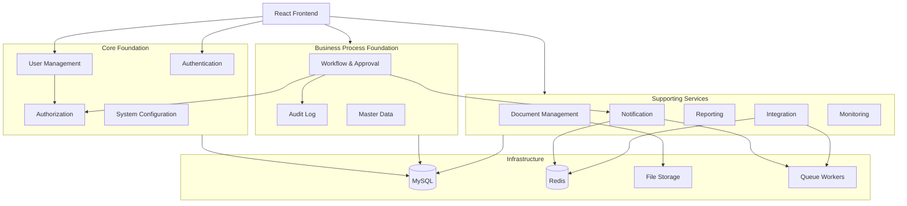
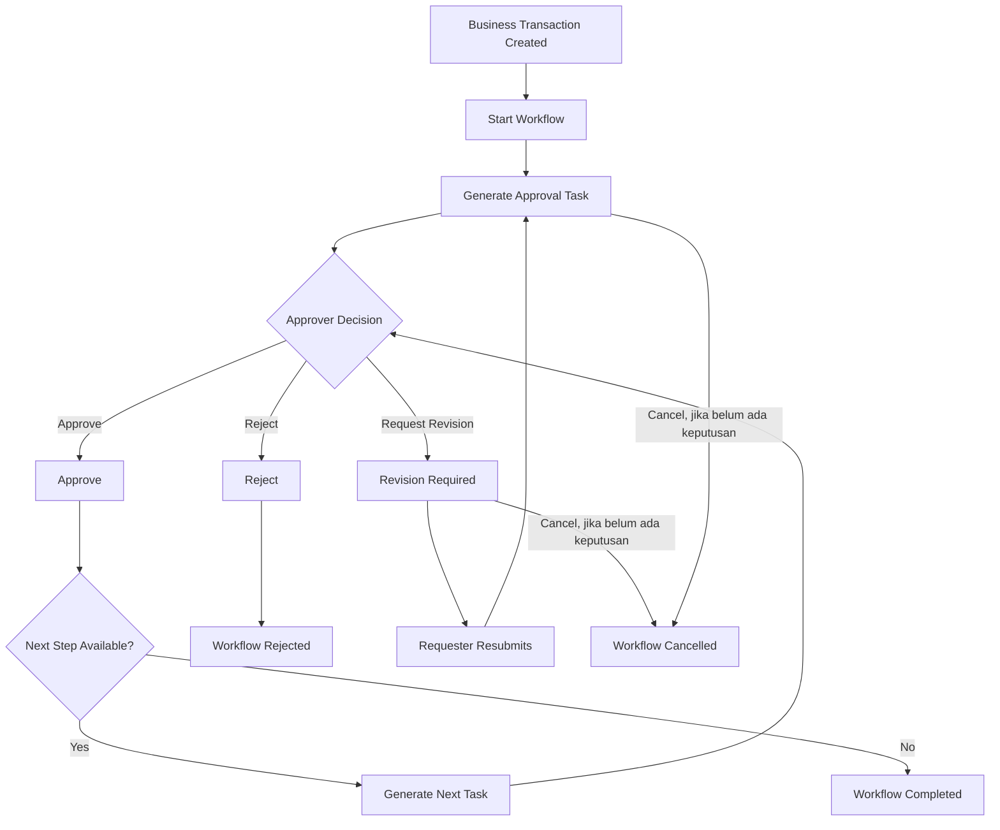

# MODULE_SPECIFICATION.md
## Enterprise System Starter Kit

**Document Type:** Technical Module Specification  
**Architecture:** Modular Monolith  
**Backend:** Laravel 13.x  
**Frontend:** React + TypeScript  
**Database:** MySQL 8.x  
**Cache & Queue:** Redis  
**API Architecture:** REST API  
**Status:** Draft – Foundation Specification

---

> **Base v1:** Cakupan implementasi awal dan bagian yang ditunda tercantum di `README.md`.

# 1. Introduction

## 1.1 Purpose

Dokumen ini mendefinisikan spesifikasi modul yang menjadi fondasi Enterprise System Starter Kit.

Setiap modul memiliki tanggung jawab, batasan, struktur, dependensi, dan kontrak komunikasi yang jelas.

Tujuannya adalah membangun sistem yang modular, reusable, maintainable, scalable, dan mudah dikembangkan oleh tim.

## 1.2 Objectives

1. Mendefinisikan tanggung jawab setiap modul.
2. Memisahkan business logic berdasarkan domain.
3. Menghindari ketergantungan antar-modul yang tidak terkontrol.
4. Menetapkan standar komunikasi antar-modul.
5. Menentukan struktur backend dan frontend.
6. Menetapkan standar API dan event.
7. Memudahkan penambahan modul bisnis baru.
8. Menjadi acuan pembagian task development.

## 1.3 Scope

Dokumen ini mencakup:

- Core Foundation Modules.
- Supporting Modules.
- Business Module Extension.
- Backend Module Structure.
- Frontend Module Structure.
- Module Dependencies.
- Inter-module Communication.
- Module API Contract.
- Module Security.
- Testing Strategy.

---

# 2. Module Architecture Overview

## 2.1 Architecture Concept

Sistem menggunakan pendekatan Modular Monolith.

Setiap modul memiliki tanggung jawab bisnis yang spesifik, tetapi seluruh modul berjalan dalam satu aplikasi Laravel dan satu deployment utama.

Prinsipnya:

- Setiap modul memiliki domain sendiri.
- Business logic tidak ditempatkan langsung di controller.
- Modul tidak boleh mengakses internal modul lain secara sembarangan.
- Komunikasi antar-modul menggunakan contract, service interface, atau event.
- Shared functionality ditempatkan pada Core atau Shared.
- Modul bisnis dapat ditambahkan tanpa mengubah fondasi sistem secara signifikan.

## 2.2 Module Classification

Modul dibagi menjadi tiga kategori.

| Category | Description |
|---|---|
| Core Modules | Fondasi utama sistem |
| Supporting Modules | Fitur pendukung lintas modul |
| Business Modules | Fitur khusus kebutuhan bisnis |

## 2.3 Module Overview

| No. | Module | Category | Priority |
|---|---|---|---|
| 1 | Authentication | Core | Critical |
| 2 | User Management | Core | Critical |
| 3 | Authorization | Core | Critical |
| 4 | System Configuration | Core | High |
| 5 | Workflow & Approval | Core | High |
| 6 | Audit Log | Core | High |
| 7 | Document Management | Supporting | High |
| 8 | Notification | Supporting | High |
| 9 | Master Data | Supporting | Medium |
| 10 | Reporting | Supporting | Medium |
| 11 | Integration | Supporting | Medium |
| 12 | Monitoring | Supporting | Medium |

Priority menunjukkan urutan implementasi yang disarankan, bukan tingkat kepentingan bisnis secara universal.

---

# 3. High-Level Module Architecture



---

# 4. Core Foundation Modules

## 4.1 Authentication Module

### Purpose

Mengelola proses autentikasi pengguna dan keamanan akses ke aplikasi.

### Responsibilities

- Login.
- Logout.
- Session management.
- Password management.
- Password reset.
- Email verification.
- Authentication token.
- Account activation.
- Account deactivation.
- Login history.
- Session revocation.

### Main Features

| Feature | Description |
|---|---|
| Login | Autentikasi menggunakan email atau username dan password, dengan opsi Ingat saya |
| Logout | Mengakhiri sesi pengguna |
| Forgot Password | Permintaan reset password |
| Reset Password | Mengubah password menggunakan token valid |
| Change Password | Mengubah password saat login |
| Email Verification | Memverifikasi alamat email |
| Session Management | Mengelola sesi aktif |
| Token Management | Mengelola personal access token |
| Account Status | Mengontrol status akun |

### Backend Components

| Component | Responsibility |
|---|---|
| AuthController | Menangani request autentikasi |
| LoginAction | Proses login |
| LogoutAction | Proses logout |
| PasswordResetAction | Reset password |
| ChangePasswordAction | Perubahan password |
| SessionService | Pengelolaan sesi |
| AuthRequest | Validasi request |
| AuthResource | Format response |

### Database

- users
- sessions
- password_reset_tokens
- personal_access_tokens

### Dependencies

- User Management
- Authorization
- Audit Log
- Notification

### API Endpoints

| Method | Endpoint | Description |
|---|---|---|
| POST | /login | Login SPA (session) |
| POST | /logout | Logout SPA |
| GET | /api/v1/auth/user | Current user |
| POST | /api/v1/auth/forgot-password | Forgot password |
| POST | /api/v1/auth/reset-password | Reset password |
| POST | /api/v1/auth/change-password | Change password |
| POST | /api/v1/auth/email/verification-notification | Resend email verification |
| GET | /api/v1/auth/email/verify/{id}/{hash} | Verify email |
| GET | /api/v1/auth/sessions | Active sessions |
| DELETE | /api/v1/auth/sessions/{id} | Revoke session |
| GET | /api/v1/auth/tokens | List API tokens |
| POST | /api/v1/auth/tokens | Create API token |
| DELETE | /api/v1/auth/tokens/{id} | Revoke API token |

### Business Rules

1. User nonaktif tidak dapat login.
2. Password wajib disimpan dalam bentuk hash.
3. Login gagal harus mengikuti kebijakan rate limiting.
4. Password reset token harus memiliki masa berlaku.
5. Logout harus mencabut atau mengakhiri sesi yang sesuai.
6. Aktivitas autentikasi penting harus dicatat.
7. Endpoint yang memerlukan autentikasi harus memvalidasi session atau token.

### Security Requirements

- Rate limiting.
- Secure password hashing.
- Session protection.
- CSRF protection untuk SPA cookie-based authentication.
- Token expiration dan revocation.
- Secure cookie configuration.
- Brute-force protection.

---

## 4.2 User Management Module

### Purpose

Mengelola informasi pengguna dan status akun dalam sistem.

### Responsibilities

- Create user.
- Update user.
- Delete atau deactivate user.
- User profile.
- User listing.
- User search.
- User status.
- Assign role.
- User import.

### Main Features

| Feature | Description |
|---|---|
| User Listing | Daftar pengguna |
| Create User | Membuat pengguna |
| Edit User | Mengubah informasi pengguna |
| User Profile | Informasi profil |
| User Status | Active / Inactive |
| Assign Role | Menetapkan role |
| Bulk Import | Import pengguna |
| User Detail | Detail pengguna |

### Backend Components

- UserController
- UserService
- CreateUserAction
- UpdateUserAction
- DeactivateUserAction
- AssignUserRoleAction
- UserRequest
- UserResource

### Database

- users
- model_has_roles
- model_has_permissions

### Dependencies

- Authentication
- Authorization
- Audit Log
- Notification

### API Endpoints

| Method | Endpoint | Description |
|---|---|---|
| GET | /api/v1/users | List users |
| POST | /api/v1/users | Create user |
| GET | /api/v1/users/{id} | User detail |
| PATCH | /api/v1/users/{id} | Update user |
| DELETE | /api/v1/users/{id} | Deactivate/delete user |
| GET | /api/v1/users/{id}/roles | User roles |
| PUT | /api/v1/users/{id}/roles | Assign roles |

### Business Rules

1. Email harus unik.
2. User yang sudah memiliki histori bisnis sebaiknya dinonaktifkan, bukan dihapus permanen.
3. Setiap perubahan role harus melalui validasi authorization.
4. User hanya dapat dikelola oleh pihak yang memiliki permission.

---

## 4.3 Authorization Module

### Purpose

Mengelola hak akses pengguna berdasarkan role dan permission.

### Authorization Strategy

Menggunakan kombinasi:

- Role-Based Access Control (RBAC).
- Laravel Policies.
- Laravel Gates.
- Scope data pengguna.
- Resource-level authorization.

### Main Features

| Feature | Description |
|---|---|
| Role Management | Pengelolaan role |
| Permission Management | Pengelolaan permission |
| Role Assignment | Penetapan role |
| Permission Assignment | Penetapan permission |
| Policy Authorization | Otorisasi resource |
| Access Control | Kontrol akses fitur |
| Menu Authorization | Filter menu frontend |

### Backend Components

- RoleController
- PermissionController
- RoleService
- PermissionService
- RolePolicy
- PermissionPolicy
- AuthorizationService

### Database

- roles
- permissions
- role_has_permissions
- model_has_roles
- model_has_permissions

### API Endpoints

| Method | Endpoint | Description |
|---|---|---|
| GET | /api/v1/roles | List roles |
| POST | /api/v1/roles | Create role |
| PATCH | /api/v1/roles/{id} | Update role |
| DELETE | /api/v1/roles/{id} | Delete role |
| GET | /api/v1/permissions | List permissions |
| GET | /api/v1/roles/{id}/permissions | Role permissions |
| PUT | /api/v1/roles/{id}/permissions | Assign permissions |

Permission milik user aktif dikembalikan oleh `GET /api/v1/auth/user`.

### Business Rules

1. Setiap permission memiliki format penamaan konsisten.
2. Permission diperiksa pada backend, bukan hanya frontend.
3. Frontend hanya menggunakan permission untuk mengatur tampilan.
4. Super Admin tidak boleh menjadi jalan pintas untuk melewati validasi keamanan pada resource sensitif.
5. Perubahan permission harus dicatat.
6. Role yang masih digunakan tidak boleh dihapus tanpa proses validasi.

### Permission Convention

```text
user.view
user.create
user.update
user.delete


workflow.view
workflow.approve
workflow.reject

document.view
document.upload
document.download
document.delete
```

---

## 4.4 System Configuration Module

### Purpose

Mengelola konfigurasi global aplikasi dan pengaturan sistem.

### Responsibilities

- Application settings.
- System preferences.
- Date and time configuration.
- Number formatting.
- Currency configuration.
- File upload configuration.
- Notification settings.
- Feature flags.
- System parameters.

### Main Features

| Feature | Description |
|---|---|
| General Settings | Pengaturan aplikasi |
| Localization | Bahasa dan format lokal |
| Timezone | Zona waktu |
| Currency | Mata uang |
| Number Format | Format angka |
| Feature Flags | Aktivasi fitur |
| Upload Settings | Pengaturan file |
| System Parameters | Parameter sistem |

### Backend Components

- SystemConfigurationController
- ConfigurationService
- UpdateConfigurationAction

### Database

- system_configurations

### API Endpoints

| Method | Endpoint | Description |
|---|---|---|
| GET | /api/v1/system-configurations | List configurations |
| GET | /api/v1/system-configurations/{key} | Configuration detail |
| PATCH | /api/v1/system-configurations/{key} | Update configuration |
| GET | /api/v1/system-configurations/public | Public configurations |
| GET | /api/v1/system-configurations/feature-flags | Feature flags |

### Business Rules

1. Hanya authorized user yang dapat mengubah konfigurasi.
2. Konfigurasi sensitif tidak boleh dikirim ke frontend.
3. Perubahan konfigurasi harus dicatat.
4. Konfigurasi harus memiliki default value yang aman.
5. Perubahan kritis dapat memerlukan approval.

---

# 5. Business Process Foundation Modules

## 5.1 Workflow & Approval Module

### Purpose

Menyediakan workflow engine yang dapat digunakan oleh berbagai modul bisnis.

Contoh penggunaan:

- Procurement approval.
- Purchase request approval.
- Document approval.
- Expense approval.
- Leave request approval.
- Budget approval.

### Responsibilities

- Workflow definition.
- Workflow versioning.
- Workflow step.
- Workflow instance.
- Approval task.
- Assignment.
- Delegation.
- Approval history.
- Workflow status.
- Escalation.

### Main Features

| Feature | Description |
|---|---|
| Workflow Builder | Definisi alur kerja |
| Workflow Versioning | Version control workflow |
| Approval Steps | Tahapan approval |
| Task Assignment | Penugasan approver |
| Approval | Persetujuan |
| Rejection | Penolakan |
| Revision | Pengembalian untuk diperbaiki dan pengajuan ulang |
| Cancellation | Pembatalan pengajuan |
| Delegation | Delegasi approval |
| Escalation | Eskalasi task |
| History | Histori proses |
| Workflow Monitoring | Monitoring workflow |

### Backend Components

- WorkflowController
- WorkflowDefinitionService
- WorkflowExecutionService
- WorkflowTaskService
- WorkflowTransitionService
- StartWorkflowAction
- ApproveWorkflowTaskAction
- RejectWorkflowTaskAction
- RequestWorkflowRevisionAction
- ResubmitWorkflowAction
- CancelWorkflowAction
- DelegateWorkflowTaskAction
- WorkflowPolicy

### Database

- workflow_definitions
- workflow_versions
- workflow_steps
- workflow_instances
- workflow_tasks
- workflow_history

### API Endpoints

| Method | Endpoint | Description |
|---|---|---|
| GET | /api/v1/workflows | List definitions |
| POST | /api/v1/workflows | Create definition |
| POST | /api/v1/workflows/{id}/versions | Create version |
| POST | /api/v1/workflows/{id}/publish | Publish version |
| POST | /api/v1/workflow-instances | Start workflow |
| GET | /api/v1/workflow-instances/{id} | Workflow detail |
| POST | /api/v1/workflow-instances/{id}/cancel | Cancel workflow |
| POST | /api/v1/workflow-instances/{id}/resubmit | Resubmit after revision |
| GET | /api/v1/workflow-tasks | Approval tasks milik user aktif |
| POST | /api/v1/workflow-tasks/{id}/approve | Approve task |
| POST | /api/v1/workflow-tasks/{id}/reject | Reject task |
| POST | /api/v1/workflow-tasks/{id}/request-revision | Request revision |
| POST | /api/v1/workflow-tasks/{id}/delegate | Delegate task |

### Business Rules

1. Workflow instance harus menggunakan published version.
2. Published version tidak dapat diubah secara langsung.
3. Approval hanya dapat dilakukan oleh user yang berwenang.
4. Workflow harus memiliki state transition yang valid.
5. Setiap tindakan approval harus dicatat.
6. Task tidak dapat diproses dua kali secara bersamaan.
7. Approval harus mendukung transaksi database dan concurrency control.
8. Requester dapat membatalkan instance miliknya selama belum ada task `approved` atau `rejected` pada pengajuan berjalan. Permintaan revisi tidak dihitung sebagai keputusan.
9. Super Admin dapat membatalkan instance yang masih aktif dengan alasan yang tercatat.
10. Approver yang ditugaskan dapat meminta revisi dengan alasan wajib.
11. Hanya requester yang dapat mengajukan ulang instance berstatus `revision_required`.
12. Pengajuan ulang menaikkan `submission_number`, memakai workflow version yang sama, dan memulai approval dari step pertama. Task lama tetap tersimpan sebagai histori.

### Workflow Status

| Entity | Allowed Status |
|---|---|
| workflow_versions | `draft`, `published`, `archived` |
| workflow_instances | `pending`, `in_progress`, `revision_required`, `completed`, `rejected`, `cancelled` |
| workflow_tasks | `pending`, `approved`, `rejected`, `revision_requested`, `delegated`, `cancelled` |

Status disimpan sebagai Enum per entitas. Sebuah instance menjadi `completed` setelah seluruh step disetujui.

### Workflow Flow



---

## 5.2 Audit Log Module

### Purpose

Mencatat aktivitas penting yang terjadi di dalam sistem untuk kebutuhan audit, monitoring, dan investigasi.

### Responsibilities

- User activity tracking.
- Data change tracking.
- Authentication activity.
- Approval activity.
- Configuration change.
- Security event.
- Audit history.

### Main Features

- Activity log listing.
- Activity detail.
- Filter by user.
- Filter by module.
- Filter by date.
- Filter by action.
- Export audit report.

### Backend Components

- AuditLogController
- AuditLogService
- AuditEventListener
- ActivityLogResource

### Database

- activity_log
- security_events

`activity_log` menggunakan migration bawaan Spatie Activitylog dengan konfigurasi yang disesuaikan.

### Business Rules

1. Aktivitas penting harus tercatat.
2. Password dan token tidak boleh disimpan dalam log.
3. Log hanya dapat diakses oleh user yang memiliki permission.
4. Log tidak boleh dapat dimodifikasi oleh user biasa.
5. Retensi log harus ditetapkan berdasarkan kebutuhan bisnis dan kepatuhan.

### Recommended Events

```text
user.created
user.updated
user.deactivated
user.role_assigned

auth.login
auth.logout
auth.login_failed
auth.password_changed

workflow.started
workflow.approved
workflow.rejected
workflow.revision_requested
workflow.resubmitted
workflow.cancelled

document.uploaded
document.version_created
document.deleted

system.configuration_updated
system.branding_updated
system.branding_removed
```

---

# 6. Supporting Modules

## 6.1 Document Management Module

### Purpose

Mengelola dokumen dan file yang digunakan oleh berbagai modul bisnis.

### Responsibilities

- Document upload.
- Document download.
- Document metadata.
- Document versioning.
- Document preview.
- File validation.
- Document access control.
- Document archival.

### Main Features

| Feature | Description |
|---|---|
| Upload | Upload file |
| Download | Download file |
| Preview | Preview dokumen |
| Versioning | Pengelolaan revisi |
| Metadata | Informasi dokumen |
| Access Control | Hak akses dokumen |
| Search | Pencarian dokumen |
| Archive | Pengarsipan |

### Backend Components

- DocumentController
- DocumentService
- DocumentVersionService
- UploadDocumentAction
- CreateDocumentVersionAction
- DownloadDocumentAction
- DocumentPolicy
- FileStorageService

### Database

- documents
- document_versions
- document_references

### Dependencies

- Authentication
- Authorization
- Audit Log
- Notification

### API Endpoints

| Method | Endpoint | Description |
|---|---|---|
| GET | /api/v1/documents | List documents |
| POST | /api/v1/documents | Upload document |
| GET | /api/v1/documents/{id} | Document detail |
| GET | /api/v1/documents/{id}/download | Download |
| GET | /api/v1/documents/{id}/versions | Version history |
| POST | /api/v1/documents/{id}/versions | Create version |
| DELETE | /api/v1/documents/{id} | Delete/archive |

### Business Rules

1. File harus divalidasi sebelum disimpan.
2. File disimpan menggunakan private storage.
3. Filename fisik harus menggunakan nama yang aman dan tidak bergantung pada filename dari user.
4. Setiap revisi menghasilkan document version baru.
5. File hanya dapat diakses oleh user yang memiliki permission.
6. File harus diperiksa menggunakan mekanisme malware scanning jika tersedia.
7. Download harus melalui authorized endpoint atau signed URL yang terbatas.

---

## 6.2 Notification Module

### Purpose

Menyediakan layanan notifikasi terpusat untuk seluruh modul aplikasi.

### Responsibilities

- In-app notification.
- Email notification.
- Workflow notification.
- System notification.
- Security notification.
- Notification delivery.
- Notification preferences.

### Main Features

- Notification inbox.
- Mark as read.
- Mark all as read.
- Notification preferences.
- Email delivery.
- Notification history.

### Backend Components

- NotificationController
- MarkNotificationAsReadAction
- MarkAllNotificationsAsReadAction
- NotificationPolicy
- NotificationServiceProvider

### Database

- notifications (tabel bawaan Laravel Database Notifications)
- notification_deliveries (ditunda sampai channel eksternal/email membutuhkan pelacakan per delivery)

### API Endpoints

| Method | Endpoint | Description |
|---|---|---|
| GET | /api/v1/notifications | List notifications |
| GET | /api/v1/notifications/unread-count | Unread count |
| PATCH | /api/v1/notifications/{id}/read | Mark as read |
| POST | /api/v1/notifications/read-all | Mark all as read |

Endpoint `/api/v1/notification-preferences` ditunda sampai ada channel lain selain in-app.

### Business Rules

1. Notification hanya dapat dilihat oleh penerima.
2. Email notification diproses secara asynchronous.
3. Kegagalan delivery harus dapat ditelusuri.
4. Pengiriman ulang harus mempertimbangkan idempotency.
5. User dapat mengatur preferensi channel sesuai kebijakan sistem.

---

## 6.3 Master Data Module

### Purpose

Mengelola data referensi yang digunakan oleh berbagai modul bisnis.

### Responsibilities

- Shared master data.
- Reference data.
- Category.
- Classification.
- Status reference.
- Unit of measurement.
- Country and region.
- Currency.
- Configurable lookup data.

### Main Features

- Master data listing.
- Master data creation.
- Master data update.
- Master data activation.
- Master data search.
- Master data import/export.

### Backend Components

- MasterDataController
- MasterDataService
- MasterDataRepository
- MasterDataImportAction

### Database

- master_categories
- master_data_items
- master_data_values

Struktur final dapat disesuaikan dengan jenis referensi. Jangan menggunakan satu tabel generik untuk seluruh master data jika setiap domain memiliki atribut dan aturan bisnis yang berbeda.

### Business Rules

1. Data master yang sudah digunakan dalam transaksi tidak boleh dihapus sembarangan.
2. Data master harus memiliki kode unik dalam scope yang ditetapkan.
3. Perubahan master data perlu dicatat.
4. Master data yang tidak aktif tidak boleh digunakan pada transaksi baru, kecuali ada aturan khusus.

---

## 6.4 Reporting Module

### Purpose

Menyediakan layanan laporan dan agregasi data dari berbagai modul bisnis.

### Responsibilities

- Dashboard data.
- Summary report.
- Detail report.
- Export Excel.
- Export PDF.
- Scheduled report.
- Report filtering.
- Report access control.

### Main Features

- Dashboard widgets.
- Report builder.
- Report filters.
- Export Excel.
- Export PDF.
- Scheduled report.

### Backend Components

- DashboardController
- ReportController
- ReportService
- ReportQueryService
- ReportExportService
- GenerateReportJob

### Dependencies

- Authorization
- Business Modules
- Document Management
- Queue

### Business Rules

1. Data laporan harus mengikuti permission user.
2. Data laporan harus mengikuti scope data.
3. Export berukuran besar harus diproses menggunakan queue.
4. Laporan harus memiliki filter periode dan parameter yang jelas.
5. Query reporting tidak boleh mengganggu transaksi operasional secara berlebihan.

---

## 6.5 Integration Module

### Purpose

Mengelola integrasi dengan sistem eksternal.

Contoh:

- ERP eksternal.
- Accounting system.
- Payment gateway.
- Email provider.
- HR system.
- Third-party API.

### Responsibilities

- API connection.
- Credential management.
- Request/response logging.
- Webhook handling.
- Retry mechanism.
- Integration monitoring.
- Data synchronization.

### Main Features

- Integration configuration.
- API connection.
- Webhook endpoint.
- Synchronization.
- Retry.
- Integration history.
- Error monitoring.

### Backend Components

- IntegrationController
- IntegrationService
- IntegrationConnectionService
- WebhookController
- IntegrationDispatcher
- IntegrationJob
- IntegrationLogService

### Database

- integration_connections
- integration_logs

### Business Rules

1. Credential harus dienkripsi.
2. Request harus memiliki timeout.
3. Retry harus menggunakan strategi yang terkontrol.
4. Integration log harus menyimpan informasi yang sudah disanitasi.
5. Webhook harus memvalidasi signature atau mekanisme autentikasi.
6. Operasi integrasi yang dapat diulang harus mendukung idempotency.

---

## 6.6 Monitoring Module

### Purpose

Menyediakan visibilitas terhadap kondisi aplikasi dan proses background.

### Responsibilities

- Application health.
- Database health.
- Queue monitoring.
- Failed jobs.
- Integration status.
- Error monitoring.
- Performance metrics.

### Main Features

- Health check.
- Queue status.
- Failed job monitoring.
- Error monitoring.
- Application metrics.
- System status dashboard.

### Backend Components

- HealthController
- MonitoringService
- QueueMonitoringService
- SystemMetricsService

### Infrastructure

- Laravel Health Checks.
- Redis monitoring.
- Application logging.
- Metrics and alerting tools.

### Business Rules

1. Health endpoint publik hanya menampilkan informasi minimum.
2. Informasi infrastruktur sensitif tidak boleh terekspos ke publik.
3. Monitoring endpoint internal harus dilindungi.
4. Alert harus memiliki threshold dan mekanisme eskalasi.

---

# 7. Module Dependency Matrix

Matriks berikut menggambarkan dependensi konseptual antar-modul.

| Module | Auth | User | Authz | Dept | Workflow | Audit | Document | Notification |
|---|---|---|---|---|---|---|---|---|
| Authentication | - | Yes | Yes | No | No | Yes | No | Yes |
| User Management | Yes | - | Yes | Yes | No | Yes | No | Yes |
| Authorization | Yes | Yes | - | Optional | No | Yes | No | No |
| Workflow | Yes | Yes | Yes | Yes | - | Yes | Optional | Yes |
| Audit Log | Yes | Yes | Yes | Optional | Optional | - | No | No |
| Document | Yes | Yes | Yes | Optional | Optional | Yes | - | Optional |
| Notification | Yes | Yes | No | No | Optional | Optional | Optional | - |

`Yes` menunjukkan dependensi yang umum diperlukan. `Optional` menunjukkan integrasi berdasarkan kebutuhan. Matriks ini bukan izin untuk mengakses tabel internal modul lain secara langsung.

---

# 8. Inter-Module Communication

## 8.1 Communication Principles

Komunikasi antar-modul harus menggunakan pendekatan yang terkontrol.

Terdapat tiga pola komunikasi utama.

| Method | Usage |
|---|---|
| Direct Service Contract | Operasi yang membutuhkan hasil langsung |
| Domain Event | Memberi informasi bahwa sesuatu telah terjadi |
| Queue Job | Proses asynchronous dan pekerjaan berat |

## 8.2 Direct Service Contract

Digunakan saat modul membutuhkan hasil langsung dari modul lain.

Contoh:

Procurement Module membutuhkan Document Management untuk melampirkan dokumen.

```php
interface DocumentServiceInterface
{
    public function attachToBusiness(
        string $documentUuid,
        string $referenceType,
        int $referenceId
    ): void;
}
```

Implementasi interface berada di Document Module.

## 8.3 Domain Events

Digunakan ketika sebuah modul perlu mengumumkan perubahan yang dapat dimanfaatkan modul lain.

Contoh event:

```text
UserCreated
UserDeactivated
WorkflowStarted
WorkflowApproved
WorkflowRejected
WorkflowRevisionRequested
WorkflowResubmitted
WorkflowCancelled
DocumentUploaded
DocumentVersionCreated
```

Contoh:

```php
final class WorkflowApproved
{
    public function __construct(
        public readonly int $workflowInstanceId,
        public readonly int $approvedBy,
    ) {}
}
```

Event listener dapat digunakan untuk:

- Mengirim notifikasi.
- Membuat audit activity.
- Memperbarui status transaksi bisnis.
- Menjalankan proses lanjutan.

## 8.4 Queue Jobs

Gunakan queue untuk pekerjaan yang tidak harus selesai dalam request HTTP.

Contoh:

- Email delivery.
- Excel export.
- Document processing.
- Integration synchronization.
- Scheduled report.
- Bulk import.

## 8.5 Communication Rules

1. Hindari pemanggilan controller modul lain.
2. Hindari query langsung ke model internal modul lain.
3. Gunakan interface atau contract yang terdokumentasi.
4. Gunakan event untuk komunikasi yang tidak membutuhkan hasil langsung.
5. Gunakan queue untuk proses asynchronous.
6. Hindari circular dependency.
7. Operasi yang mengubah beberapa domain harus memiliki batas transaksi yang jelas.

---

# 9. Backend Module Folder Structure

Struktur direktori backend yang direkomendasikan:

```text
app/
├── Core/
│   ├── Authentication/
│   ├── Authorization/
│   ├── Security/
│   ├── Audit/
│   ├── Exceptions/
│   └── Logging/
│
├── Modules/
│   ├── UserManagement/
│   │   ├── Contracts/
│   │   ├── Controllers/
│   │   ├── Actions/
│   │   ├── Services/
│   │   ├── Models/
│   │   ├── Requests/
│   │   ├── Resources/
│   │   ├── Policies/
│   │   ├── Events/
│   │   ├── Listeners/
│   │   ├── Jobs/
│   │   └── Routes/
│   │
│   ├── Workflow/
│   ├── Document/
│   ├── Notification/
│   ├── MasterData/
│   ├── Reporting/
│   ├── Integration/
│   ├── Monitoring/
│   └── SystemConfiguration/
│
└── Shared/
    ├── Contracts/
    ├── DTOs/
    ├── Enums/
    ├── Exceptions/
    ├── Helpers/
    └── Traits/
```

Setiap modul tidak wajib memiliki seluruh folder. Tambahkan hanya ketika diperlukan.

## 9.1 Recommended Module Structure

Contoh struktur Workflow:

```text
Workflow/
├── Contracts/
│   ├── WorkflowServiceInterface.php
│   └── WorkflowRepositoryInterface.php
├── Controllers/
│   └── WorkflowController.php
├── Actions/
│   ├── StartWorkflowAction.php
│   ├── ApproveWorkflowTaskAction.php
│   └── RejectWorkflowTaskAction.php
├── Services/
│   ├── WorkflowExecutionService.php
│   └── WorkflowTransitionService.php
├── Models/
│   ├── WorkflowDefinition.php
│   ├── WorkflowVersion.php
│   ├── WorkflowInstance.php
│   ├── WorkflowStep.php
│   └── WorkflowTask.php
├── Requests/
├── Resources/
├── Policies/
├── Events/
├── Listeners/
├── Jobs/
├── Enums/
├── Exceptions/
└── Routes/
    └── api.php
```

---

# 10. Frontend Module Structure

Frontend menggunakan feature-based architecture.

## 10.1 Directory Structure

```text
src/
├── app/
│   ├── router/
│   ├── providers/
│   └── guards/
│
├── components/
│   ├── ui/
│   ├── shared/
│   └── layouts/
│
├── features/
│   ├── authentication/
│   │   ├── services/
│   │   ├── components/
│   │   ├── hooks/
│   │   ├── pages/
│   │   ├── schemas/
│   │   └── types/
│   │
│   ├── users/
│   ├── roles/
│   ├── permissions/
│   ├── workflows/
│   ├── documents/
│   ├── notifications/
│   ├── reports/
│   ├── settings/
│   └── dashboard/
│
├── hooks/
├── lib/
├── services/
├── stores/
├── types/
└── utils/
```

## 10.2 Frontend Module Responsibilities

| Layer | Responsibility |
|---|---|
| Pages | Page-level composition |
| Components | Reusable UI |
| Feature Services | HTTP communication |
| Hooks | Feature-level reusable logic |
| Schemas | Zod validation |
| Types | TypeScript types |
| Stores | Client-side global state |
| Shared Services | Shared application services |

## 10.3 Frontend Rules

1. Setiap feature memiliki folder sendiri.
2. Komponen UI umum ditempatkan di `components/ui`.
3. Business-specific components tetap berada dalam feature masing-masing.
4. Server state menggunakan TanStack Query.
5. Client state menggunakan Zustand bila memang diperlukan.
6. Form validation menggunakan React Hook Form dan Zod.
7. API request melalui Axios instance terpusat.
8. Authorization UI berdasarkan permission dari backend.
9. Hindari duplikasi business logic antara frontend dan backend.
10. Jangan menyimpan credential atau secret di frontend.

---

# 11. API Module Standards

## 11.1 API Versioning

Format:

```text
/api/v1/{resource}
```

Contoh:

```text
/api/v1/users
/api/v1/workflows
/api/v1/documents
/api/v1/notifications
```

`API_SPECIFICATION.md` adalah sumber kebenaran untuk seluruh endpoint, field, dan permission. Tabel endpoint pada dokumen ini hanya ringkasan per modul.

## 11.2 Response Format

Success response:

```json
{
  "success": true,
  "message": "Data retrieved successfully",
  "data": {
    "id": "01932f5e-1234-7000-8000-123456789abc",
    "name": "Example"
  },
  "meta": null
}
```

Error response:

```json
{
  "success": false,
  "message": "Validation failed",
  "code": "VALIDATION_FAILED",
  "data": null,
  "errors": {
    "email": [
      "The email field is required."
    ]
  },
  "meta": null
}
```

## 11.3 HTTP Status Code

| Status | Usage |
|---|---|
| 200 | Successful request |
| 201 | Resource created |
| 204 | Successful request without response body |
| 400 | Bad request |
| 401 | Unauthenticated |
| 403 | Forbidden |
| 404 | Resource not found |
| 409 | Conflict |
| 422 | Validation error |
| 429 | Too many requests |
| 500 | Internal server error |

---

# 12. Module Security Standards

Setiap modul harus menerapkan security controls yang relevan.

| Security Control | Implementation |
|---|---|
| Authentication | Laravel Sanctum |
| Authorization | Spatie Permission + Laravel Policies |
| Input Validation | Form Request + Zod |
| SQL Injection Prevention | Eloquent / parameterized queries |
| XSS Prevention | Output encoding and safe rendering |
| CSRF | Laravel CSRF protection for cookie-based SPA |
| Rate Limiting | Laravel Rate Limiter |
| File Security | MIME validation, private storage, scanning |
| Audit | Spatie Activitylog |
| Secret Management | Encrypted configuration / secret manager |
| Data Access | Resource scope |

Security verification menggunakan OWASP ASVS Level 2 sebagai target baseline, dengan penyesuaian berdasarkan risiko setiap modul.

---

# 13. Module Testing Strategy

Setiap modul wajib memiliki pengujian sesuai tanggung jawabnya.

## 13.1 Testing Types

| Test Type | Purpose |
|---|---|
| Unit Test | Menguji business logic |
| Feature Test | Menguji endpoint dan application flow |
| Integration Test | Menguji interaksi antar-modul |
| Authorization Test | Menguji permission |
| Database Test | Menguji relasi dan constraint |
| API Contract Test | Memastikan response sesuai kontrak |
| Performance Test | Menguji performa pada skenario penting |

## 13.2 Testing Requirements

Contoh Workflow Module:

- Workflow definition dapat dibuat.
- Workflow version dapat dipublikasikan.
- Workflow instance menggunakan versi yang benar.
- Task dibuat sesuai workflow step.
- User tanpa permission tidak dapat melakukan approval.
- Approval menghasilkan history.
- Concurrent approval tidak memproses task dua kali.
- Workflow rejection menghasilkan status yang konsisten.

## 13.3 Definition of Done

Sebuah modul dianggap selesai apabila:

- Business requirement terpenuhi.
- API terdokumentasi.
- Database migration tersedia.
- Authorization diterapkan.
- Unit dan feature tests lulus.
- Error handling tersedia.
- Activity logging diterapkan untuk aktivitas penting.
- Tidak ada critical security finding yang belum ditangani.
- Dokumentasi modul diperbarui.

---

# 14. Business Module Extension

Foundation harus dapat digunakan oleh modul bisnis tambahan tanpa mengubah seluruh core system.

## 14.1 Recommended Business Modules

| Module | Responsibilities |
|---|---|
| Procurement | Purchase Request, RFQ, Quotation, PO |
| Inventory | Stock, Warehouse, Stock Movement |
| Finance | Payment, Expense, Budget, Accounting |
| HRM | Employee, Attendance, Payroll |
| Manufacturing | Production, BOM, Work Order |
| Quality | Inspection, NCR, Quality Control |
| Sales | Customer, Sales Order, Invoice |
| Asset Management | Asset, Maintenance, Depreciation |

## 14.2 Example: Procurement Module

Procurement menggunakan foundation modules sebagai berikut:

| Foundation Module | Procurement Usage |
|---|---|
| Authentication | User login |
| User Management | Requester and purchaser |
| Authorization | Procurement permissions |
| Workflow | PR and PO approval |
| Document | Quotation and attachment |
| Notification | Approval notification |
| Audit Log | Procurement activity |
| Reporting | Procurement dashboard |
| Integration | ERP and accounting integration |

Contoh struktur:

```text
app/Modules/Procurement/
├── Contracts/
├── Controllers/
├── Actions/
│   ├── CreatePurchaseRequestAction.php
│   ├── SubmitPurchaseRequestAction.php
│   └── CancelPurchaseRequestAction.php
├── Services/
├── Models/
├── Requests/
├── Resources/
├── Policies/
├── Events/
├── Listeners/
├── Jobs/
├── Enums/
└── Routes/
```

Procurement memiliki tabel bisnis sendiri. Approval tetap menggunakan Workflow Module dan file lampiran tetap menggunakan Document Management Module.

## 14.3 Business Module Rules

1. Modul bisnis tidak boleh menyimpan ulang data user, role, atau permission.
2. Modul bisnis harus menggunakan foundation service yang tersedia.
3. Modul bisnis memiliki ownership atas tabel dan business logic sendiri.
4. Workflow dipanggil melalui contract yang disepakati.
5. Audit aktivitas bisnis harus menggunakan mekanisme audit terpusat.
6. Modul bisnis tidak boleh bergantung pada controller modul lain.
7. Setiap modul harus memiliki API contract dan test sendiri.

---

# 15. Module Implementation Roadmap

## Phase 1 – Core Foundation

| No. | Module | Deliverable |
|---|---|---|
| 1 | Authentication | Login, logout, session |
| 2 | User Management | User CRUD |
| 3 | Authorization | Role and permission |
| 4 | System Configuration | Application settings |
| 5 | Audit Log | Centralized activity history |
| 6 | In-App Notification | Notification inbox, unread count, mark as read, async event listener |

## Phase 2 – Business Process Foundation

Dibangun saat modul bisnis pertama membutuhkannya.

| No. | Module | Deliverable |
|---|---|---|
| 1 | Notification Extensions | Email channel, delivery tracking, user preferences |
| 2 | Document | Upload, private storage, download authorization |
| 3 | Workflow | Sequential approval, definition via seeder |

## Phase 3 – Supporting Services

Dibangun berdasarkan kebutuhan nyata.

| No. | Module | Deliverable |
|---|---|---|
| 1 | Master Data | Shared reference data |
| 2 | Reporting | Dashboard and report |
| 3 | Integration | External API connection |
| 4 | Monitoring | Queue monitoring and metrics |
| 5 | Workflow Extensions | Versioning UI, delegation, escalation |
| 6 | Document Extensions | Versioning and preview |

## Phase 4 – Business Applications

Implementasikan modul bisnis berdasarkan kebutuhan aplikasi:

- Procurement.
- Inventory.
- Finance.
- HRM.
- Manufacturing.
- Quality Management.
- Sales.
- Asset Management.

---

# 16. Module Governance

Untuk menjaga konsistensi pengembangan, setiap modul wajib mengikuti aturan governance.

## 16.1 Module Ownership

Setiap modul harus memiliki:

- Module owner.
- Technical owner.
- Database ownership.
- API contract.
- Business rules.
- Testing responsibility.
- Documentation.

## 16.2 Change Management

Perubahan pada modul harus mempertimbangkan:

1. Dampak terhadap modul lain.
2. Dampak terhadap API contract.
3. Dampak terhadap database.
4. Dampak terhadap permission.
5. Dampak terhadap workflow.
6. Dampak terhadap integrasi.
7. Dampak terhadap backward compatibility.

## 16.3 Architecture Decision

Keputusan arsitektur yang berdampak lintas modul harus dicatat dalam Architecture Decision Record (ADR).

Contoh:

- ADR-011: Module Communication Standard.
- ADR-012: Module Database Ownership.
- ADR-013: Workflow Integration Contract.
- ADR-014: Event and Queue Strategy.

---

# 17. Recommended Next Documents

Setelah Module Specification, dokumen berikutnya yang direkomendasikan:

| Document | Purpose |
|---|---|
| API_SPECIFICATION.md | Definisi API contract seluruh modul |
| AUTHORIZATION_MATRIX.md | Role dan permission matrix |
| WORKFLOW_ENGINE.md | Detail workflow engine |
| DEVELOPMENT_GUIDELINE.md | Coding standard backend dan frontend |
| SECURITY_SPECIFICATION.md | Detail implementasi security |
| MODULE_TEMPLATE.md | Template pembuatan modul baru |
| TESTING_STRATEGY.md | Strategi testing keseluruhan sistem |

---

# 18. Conclusion

Module Specification menjadi pedoman utama untuk menjaga agar Enterprise System Starter Kit tetap modular dan konsisten.

Setiap modul memiliki tanggung jawab yang jelas, ownership atas business logic, database, API, dan testing.

Dengan pendekatan Modular Monolith, sistem dapat dikembangkan secara bertahap tanpa harus langsung menerapkan kompleksitas microservices.

Foundation yang stabil memungkinkan penambahan berbagai aplikasi bisnis seperti Procurement, ERP, Inventory, HRM, dan Manufacturing menggunakan standar arsitektur yang sama.