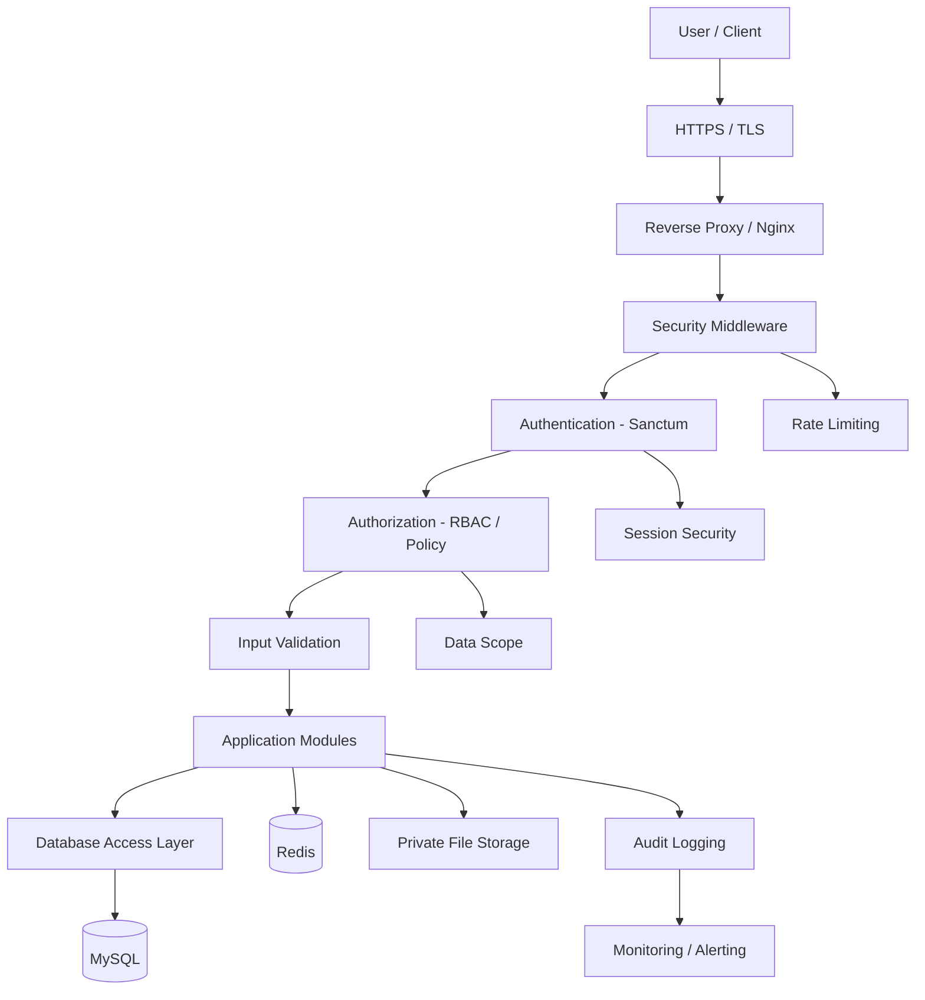
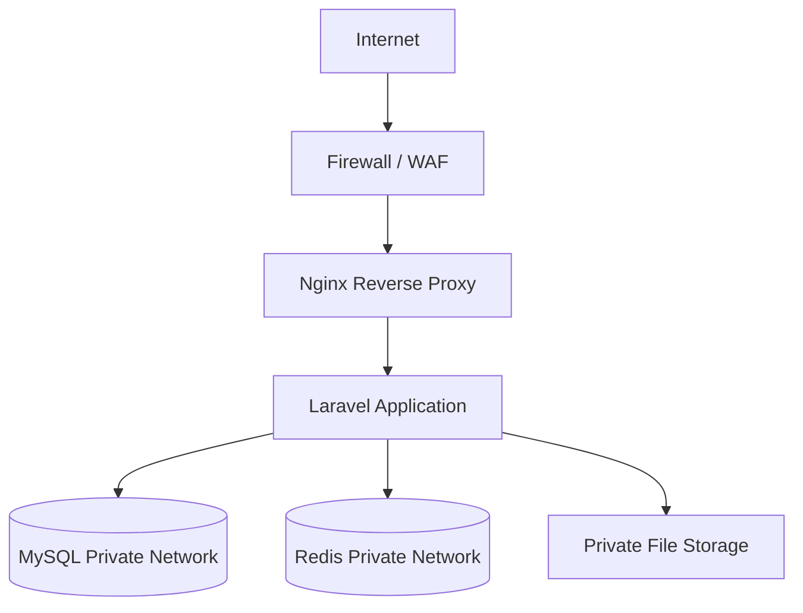
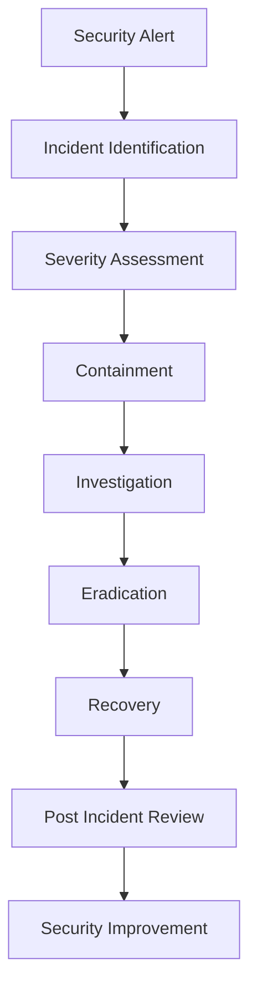

# SECURITY_SPECIFICATION.md

# Enterprise System Starter Kit
## Security Specification

**Document Type:** Technical Security Specification  
**Architecture:** Modular Monolith  
**Backend:** Laravel 13.x / PHP 8.4.x  
**Frontend:** React + TypeScript  
**Database:** MySQL 8.x  
**Cache & Queue:** Redis  
**Authentication:** Laravel Sanctum  
**Authorization:** Spatie Permission + Laravel Policies  
**Audit Logging:** Spatie Activitylog  
**Deployment:** Docker  
**Security Standard:** OWASP ASVS 5.0.0 Level 2  
**Risk Reference:** OWASP Top 10:2025

---

> **Base v1:** Cakupan implementasi awal dan bagian yang ditunda tercantum di `README.md`.

# 1. Introduction

## 1.1 Purpose

Dokumen ini mendefinisikan spesifikasi keamanan untuk Enterprise System Starter Kit.

Tujuannya adalah memastikan seluruh komponen sistem memiliki kontrol keamanan yang konsisten, mulai dari authentication, authorization, data protection, API security, hingga infrastructure security.

Security harus menjadi bagian dari proses perancangan, development, testing, deployment, dan maintenance.

## 1.2 Security Objectives

Tujuan keamanan sistem:

| Objective | Description |
|---|---|
| Confidentiality | Mencegah akses data oleh pihak yang tidak berwenang |
| Integrity | Menjaga data dari perubahan yang tidak sah |
| Availability | Menjaga sistem tetap tersedia |
| Authentication | Memastikan identitas pengguna |
| Authorization | Membatasi akses berdasarkan permission |
| Accountability | Memastikan aktivitas penting dapat ditelusuri |
| Privacy | Melindungi informasi pribadi dan sensitif |
| Resilience | Memastikan sistem mampu menghadapi gangguan dan serangan |

## 1.3 Security Scope

Security specification mencakup:

1. Authentication and session management.
2. Authorization and access control.
3. Scope data pengguna.
4. Password and credential security.
5. API security.
6. Input validation and output encoding.
7. Database security.
8. File upload and document security.
9. Encryption and data protection.
10. Audit logging and monitoring.
11. Application security.
12. Infrastructure and deployment security.
13. Backup and disaster recovery.
14. Security testing.
15. Incident response.

---

# 2. Security Standards & References

## 2.1 Security References

| Standard | Usage |
|---|---|
| OWASP ASVS 5.0.0 | Application security verification |
| OWASP Top 10:2025 | Application security risk reference |
| OWASP Cheat Sheet Series | Secure implementation guidance |
| ISO/IEC 27001:2022 | Information security management reference |
| ISO/IEC 27701 | Privacy information management reference, if applicable |

OWASP ASVS Level 2 menjadi baseline verifikasi teknis. Pemenuhan ASVS harus dibuktikan melalui pengujian dan evidence, bukan hanya penggunaan framework atau library tertentu.

## 2.2 OWASP Top 10:2025 Mapping

| Risk | Security Control |
|---|---|
| A01 Broken Access Control | RBAC, Policies, data scope |
| A02 Security Misconfiguration | Secure configuration, environment separation |
| A03 Software Supply Chain Failures | Dependency scanning, package verification |
| A04 Cryptographic Failures | Encryption, secure key management |
| A05 Injection | Parameter binding, validation, output encoding |
| A06 Insecure Design | Threat modeling, secure architecture |
| A07 Authentication Failures | Sanctum, session security, MFA readiness |
| A08 Software or Data Integrity Failures | CI/CD protection, signed artifacts where appropriate |
| A09 Security Logging and Alerting Failures | Audit trail, monitoring, security alerts |
| A10 Mishandling of Exceptional Conditions | Safe error handling, fail-secure behavior |

Referensi resmi:

- OWASP ASVS: https://asvs.owasp.org/
- OWASP Top 10: https://owasp.org/Top10/

---

# 3. Security Architecture

## 3.1 Security Architecture Overview

Security diterapkan pada setiap lapisan sistem.



## 3.2 Security Principles

Sistem wajib menerapkan:

- Defense in Depth.
- Least Privilege.
- Deny by Default.
- Secure by Default.
- Separation of Duties.
- Fail Securely.
- Input Validation.
- Secure Session Management.
- Complete Mediation.
- Auditability.

## 3.3 Trust Boundaries

Trust boundary harus ditentukan secara eksplisit.

| Boundary | Trust Level | Control |
|---|---|---|
| Browser Client | Untrusted | Validation, authentication, authorization |
| Reverse Proxy | Controlled Infrastructure | TLS, request filtering |
| Laravel Application | Trusted execution environment | Middleware, policies, validation |
| MySQL | Restricted Infrastructure | Database credentials, network isolation |
| Redis | Restricted Infrastructure | Authentication, private network |
| File Storage | Restricted Infrastructure | Private access, authorization |
| External API | Untrusted Integration | Authentication, timeout, validation |

Semua data yang berasal dari client atau external integration harus dianggap tidak tepercaya sampai divalidasi.

---

# 4. Authentication Security

## 4.1 Authentication Mechanism

Gunakan Laravel Sanctum sebagai authentication mechanism.

Terdapat dua skenario:

**A. First-party SPA Authentication**

Untuk React SPA yang berkomunikasi dengan Laravel:

- Gunakan session-based authentication.
- Gunakan secure cookie.
- Terapkan CSRF protection.
- Konfigurasikan stateful domains.
- Gunakan HTTPS.
- Jangan menyimpan session credential dalam localStorage.

**B. External API Authentication**

Untuk external client:

- Gunakan Sanctum personal access token.
- Gunakan Bearer token melalui HTTPS.
- Batasi token berdasarkan abilities.
- Terapkan expiry policy.
- Sediakan mekanisme revocation.
- Jangan memberikan token dengan permission berlebihan.

## 4.2 Login Security

Login harus menerapkan:

- Email validation.
- Password verification.
- Rate limiting.
- Generic authentication error message.
- Account status validation.
- Session regeneration setelah login.
- Security event logging.

Contoh:

```php
Route::post('/login', [AuthenticatedSessionController::class, 'store'])
    ->middleware('throttle:login');
```

Rate limiter harus dikonfigurasi dengan batas yang mempertimbangkan risiko brute force dan potensi denial of service.

Jangan mengungkapkan apakah email tertentu terdaftar melalui pesan error login.

## 4.3 Password Policy

Password harus memenuhi kebijakan berikut:

- Disimpan menggunakan secure password hashing.
- Tidak pernah disimpan dalam plain text.
- Tidak pernah dikirim melalui log.
- Tidak dapat dibaca kembali oleh administrator.
- Memiliki mekanisme reset password yang aman.
- Tidak boleh menggunakan password default yang sama untuk seluruh user.

Rekomendasi kebijakan:

| Policy | Requirement |
|---|---|
| Minimum Length | Minimal 12 karakter untuk password biasa |
| Hashing | Argon2id (`HASH_DRIVER=argon2id`) |
| Password Reset | Menggunakan token sekali pakai |
| Reset Expiry | Memiliki masa berlaku |
| Password Reuse | Pertimbangkan histori password sesuai kebutuhan risiko |
| Compromised Password | Tolak password yang diketahui telah bocor |
| MFA | Diwajibkan untuk akun privileged jika memungkinkan |

Password policy harus mempertimbangkan keseimbangan keamanan dan usability. Jangan mewajibkan aturan kompleksitas yang tidak memberikan manfaat nyata apabila panjang password dan pemeriksaan password bocor sudah diterapkan.

## 4.4 Multi-Factor Authentication

MFA direkomendasikan untuk:

- System Administrator.
- Super Administrator.
- Finance Administrator.
- User dengan akses data sensitif.
- External access yang memiliki risiko tinggi.

Metode yang dapat dipertimbangkan:

- TOTP authenticator.
- Passkey / WebAuthn.
- Hardware security key.

MFA harus memiliki:

- Enrollment verification.
- Recovery mechanism.
- Device management.
- Rate limiting.
- Recovery code yang aman.

## 4.5 Session Management

Session security harus menerapkan:

| Setting | Requirement |
|---|---|
| Secure Cookie | Enabled pada production HTTPS |
| HttpOnly | Enabled |
| SameSite | Sesuai kebutuhan deployment dan CSRF |
| Session Regeneration | Setelah login dan perubahan privilege |
| Session Expiry | Mengikuti kebijakan inactivity dan absolute timeout |
| Remember Me | Opsional per login, berlaku 30 hari, token dirotasi saat logout, ubah password, reset password, dan penonaktifan akun |
| Logout | Invalidasi session |
| Password Reset | Kebijakan invalidasi session aktif |
| Privileged Session | Timeout lebih ketat jika diperlukan |

Contoh konfigurasi cookie production:

```env
SESSION_SECURE_COOKIE=true
SESSION_HTTP_ONLY=true
SESSION_SAME_SITE=lax
```

Nilai `SameSite` dan domain cookie harus disesuaikan dengan topologi deployment SPA dan API.

---

# 5. Authorization & Access Control

## 5.1 Authorization Architecture

Gunakan kombinasi:

- Spatie Permission untuk Role-Based Access Control.
- Laravel Policy untuk resource-level authorization.
- Laravel Gate untuk authorization berbasis kemampuan.

Authorization harus diperiksa di backend untuk setiap operasi yang dilindungi.

## 5.2 Role-Based Access Control

Contoh role:

| Role | Description |
|---|---|
| Super Admin | Pengelolaan platform |
| System Admin | Konfigurasi dan operasional sistem |
| Admin | Pengelolaan user |
| Manager | Pengelolaan dan approval |
| Supervisor | Operasional dan approval tertentu |
| Staff | Operasional sesuai permission |
| Viewer | Read-only access |

Definisi dan hak akses role mengikuti `AUTHORIZATION_MATRIX.md`.

## 5.3 Permission Convention

Format permission:

```text
{resource}.{action}
```

Contoh:

```text
user.view
user.create
user.update
user.delete


workflow.submit
workflow.approve
workflow.reject

document.view
document.upload
document.download
document.delete
```

Permission harus menggunakan naming convention yang konsisten.

## 5.4 Laravel Policy

Contoh:

```php
class UserPolicy
{
    public function view(User $user, User $target): bool
    {
        return $user->can('user.view')
            && app(UserAccessService::class)
                ->canAccessUser($user, $target);
    }
}
```

Policy harus mempertimbangkan:

- Permission.
- Ownership.
- Resource status.
- Business rule.
- Separation of duties.

## 5.5 Privilege Escalation Prevention

Sistem harus mencegah:

- User mengubah role sendiri tanpa izin.
- User memberikan permission kepada dirinya sendiri.
- User mengubah ownership resource.
- User mengakses endpoint administrator.
- User memanipulasi request untuk mendapatkan privilege.
- User mengubah field internal yang tidak diizinkan.

Gunakan explicit allowlist untuk field yang dapat diubah.

---

# 6. API Security

## 6.1 HTTPS Enforcement

Seluruh komunikasi production wajib menggunakan HTTPS.

Ketentuan:

- Redirect HTTP ke HTTPS.
- TLS configuration mengikuti standar modern.
- HSTS diterapkan setelah konfigurasi HTTPS tervalidasi.
- Secure cookie diaktifkan.
- Sensitive data tidak boleh dikirim melalui URL query parameter.

## 6.2 CORS Configuration

Frontend dan API berada pada satu domain, sehingga production tidak memerlukan CORS. Konfigurasi berikut berlaku jika API dibuka untuk origin lain.

CORS harus membatasi origin yang diizinkan.

Contoh:

```php
'allowed_origins' => [
    'https://app.example.com',
],

'allowed_methods' => [
    'GET',
    'POST',
    'PUT',
    'PATCH',
    'DELETE',
],

'allowed_headers' => [
    'Accept',
    'Authorization',
    'Content-Type',
    'X-XSRF-TOKEN',
    'X-Requested-With',
    'Idempotency-Key',
],

'supports_credentials' => true,
```

Ketentuan:

- Jangan menggunakan wildcard origin untuk credentialed SPA.
- Batasi method dan header.
- Pisahkan konfigurasi development dan production.
- CORS bukan pengganti authentication atau authorization.

## 6.3 Rate Limiting

Rate limiting diterapkan pada endpoint berisiko.

| Endpoint | Protection |
|---|---|
| Login | Strict rate limit |
| Password Reset | Strict rate limit |
| OTP / MFA | Strict rate limit |
| Public API | Client-based limit |
| Search | Request throttling |
| File Upload | Request and size limits |
| Export | Concurrency and quota control |

Rate limit sebaiknya mempertimbangkan user, IP, token, dan resource sesuai karakteristik endpoint.

## 6.4 API Input Validation

Setiap API request harus:

- Menggunakan Form Request.
- Memvalidasi tipe data.
- Memvalidasi panjang input.
- Memvalidasi relasi database.
- Memvalidasi business rule.
- Membatasi field yang dapat diterima.
- Menghindari mass assignment.

Contoh:

```php
protected $fillable = [
    'name',
    'email',
];
```

Jangan menerima field internal seperti `is_admin` atau `created_by` tanpa aturan authorization dan validasi yang sesuai.

## 6.5 SQL Injection Prevention

Gunakan Eloquent atau parameterized query.

Benar:

```php
User::where('email', $email)->first();
```

Benar:

```php
DB::select(
    'SELECT * FROM users WHERE email = ?',
    [$email]
);
```

Hindari:

```php
DB::select(
    "SELECT * FROM users WHERE email = '$email'"
);
```

Untuk dynamic sorting dan filtering, gunakan whitelist kolom.

## 6.6 API Response Security

Response API tidak boleh mengekspos:

- Password hash.
- Access token.
- Internal secret.
- Sensitive personal information.
- Internal database structure.
- Debug stack trace.
- Server filesystem path.

Gunakan Laravel API Resource untuk mengontrol field yang diekspos.

---

# 7. Input Validation & Output Encoding

## 7.1 Input Validation

Semua input harus dianggap tidak tepercaya.

Validasi diterapkan pada:

- Form input.
- API request.
- Query parameters.
- File upload.
- External integration.
- Import data.
- Background job payload.

Validasi harus mempertimbangkan format, panjang, tipe, batas nilai, dan business constraints.

## 7.2 Output Encoding

Frontend harus menghindari rendering HTML yang tidak tepercaya.

Ketentuan:

- Gunakan React default escaping.
- Hindari `dangerouslySetInnerHTML`.
- Jika rich text diperlukan, gunakan sanitization yang terpelihara.
- Jangan menganggap input yang telah divalidasi aman untuk semua konteks output.
- Encode output sesuai konteks HTML, JavaScript, URL, atau atribut.

## 7.3 Mass Assignment Protection

Gunakan `$fillable` atau explicit assignment.

Contoh:

```php
$user->update([
    'name' => $request->validated('name'),
    'email' => $request->validated('email'),
]);
```

Hindari menerima seluruh request payload langsung ke model.

---

# 8. Database Security

## 8.1 Database Access Control

Gunakan database user dengan privilege terbatas.

Contoh pemisahan:

| Database User | Permission |
|---|---|
| Application User | CRUD sesuai kebutuhan aplikasi |
| Migration User | DDL untuk migration |
| Reporting User | Read-only |
| Backup User | Backup permission |
| DBA | Administrative access |

Application user tidak boleh menggunakan root database account.

## 8.2 Database Security Requirements

- MySQL tidak diekspos langsung ke public internet.
- Database hanya dapat diakses dari network yang diizinkan.
- Gunakan password yang kuat.
- Batasi privilege database user.
- Aktifkan backup secara terjadwal.
- Monitor database connection.
- Gunakan TLS untuk koneksi database lintas host.
- Lindungi backup dengan encryption.
- Audit akses administratif.

## 8.3 Sensitive Data

Data sensitif harus diidentifikasi dan diklasifikasikan.

Contoh klasifikasi:

| Classification | Example | Protection |
|---|---|---|
| Public | Company public profile | Standard access |
| Internal | Operational data | Authenticated access |
| Confidential | Employee records, business contracts | Restricted access |
| Restricted | Credentials, financial secrets | Strong access control and encryption |

## 8.4 Data Retention

Setiap jenis data harus memiliki aturan:

- Retention period.
- Archiving.
- Deletion.
- Backup retention.
- Legal hold jika diperlukan.

Penghapusan data harus memperhatikan kebutuhan audit, regulasi, dan kebijakan perusahaan.

---

# 9. Encryption & Data Protection

## 9.1 Encryption in Transit

Gunakan TLS untuk komunikasi:

- Browser ke reverse proxy.
- Reverse proxy ke application server jika melintasi jaringan tidak tepercaya.
- Application server ke database jika koneksi lintas host.
- Application server ke external API.

## 9.2 Encryption at Rest

Encryption at rest diterapkan berdasarkan sensitivitas data dan kemampuan infrastruktur.

Area yang perlu dipertimbangkan:

- Database storage.
- Backup files.
- Document storage.
- Disk volumes.
- Secrets.
- Exported reports.

Laravel application encryption dapat digunakan untuk field tertentu, tetapi bukan pengganti encryption pada disk, database, atau backup.

## 9.3 Key Management

Encryption key harus:

- Disimpan terpisah dari source code.
- Tidak di-commit ke Git.
- Tidak dicatat dalam log.
- Memiliki prosedur rotasi.
- Memiliki akses terbatas.
- Memiliki backup dan recovery procedure yang aman.

`APP_KEY` Laravel harus diperlakukan sebagai secret kritis. Jangan menggantinya secara sembarangan karena dapat memengaruhi kemampuan aplikasi membaca data terenkripsi yang sudah ada.

## 9.4 Sensitive Data Masking

Data sensitif harus dimasking pada tampilan atau log jika tidak diperlukan secara penuh.

Contoh:

```text
Email: ahm***@example.com
Phone: 0812******90
Token: ************
```

---

# 10. File Upload & Document Security

## 10.1 Upload Validation

Setiap file upload harus divalidasi berdasarkan:

- Allowed MIME type.
- File extension.
- File size.
- Actual file content.
- Business ownership.
- User authorization.

Jangan hanya mempercayai extension atau `Content-Type` yang dikirim browser.

## 10.2 File Storage

Ketentuan:

- Simpan file sensitif di private storage.
- Gunakan randomized filename.
- Simpan metadata di database.
- Hindari menyimpan file langsung di public web root.
- Gunakan signed URL dengan expiry jika mekanisme tersebut digunakan.
- Terapkan authorization saat file diakses.
- Lakukan malware scanning apabila infrastruktur mendukung.

## 10.3 File Download

Sebelum mengunduh file, sistem harus memvalidasi:

1. User telah terautentikasi.
2. User memiliki permission.
3. User memiliki akses terhadap dokumen.
4. Dokumen masih tersedia.
5. Data scope sesuai.
6. File tidak dibagikan secara publik tanpa kebijakan yang sah.

## 10.4 File Processing

File yang diproses oleh sistem harus dibatasi untuk menghindari:

- Malicious payload.
- Path traversal.
- Archive bomb.
- Excessive resource consumption.
- Script execution.
- Unauthorized file access.

Untuk Excel, PDF, dan dokumen lainnya, gunakan library yang terpelihara dan batasi ukuran serta kompleksitas pemrosesan.

## 10.5 Branding Publik

Logo perusahaan, logo untuk latar gelap, dan favicon adalah satu-satunya file yang boleh diakses tanpa login, karena dibutuhkan halaman login dan tab browser. Kebijakan ini tidak berlaku untuk file lain.

- File disimpan di private storage dengan nama acak, bukan di public web root, dan disajikan lewat `GET /api/v1/branding/{logo|logo-dark|favicon}`.
- Path hanya ditulis oleh endpoint upload. `PATCH /system-configurations/company.logo`, `company.logo_dark`, dan `company.favicon` ditolak, dan path yang bentuknya tidak sesuai hasil upload tidak pernah disajikan.
- Logo dan logo latar gelap menerima PNG, JPG, atau WebP sampai 2 MB. Favicon menerima PNG, JPG, WebP, atau ICO sampai 1 MB. SVG ditolak karena dapat memuat script.
- Ekstensi dan tipe yang dideteksi dari isi file harus sama-sama diizinkan.
- Gambar di atas 40 megapiksel ditolak berdasarkan header file sebelum dibuka, karena file kecil dapat menjadi bitmap yang sangat besar.
- Server mengecilkan gambar agar muat di 1200 x 400 piksel untuk logo dan 256 x 256 piksel untuk favicon, lalu menulisnya ulang sebagai PNG. Favicon yang tidak persegi diberi ruang transparan. Penulisan ulang membuang data yang disisipkan di file asli. ICO disimpan apa adanya karena GD tidak dapat membacanya.
- Response memakai `Content-Type` dari ekstensi yang tersimpan, `X-Content-Type-Options: nosniff`, dan `Content-Security-Policy: default-src 'none'; sandbox`.
- Upload dan penghapusan membutuhkan `system_config.update`, dibatasi 20 permintaan per menit per pengguna, dan tercatat di audit log.

---

# 11. Redis & Queue Security

## 11.1 Redis Security

Redis harus:

- Tidak diekspos ke public internet.
- Berada dalam private network.
- Menggunakan authentication atau ACL.
- Menggunakan TLS jika komunikasi melewati jaringan yang tidak sepenuhnya tepercaya.
- Memiliki akses terbatas.
- Dipantau kapasitas dan aktivitasnya.

## 11.2 Cache Isolation

Cache key harus mempertimbangkan konteks akses.

Contoh:

```text
users:list:{scope_hash}:{filter_hash}
users:detail:{user_id}
```

Jangan menggunakan cache key global untuk data yang berbeda berdasarkan user.

## 11.3 Queue Security

Job harus:

- Menggunakan payload minimal.
- Tidak menyimpan password atau token.
- Memvalidasi ulang authorization-sensitive context saat diproses.
- Memastikan data scope.
- Aman untuk retry.
- Mencatat kegagalan tanpa membocorkan secret.

Job yang menjalankan operasi bisnis sensitif tidak boleh hanya mengandalkan permission yang dimiliki user pada saat job dibuat.

---

# 12. Audit Logging & Security Monitoring

## 12.1 Audit Events

Aktivitas yang harus dipertimbangkan untuk dicatat:

| Event | Description |
|---|---|
| Login Success | User berhasil login |
| Login Failure | Percobaan login gagal |
| Logout | User logout |
| Password Reset | Password diubah melalui reset |
| Role Changed | Perubahan role |
| Permission Changed | Perubahan permission |
| User Created | User baru dibuat |
| User Deactivated | User dinonaktifkan |
| Data Deleted | Data dihapus |
| Approval | Workflow disetujui |
| Document Access | Akses dokumen sensitif |
| Configuration Changed | Konfigurasi sistem diubah |
| Access Denied | Akses ditolak pada operasi sensitif |

## 12.2 Audit Log Fields

Minimal field:

```text
id
actor_id
action
subject_type
subject_id
old_values
new_values
ip_address
user_agent
created_at
```

Struktur aktual dapat disesuaikan dengan Spatie Activitylog dan kebutuhan audit.

## 12.3 Logging Rules

Jangan mencatat:

- Password.
- Plain access token.
- Session ID yang dapat digunakan kembali.
- API secret.
- Encryption key.
- Full sensitive document content.
- Data pribadi yang tidak diperlukan.

Audit log harus dilindungi dari perubahan tidak sah. Untuk aktivitas dengan kebutuhan non-repudiation lebih tinggi, pertimbangkan append-only storage atau mekanisme tamper-evident.

## 12.4 Security Monitoring

Monitor aktivitas seperti:

- Repeated failed login.
- Suspicious token usage.
- Privilege changes.
- Repeated authorization failures.
- Unusual export activity.
- Large file downloads.
- Unexpected configuration changes.
- Queue failure spikes.
- Database access anomalies.

Monitoring harus memiliki alerting untuk kejadian yang membutuhkan tindakan.

---

# 13. Application Security Configuration

## 13.1 Laravel Production Configuration

Production wajib menggunakan:

```env
APP_ENV=production
APP_DEBUG=false
APP_URL=https://example.com
SESSION_SECURE_COOKIE=true
SANCTUM_STATEFUL_DOMAINS=example.com
```

Pastikan juga:

- `APP_KEY` telah diatur dengan aman.
- Debug mode nonaktif.
- Error response tidak menampilkan detail internal.
- Trusted proxy configuration benar.
- CORS dibatasi.
- Security headers dikonfigurasi.
- Dependency production telah diperiksa.

## 13.2 Security Headers

Rekomendasi headers:

```http
Strict-Transport-Security: max-age=31536000; includeSubDomains
X-Content-Type-Options: nosniff
Referrer-Policy: strict-origin-when-cross-origin
Content-Security-Policy: default-src 'self'
```

CSP harus disesuaikan dengan kebutuhan asset, font, API, dan integrasi frontend.

Jangan menerapkan CSP yang terlalu longgar atau menggunakan `unsafe-eval` tanpa alasan yang dapat dibenarkan.

`X-Frame-Options` atau CSP `frame-ancestors` dapat digunakan untuk membatasi clickjacking sesuai kebutuhan.

## 13.3 Debug & Error Handling

Production tidak boleh mengembalikan:

- Stack trace.
- Internal exception detail.
- SQL error detail.
- Server path.
- Framework configuration.
- Environment variables.

Gunakan correlation ID atau request ID untuk menghubungkan error response dengan internal log.

---

# 14. Frontend Security

## 14.1 Token Storage

Untuk first-party Sanctum SPA:

- Gunakan secure session cookie.
- Jangan menyimpan session credential di localStorage.
- Terapkan CSRF protection.

Untuk external token-based client, penyimpanan credential harus mengikuti threat model platform. Hindari menyimpan long-lived token dalam browser storage yang dapat dibaca JavaScript.

## 14.2 XSS Prevention

- Gunakan React default escaping.
- Hindari `dangerouslySetInnerHTML`.
- Sanitasi rich text.
- Validasi URL yang ditampilkan sebagai link.
- Terapkan CSP.
- Jangan menjalankan script dari input pengguna.

## 14.3 Frontend Permission

Frontend boleh menyembunyikan menu atau action berdasarkan permission.

Namun:

- Frontend permission bukan security boundary.
- Backend wajib memvalidasi permission.
- Jangan mengirim data sensitif hanya karena tombolnya disembunyikan.
- Protected route harus tetap memerlukan validasi backend.

## 14.4 Dependency Security

- Gunakan dependency resmi dan terpelihara.
- Hindari package tidak dikenal.
- Periksa dependency vulnerability.
- Gunakan lock file.
- Review dependency update.
- Hindari penggunaan script pihak ketiga tanpa evaluasi keamanan.

---

# 15. Infrastructure & Deployment Security

## 15.1 Docker Security

Container harus:

- Menggunakan base image resmi dan terpelihara.
- Menghindari root user jika memungkinkan.
- Menggunakan minimal required packages.
- Tidak menyimpan secret di Docker image.
- Menggunakan read-only filesystem jika sesuai.
- Memiliki resource limit.
- Memisahkan network antar-service sesuai kebutuhan.
- Memindai image untuk vulnerability.

## 15.2 Network Security

Contoh network:



Ketentuan:

- MySQL tidak boleh diakses publik.
- Redis tidak boleh diakses publik.
- Application port tidak boleh terbuka langsung tanpa kebutuhan.
- Hanya port yang diperlukan yang diekspos.
- Administrative access dibatasi.
- Gunakan firewall rules yang jelas.

## 15.3 Server Security

- Gunakan OS yang masih mendapatkan security update.
- Patch sistem secara berkala.
- Nonaktifkan service yang tidak diperlukan.
- Batasi SSH access.
- Gunakan key-based authentication.
- Batasi privilege administrator.
- Aktifkan firewall.
- Monitor disk, CPU, memory, dan network.
- Sinkronisasi waktu menggunakan NTP.

## 15.4 CI/CD Security

Pipeline harus:

- Menggunakan protected branch.
- Membatasi deployment permission.
- Menggunakan secret management.
- Memindai dependency.
- Memindai source code.
- Melindungi build artifact.
- Memisahkan environment credentials.
- Memerlukan approval untuk production deployment.

---

# 16. Backup & Disaster Recovery Security

## 16.1 Backup Security

Backup mencakup:

- Database.
- Uploaded documents.
- Application configuration.
- Critical system files.

Ketentuan:

- Backup harus dienkripsi.
- Akses backup dibatasi.
- Backup disimpan terpisah dari server utama.
- Retention policy ditetapkan.
- Backup tidak boleh dapat diakses publik.
- Backup restore harus diuji berkala.

## 16.2 Recovery Testing

Recovery test harus memvalidasi:

- Database dapat dipulihkan.
- File dapat dipulihkan.
- Data integrity tetap terjaga.
- Application configuration tersedia.
- Credential dapat direcover secara aman.
- Sistem dapat kembali beroperasi.

## 16.3 Recovery Objectives

Target awal:

| Metric | Target |
|---|---|
| RPO | 15 minutes |
| RTO | 4 hours |

Target tersebut merupakan sasaran perencanaan dan harus dibuktikan melalui desain backup, infrastruktur, dan simulasi recovery.

---

# 17. Security Testing & Verification

## 17.1 Security Testing Strategy

Security testing dilakukan pada beberapa tahap:

| Stage | Security Activity |
|---|---|
| Requirement | Security requirement review |
| Design | Threat modeling |
| Development | Secure code review |
| Pull Request | Static analysis dan dependency scan |
| Staging | DAST dan security test |
| Pre-production | Security assessment |
| Production | Continuous monitoring |

## 17.2 Security Testing Tools

| Tool | Purpose |
|---|---|
| OWASP ZAP | Dynamic application security testing |
| Semgrep | Static code analysis |
| Composer Audit | PHP dependency audit |
| npm audit | JavaScript dependency audit |
| Trivy | Container dan infrastructure vulnerability scanning |
| Larastan / PHPStan | PHP static analysis |
| Playwright | Security-related browser flows |
| k6 | Performance dan abuse scenario testing |

Tool tersebut merupakan rekomendasi. Pemilihan dan konfigurasi harus disesuaikan dengan pipeline aktual.

## 17.3 Security Test Checklist

### Authentication

- [ ] Login rate limiting.
- [ ] Password hashing.
- [ ] Password reset security.
- [ ] Session regeneration.
- [ ] Session invalidation.
- [ ] MFA untuk akun privileged jika diterapkan.

### Authorization

- [ ] Role dan permission.
- [ ] Resource ownership.
- [ ] Privilege escalation.
- [ ] IDOR testing.
- [ ] Deny-by-default behavior.

### API

- [ ] Input validation.
- [ ] SQL injection.
- [ ] XSS.
- [ ] CSRF.
- [ ] CORS.
- [ ] Rate limiting.
- [ ] Sensitive data exposure.

### File Management

- [ ] MIME validation.
- [ ] Extension validation.
- [ ] File size limitation.
- [ ] Private storage.
- [ ] Download authorization.
- [ ] Malware scanning jika tersedia.

### Infrastructure

- [ ] HTTPS.
- [ ] Security headers.
- [ ] Database network isolation.
- [ ] Redis network isolation.
- [ ] Docker image scanning.
- [ ] Secret management.
- [ ] Backup encryption.

---

# 18. Security Risk Management

## 18.1 Risk Assessment

Setiap risiko keamanan harus dinilai berdasarkan:

- Likelihood.
- Impact.
- Exploitability.
- Data sensitivity.
- Business impact.
- Existing security controls.

Contoh risk matrix:

| Impact / Likelihood | Low | Medium | High |
|---|---|---|---|
| Low | Low | Low | Medium |
| Medium | Low | Medium | High |
| High | Medium | High | Critical |

## 18.2 Risk Treatment

| Treatment | Description |
|---|---|
| Mitigate | Menambahkan kontrol untuk menurunkan risiko |
| Avoid | Menghilangkan aktivitas atau fitur berisiko |
| Transfer | Mengalihkan sebagian risiko melalui kontrak atau layanan |
| Accept | Menerima risiko melalui persetujuan formal |

Risiko Critical dan High harus memiliki penanganan atau risk acceptance resmi sebelum release.

## 18.3 Security Finding Management

Setiap security finding harus memiliki:

- Finding ID.
- Description.
- Affected component.
- Severity.
- Evidence.
- Risk assessment.
- Remediation.
- Owner.
- Due date.
- Verification status.

---

# 19. Incident Response

## 19.1 Incident Categories

| Category | Example |
|---|---|
| Unauthorized Access | Akun digunakan tanpa izin |
| Data Breach | Data sensitif terekspos |
| Credential Leakage | API key atau password bocor |
| Malware | File berbahaya masuk ke sistem |
| Service Disruption | Sistem tidak tersedia |
| Data Integrity Incident | Data berubah tanpa otorisasi |

## 19.2 Incident Response Flow



## 19.3 Response Activities

1. Identifikasi incident.
2. Tentukan tingkat keparahan.
3. Batasi dampak.
4. Amankan evidence.
5. Investigasi penyebab.
6. Lakukan remediation.
7. Pulihkan layanan.
8. Dokumentasikan hasil.
9. Evaluasi kontrol keamanan.
10. Lakukan perbaikan preventif.

## 19.4 Credential Compromise

Jika credential bocor:

- Revoke token yang terdampak.
- Reset credential terkait.
- Rotasi secret yang terdampak.
- Periksa log akses.
- Identifikasi resource yang mungkin diakses.
- Dokumentasikan incident.
- Evaluasi penyebab kebocoran.

## 19.5 Incident Communication

Incident yang berdampak pada data atau layanan harus dikomunikasikan kepada pihak yang berwenang sesuai kebijakan perusahaan dan ketentuan hukum yang berlaku.

---

# 20. Security Governance

## 20.1 Security Responsibility

| Role | Responsibility |
|---|---|
| System Owner | Menetapkan security requirement |
| Developer | Secure coding |
| Technical Lead | Security architecture review |
| QA Engineer | Security test execution |
| DevOps Engineer | Infrastructure security |
| System Administrator | Access dan configuration management |
| Security Officer | Security governance dan risk review |
| Business Owner | Data classification dan risk acceptance |

Satu orang dapat menjalankan beberapa peran pada tim kecil, tetapi approval untuk aktivitas berisiko tinggi tetap harus mempertimbangkan separation of duties.

## 20.2 Security Review Schedule

| Activity | Frequency |
|---|---|
| Dependency Scan | Setiap PR atau build |
| Security Code Review | Setiap perubahan berisiko |
| Access Review | Berkala, misalnya setiap 3 bulan |
| Vulnerability Assessment | Berkala dan setelah perubahan besar |
| Penetration Test | Sebelum release besar atau sesuai risk |
| Backup Restore Test | Berkala |
| Incident Response Review | Setelah incident |

---

# 21. Security Acceptance Criteria

Sistem atau fitur dapat dinyatakan memenuhi security baseline apabila setiap kriteria di bawah memiliki bukti.

## 21.1 Status Base v1

Diperiksa pada T-1105, 10 November 2026. Status ini adalah hasil pemeriksaan internal, bukan klaim kepatuhan OWASP ASVS. Path test relatif terhadap `backend/tests/Feature`, kecuali yang diawali `frontend/`.

| Kriteria | Status | Bukti | Catatan |
|---|---|---|---|
| Authentication menggunakan mekanisme yang aman. | Terbukti | Cookie session HttpOnly dan password Argon2id: `Core/SessionSecurityTest`. Regenerasi session saat login, pembatasan percobaan, dan rotasi token remember: `Core/Authentication/LoginTest`. Password minimal 12 karakter dan cek kebocoran: `ChangePasswordTest`, `PasswordResetTest`, `CreateUserTest`. Token reset di URL fragment, berlaku 60 menit, sekali pakai: `PasswordResetTest`. Login sampai logout di browser: `frontend/e2e/authentication/login.spec.ts`. | MFA ditunda sesuai `README.md` dan wajib sebelum go-live, minimal untuk akun privileged. |
| Authorization diterapkan di backend. | Terbukti | Setiap route sesuai tabel akses: `Core/RouteProtectionTest`. 401 dan 403 untuk setiap endpoint, serta permission role sesuai matriks: `Core/AuthorizationMatrixTest`. Skenario lain di `AUTHORIZATION_MATRIX.md` 14.2. | |
| Input validation diterapkan. | Terbukti | Form Request untuk setiap endpoint yang menerima input, dengan test 422 per endpoint. Allowlist sort dan filter: `Core/ListRequestTest`. Field di luar kontrak diabaikan: `CreateUserTest`, `UpdateUserTest`. | |
| SQL injection prevention diterapkan. | Terbukti | Semua query memakai query builder dengan parameter binding. Pencarian SQL mentah di `app/` dan `database/` hanya menemukan `version + 1` pada optimistic lock dan DDL migration dengan nama kolom internal, tanpa input pengguna. Kolom sort hanya dari allowlist. | Pemeriksaan kode, bukan pengujian penetrasi. |
| XSS prevention diterapkan. | Sebagian | React meng-escape output, dan tidak ada `dangerouslySetInnerHTML` di `frontend/src`. API hanya mengembalikan JSON. Logo dan favicon menolak SVG dan disajikan dengan `nosniff` serta CSP `sandbox`: `Modules/SystemConfiguration/BrandingEndpointsTest`. | Header CSP untuk halaman SPA dipasang di Nginx pada T-1203. |
| CSRF protection sesuai mekanisme authentication. | Terbukti | Request yang memakai session pengguna dari situs lain ditolak dengan 419, dan origin lain tidak mendapat session: `frontend/e2e/security/csrf.spec.ts`. Cookie session `SameSite=Lax` (`config/session.php`). CORS tertutup untuk semua origin: `Core/SessionSecurityTest`. | Laravel menerima request tanpa token jika browser mengirim `Sec-Fetch-Site: same-origin`. Header itu diatur browser dan tidak dapat diubah script dari situs lain. |
| Sensitive data dilindungi. | Terbukti | Password dan token tidak ikut serialisasi: `Database/SchemaTest`. Nilai sensitif di audit log disamarkan: `Core/AuditLoggerTest`, `Core/Audit/AuditCoverageTest`. Konfigurasi sensitif disimpan terenkripsi dan tidak pernah dikembalikan: `Modules/SystemConfiguration/SystemConfigurationEndpointsTest`. Error tidak menampilkan detail internal, juga saat debug: `Core/ApiExceptionRendererTest`. Variabel `VITE_*` hanya `VITE_API_BASE_URL`. | Enkripsi transport (HTTPS) dipasang pada T-1203. |
| File upload dan download aman. | Terbukti untuk branding | Ekstensi dan tipe isi file, ukuran, batas piksel, penulisan ulang gambar, nama acak di private storage, dan validasi path: `Modules/SystemConfiguration/BrandingEndpointsTest`. Route `/storage` yang membuka private disk dimatikan: `Core/RouteProtectionTest`. | Upload dokumen, otorisasi download, dan malware scanning berlaku saat modul Document dibangun. ICO disimpan tanpa ditulis ulang, dan disajikan sebagai `image/x-icon` dengan `nosniff`. |
| API rate limiting tersedia sesuai risiko. | Terbukti | Login, permintaan reset, dan ubah password 5 per menit, upload 20 per menit, API umum 120 per menit: `Core/RateLimitsTest`, `LoginTest`, `PasswordResetTest`, `ChangePasswordTest`, `BrandingEndpointsTest`. | |
| Audit log untuk aktivitas penting tersedia. | Terbukti | Setiap aksi sensitif tercatat tepat sekali tanpa secret: `Core/Audit/AuditCoverageTest`. Daftar dan detail hanya baca, dengan data scope: `Core/Audit/AuditLogEndpointsTest`. | |
| Production configuration aman. | Belum | Nilai yang dibutuhkan tercatat di `DEPLOYMENT_GUIDE.md`, seperti `APP_DEBUG=false` dan `SESSION_SECURE_COOKIE=true`. | Diverifikasi di server pada T-1208. |
| Dependency security diperiksa. | Terbukti | CI menjalankan `composer audit` dan `npm audit --audit-level=high`. Hasil 10 November 2026: tidak ada advisory Composer dan 0 kerentanan pada dependency produksi npm. | Dependency dev memiliki 2 temuan low dan 13 moderate dari `minimatch` dan `deepmerge` lewat ESLint, typescript-eslint, dan CLI shadcn. Paket ini tidak masuk bundle produksi, dan perbaikan yang ditawarkan menurunkan versi major. Dipantau di setiap pembaruan dependency. Scan image Docker ditunda sesuai `README.md`. |
| Backup terlindungi. | Belum | | Backup terenkripsi dan uji restore pada T-1206. |
| Tidak terdapat critical security finding yang belum ditangani atau disetujui secara formal. | Terbukti | Temuan selama Fase 11 sudah diperbaiki: route `/storage` yang membuka private disk, dan CORS yang mengizinkan semua origin. | Item terbuka bukan critical dan sudah dijadwalkan: MFA sebelum go-live, header keamanan dan HTTPS (T-1203), konfigurasi produksi (T-1208), dan backup (T-1206). |

---

# 22. ASVS Verification & Compliance Tracking

## 22.1 Verification Approach

Gunakan OWASP ASVS 5.0.0 Level 2 sebagai baseline verification.

Setiap requirement yang relevan harus memiliki:

- ASVS Requirement ID.
- Requirement Description.
- Application Component.
- Implementation Reference.
- Verification Method.
- Evidence.
- Status.
- Finding / Remediation.

## 22.2 Compliance Status

| Status | Meaning |
|---|---|
| Not Started | Belum diperiksa |
| In Progress | Sedang diimplementasikan |
| Implemented | Kontrol sudah diterapkan |
| Verified | Kontrol sudah diuji |
| Failed | Kontrol belum memenuhi requirement |
| Not Applicable | Tidak relevan dengan sistem, disertai alasan |

## 22.3 Verification Matrix Template

| ASVS ID | Requirement | Component | Evidence | Status |
|---|---|---|---|---|
| v5.0.0-... | Requirement sesuai katalog ASVS | Authentication | Test report | In Progress |
| v5.0.0-... | Requirement sesuai katalog ASVS | Authorization | Access control test | In Progress |
| v5.0.0-... | Requirement sesuai katalog ASVS | File Management | Upload security test | In Progress |

Catatan: Requirement ID harus diambil dari katalog resmi ASVS 5.0.0. Jangan menggunakan ID perkiraan atau mencampur ID antarversi.

---

# 23. Security Implementation Roadmap

## Phase 1 — Foundation Security

- [ ] HTTPS.
- [ ] Laravel Sanctum.
- [ ] Secure session configuration.
- [ ] Password hashing.
- [ ] RBAC.
- [ ] Laravel Policies.
- [ ] Input validation.
- [ ] Secure environment configuration.

## Phase 2 — Application Security

- [ ] Rate limiting.
- [ ] Security headers.
- [ ] API security.
- [ ] File upload protection.
- [ ] Audit logging.
- [ ] Sensitive data masking.
- [ ] Redis access security.
- [ ] Database access restriction.

## Phase 3 — Security Verification

- [ ] Static analysis.
- [ ] Dependency scanning.
- [ ] DAST.
- [ ] Authorization testing.
- [ ] Security review.
- [ ] ASVS Level 2 verification tracking.

## Phase 4 — Operational Security

- [ ] Security monitoring.
- [ ] Alerting.
- [ ] Backup encryption.
- [ ] Restore testing.
- [ ] Incident response procedure.
- [ ] Access review.
- [ ] Periodic vulnerability assessment.

---

# 24. Conclusion

Security Specification menjadi acuan utama untuk menerapkan keamanan pada Enterprise System Starter Kit.

Seluruh module harus mengikuti kontrol keamanan yang ditetapkan, terutama authentication, authorization, scope data, input validation, sensitive data protection, dan auditability.

Security bukan hanya tanggung jawab developer, tetapi merupakan tanggung jawab bersama antara development, QA, DevOps, system owner, dan business owner.

Dokumen ini perlu diperbarui mengikuti hasil security assessment, perubahan teknologi, dan kebutuhan bisnis.

## Related Documents

1. `SYSTEM_ARCHITECTURE.md`
2. `DATABASE_DESIGN.md`
3. `MODULE_SPECIFICATION.md`
4. `AUTHORIZATION_MATRIX.md`
5. `API_SPECIFICATION.md`
6. `DEVELOPMENT_GUIDELINE.md`
7. `TESTING_STRATEGY.md`

## References

- OWASP ASVS: https://asvs.owasp.org/
- OWASP ASVS Downloads: https://asvs.owasp.org/downloads/
- OWASP Top 10:2025: https://top10.owasp.org/2025/
- OWASP Cheat Sheet Series: https://cheatsheetseries.owasp.org/
- Laravel Security Documentation: https://laravel.com/docs
- Laravel Sanctum: https://laravel.com/docs/sanctum
- Spatie Permission: https://spatie.be/docs/laravel-permission
