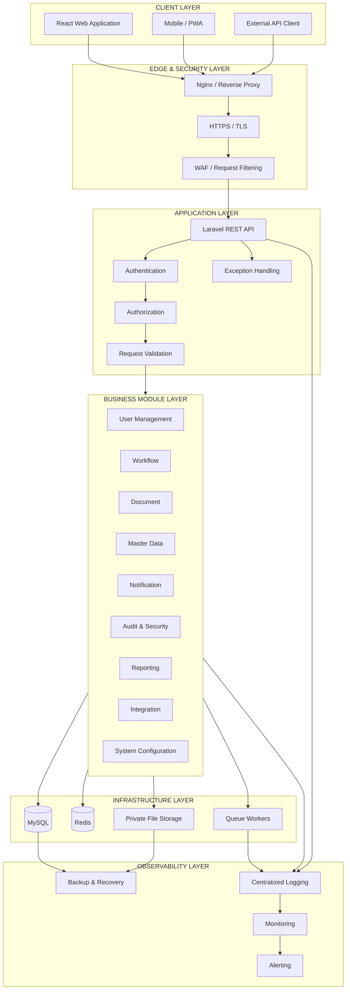
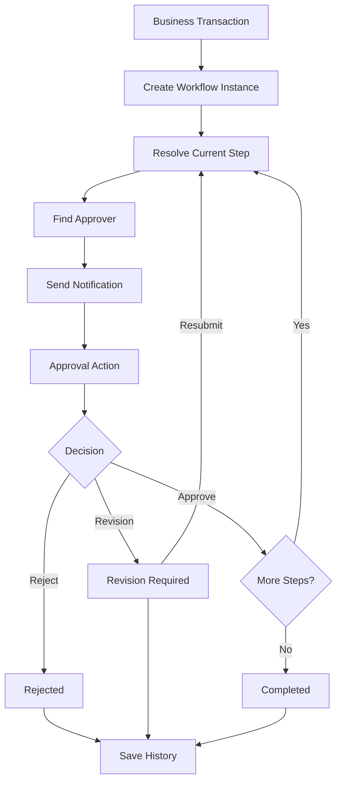
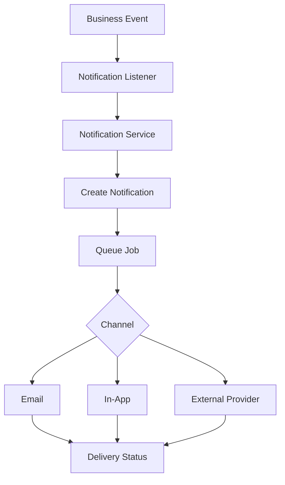
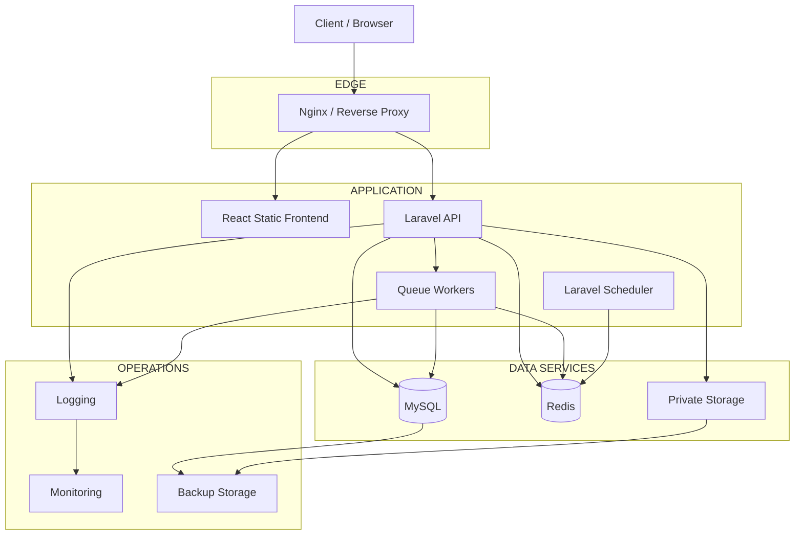
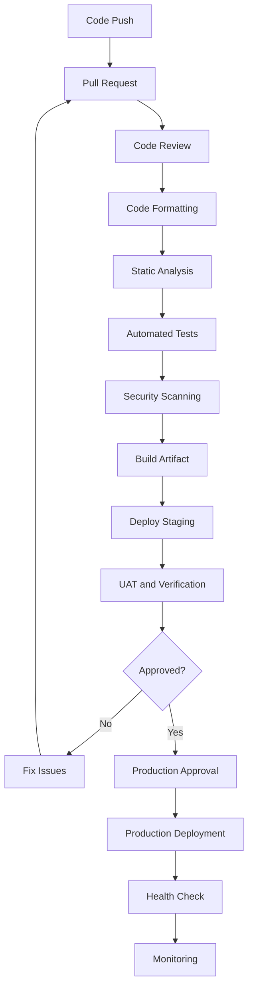

# SYSTEM_ARCHITECTURE.md

# Enterprise System Starter Kit

**System Architecture & Technical Blueprint**

| Metadata | Value |
|---|---|
| Project | Enterprise System Starter Kit |
| Document | System Architecture |
| Version | 1.0 |
| Status | Draft |
| Architecture | Modular Monolith |
| Backend | Laravel 13.x |
| Frontend | React + TypeScript |
| Database | MySQL 8.x |
| Cache & Queue | Redis |
| API Architecture | REST API |
| Security Standard | OWASP Top 10:2025 |
| Security Verification | OWASP ASVS 5.0.0 Level 2 |
| Quality Reference | ISO/IEC 25010:2023 |

---

> **Base v1:** Cakupan implementasi awal dan bagian yang ditunda tercantum di `README.md`.

# 1. Introduction

## 1.1 Purpose

Enterprise System Starter Kit merupakan fondasi pengembangan sistem informasi berbasis Laravel yang dirancang untuk memenuhi kebutuhan aplikasi enterprise.

Sistem ini menyediakan reusable core modules, security foundation, application architecture, serta development standards yang dapat digunakan untuk membangun berbagai aplikasi bisnis.

Contoh aplikasi yang dapat dibangun menggunakan fondasi ini:

- Enterprise Resource Planning (ERP).
- Human Resource Information System (HRIS).
- Procurement Management System.
- Inventory Management System.
- Quality Management System.
- Finance & Accounting System.
- Manufacturing Information System.
- Document Management System.

Dokumen ini mendefinisikan arsitektur teknis, pembagian komponen, komunikasi antar-layer, infrastruktur, security architecture, dan prinsip implementasi.

## 1.2 Objectives

Tujuan pengembangan:

1. Menyediakan standar arsitektur aplikasi enterprise.
2. Mengurangi duplikasi development antarproyek.
3. Menyediakan centralized authentication dan authorization.
4. Menerapkan security by design.
5. Mendukung pengembangan modular dan scalable.
6. Memastikan seluruh aktivitas penting dapat diaudit.
7. Menyediakan integrasi melalui REST API.
8. Mempermudah maintenance dan pengembangan jangka panjang.

## 1.3 Scope

### In Scope

- Authentication & Identity Management.
- User, Role & Permission Management.
- Workflow & Approval Engine.
- Audit Trail.
- Security Event Logging.
- Document Management.
- Notification Center.
- Master Data Management.
- API & Integration Management.
- Reporting & Dashboard.
- System Configuration.
- Application Monitoring.

### Out of Scope

- Implementasi business process ERP tertentu.
- Implementasi HRIS atau payroll.
- Implementasi procurement secara spesifik.
- Integrasi dengan sistem eksternal tertentu.
- Infrastruktur SIEM enterprise secara penuh.
- Sertifikasi ISO 27001 organisasi.
- Multi-company dan branch.

Fitur di luar scope dapat dikembangkan sebagai business module di atas foundation yang tersedia.

---

# 2. Architecture Principles

Sistem mengikuti prinsip arsitektur berikut.

| Principle | Description |
|---|---|
| Modular Architecture | Setiap modul mempunyai tanggung jawab yang jelas. |
| Separation of Concerns | Business logic dipisahkan dari presentation dan infrastructure. |
| Security by Design | Security menjadi bagian dari proses desain. |
| API First | Komunikasi frontend dan backend melalui API. |
| Reusability | Core functionality dapat digunakan kembali. |
| Least Privilege | User hanya mendapatkan akses yang dibutuhkan. |
| Auditability | Aktivitas penting dapat ditelusuri. |
| Maintainability | Kode mudah dipahami dan dikembangkan. |
| Scalability | Komponen dapat ditingkatkan sesuai kebutuhan. |
| Testability | Setiap modul dapat diuji secara independen. |

## 2.1 Architectural Pattern

Architecture: **Modular Monolith**

Backend menggunakan satu aplikasi Laravel dengan pemisahan modul berdasarkan domain bisnis.

Setiap modul memiliki tanggung jawab dan interface yang jelas.

Keuntungan:

- Deployment lebih sederhana dibandingkan microservices.
- Transaksi database lebih mudah dikelola.
- Tidak memerlukan komunikasi jaringan antar-business module.
- Pengembangan lebih mudah untuk tim kecil hingga menengah.
- Dapat dikembangkan secara bertahap.

Microservices tidak menjadi kebutuhan awal. Pemisahan service dapat dipertimbangkan ketika terdapat kebutuhan skalabilitas, independensi deployment, atau kebutuhan operasional yang nyata.

---

# 3. High-Level System Architecture

## 3.1 Architecture Overview

Sistem terdiri dari beberapa architectural layers:

1. Client Layer.
2. Edge & Security Layer.
3. Application Layer.
4. Business Module Layer.
5. Infrastructure Layer.
6. Observability Layer.

## 3.2 Architecture Diagram



## 3.3 Layer Responsibilities

| Layer | Responsibility |
|---|---|
| Client | User interface and interaction |
| Edge | Request routing, TLS, request filtering |
| Application | Authentication, authorization, validation |
| Business Modules | Business rules and use cases |
| Infrastructure | Database, cache, queue, storage |
| Observability | Logs, metrics, alerts, backup |

---

# 4. Technology Stack

## 4.1 Backend

| Component         | Technology                           |
| ----------------- | ------------------------------------ |
| Framework         | Laravel 13.x                         |
| Language          | PHP 8.4.x                            |
| API               | REST API                             |
| Authentication    | Laravel Sanctum                      |
| Authorization     | Spatie Permission + Laravel Policies |
| Activity Logging  | Spatie Activitylog                   |
| Database          | MySQL 8.x                            |
| Cache             | Redis                                |
| Queue             | Laravel Queue                        |
| API Documentation | OpenAPI / Scramble                   |
| Testing           | Pest / PHPUnit                       |
| Static Analysis   | Larastan / PHPStan                   |
| Code Formatting   | Laravel Pint                         |

## 4.2 Frontend

| Component | Technology |
|---|---|
| Framework | React |
| Language | TypeScript |
| Build Tool | Vite |
| Styling | Tailwind CSS |
| UI Components | shadcn/ui |
| Server State | TanStack Query |
| Client State | Zustand |
| Form Management | React Hook Form |
| Validation | Zod |
| Routing | React Router |
| HTTP Client | Axios |
| Table | TanStack Table |

## 4.3 Infrastructure

| Component | Technology |
|---|---|
| Web Server | Nginx |
| Application Runtime | PHP-FPM |
| Database | MySQL |
| Cache | Redis |
| Queue Worker | Laravel Queue Worker |
| Storage | Private Storage / S3-compatible |
| Containerization | Docker |
| CI/CD | GitHub Actions / GitLab CI |
| Monitoring | Laravel Pulse / Sentry |
| Backup | Automated Database & File Backup |

---

# 5. Backend Architecture

## 5.1 Backend Structure

Backend menggunakan modular domain-based architecture.

```text
backend/
│
├── app/
│   │
│   ├── Core/
│   │   ├── Authentication/
│   │   ├── Authorization/
│   │   ├── Security/
│   │   ├── Audit/
│   │   ├── Exceptions/
│   │   └── Logging/
│   │
│   ├── Modules/
│   │   │
│   │   ├── UserManagement/
│   │   │   ├── Controllers/
│   │   │   ├── Actions/
│   │   │   ├── Services/
│   │   │   ├── Models/
│   │   │   ├── Requests/
│   │   │   ├── Resources/
│   │   │   ├── Policies/
│   │   │   ├── Events/
│   │   │   ├── Listeners/
│   │   │   ├── Jobs/
│   │   │   ├── Routes/
│   │   │   └── Providers/
│   │   │
│   │   ├── Workflow/
│   │   ├── MasterData/
│   │   ├── Document/
│   │   ├── Notification/
│   │   ├── Reporting/
│   │   ├── Integration/
│   │   ├── Monitoring/
│   │   └── SystemConfiguration/
│   │
│   ├── Shared/
│   │   ├── Contracts/
│   │   ├── DTOs/
│   │   ├── Enums/
│   │   ├── Helpers/
│   │   └── Traits/
│   │
│   └── Providers/
│
├── database/
├── routes/
├── tests/
├── config/
└── storage/
```

## 5.2 Architectural Responsibilities

### Controllers

Bertanggung jawab untuk:

- Menerima HTTP request.
- Memanggil application action.
- Mengembalikan API response.

Controller tidak boleh menampung business logic yang kompleks.

### Actions

Menangani satu use case tertentu.

Contoh:

- CreateUserAction.
- UpdateUserAction.
- AssignRoleAction.
- ApproveWorkflowAction.

### Services

Menangani business logic kompleks atau reusable yang digunakan oleh beberapa actions.

### Models

Menangani representasi data dan relasi database menggunakan Eloquent.

### Requests

Menangani request validation dan normalisasi input yang relevan.

### Policies

Menangani authorization berdasarkan resource dan context pengguna.

### Resources

Menangani standardisasi output API.

### Events & Listeners

Menangani komunikasi event-driven antar-komponen.

### Jobs

Menangani proses asynchronous seperti:

- Email delivery.
- Document processing.
- Bulk import.
- Report generation.
- External API synchronization.

## 5.3 Module Independence

Setiap modul harus memiliki batas tanggung jawab.

Contoh:

User Management tidak boleh mengimplementasikan sendiri mekanisme authentication atau audit.

Modul tersebut harus menggunakan Core Authentication dan Core Audit.

Komunikasi antar-modul dapat menggunakan:

- Public application service.
- Contracts / Interfaces.
- Domain events.
- Shared DTO.

Hindari akses langsung ke internal implementation modul lain.

---

# 6. Frontend Architecture

## 6.1 Frontend Structure

Frontend menggunakan feature-based architecture.

```text
frontend/
│
└── src/
    │
    ├── app/
    │   ├── providers/
    │   ├── router/
    │   └── guards/
    │
    ├── components/
    │   ├── ui/
    │   ├── shared/
    │   └── layouts/
    │
    ├── features/
    │   ├── authentication/
    │   ├── users/
    │   ├── roles/
    │   ├── permissions/
    │   ├── workflows/
    │   ├── documents/
    │   ├── notifications/
    │   ├── reports/
    │   ├── settings/
    │   └── dashboard/
    │
    ├── hooks/
    ├── lib/
    ├── services/
    ├── stores/
    ├── types/
    ├── utils/
    ├── config/
    ├── assets/
    └── main.tsx
```

## 6.2 Frontend Responsibilities

Frontend bertanggung jawab untuk:

- Rendering UI.
- User interaction.
- Client-side validation.
- API communication.
- Server state management.
- Client state management.
- Permission-based UI rendering.
- Error handling.
- Responsive layout.

Frontend tidak boleh menjadi satu-satunya tempat validasi security atau business rules.

## 6.3 State Management

TanStack Query digunakan untuk:

- API data fetching.
- Cache management.
- Query invalidation.
- Background refetch.
- Mutation management.

Zustand digunakan untuk:

- Sidebar state.
- UI preferences.
- Temporary client state.
- Application-level interaction state.

Authentication session tidak boleh menyimpan bearer token sensitif dalam localStorage.

---

# 7. Authentication & Authorization Architecture

## 7.1 Authentication

Authentication menggunakan Laravel Sanctum.

Terdapat dua skenario:

**First-party SPA**

Menggunakan cookie-based session authentication.

Kontrol:

- HttpOnly cookie.
- Secure cookie.
- SameSite configuration.
- CSRF protection.
- Session regeneration.
- Session expiration.
- Logout invalidation.

**External API Client**

Menggunakan Sanctum personal access token.

Kontrol:

- Token abilities.
- Token expiration.
- Token revocation.
- Secure token handling.
- API rate limiting.

## 7.2 Authorization

Menggunakan kombinasi:

- Role-Based Access Control.
- Laravel Gate.
- Laravel Policy.
- User Scope.
- Data Ownership Validation.

Contoh permission naming:

```text
user.view
user.create
user.update
user.delete

role.view
role.create
role.update
role.delete

workflow.view
workflow.approve
workflow.reject

document.view
document.upload
document.download
document.delete

system_config.view
system_config.update
```

## 7.3 Data Scope

Sistem dirancang untuk satu perusahaan per instalasi. Tidak ada entitas company, branch, atau organisasi; profil perusahaan disimpan di `system_configurations`.

Contoh:

```text
PT Example Indonesia (system configuration)
├── Information Technology
├── Finance
└── Human Resources
    └── Recruitment
```

Authorization harus memperhatikan:

1. User identity.
2. Assigned roles.
3. Permission.
4. Resource ownership.
5. Additional business restrictions.

Frontend permission rendering hanya berfungsi sebagai UI convenience. Backend tetap menjadi authority.

---

# 8. Core Business Modules

## 8.1 Module Overview

| Module | Responsibilities |
|---|---|
| Authentication | Login, MFA, session |
| User Management | User accounts |
| Authorization | Roles, permissions |
| Workflow | Approval process |
| Audit | Business activity tracking |
| Security | Security event management |
| Document | File and document lifecycle |
| Master Data | Reference data |
| Notification | In-app and email notifications |
| Reporting | Dashboard and reports |
| Integration | External API and webhook |
| System Configuration | Application settings |
| Monitoring | Application health |

## 8.2 Core Module Dependency

Core modules must not introduce circular dependencies.

Recommended dependency direction:

```text
Business Modules
       |
       v
Shared Contracts
       |
       v
Core Infrastructure
       |
       v
Laravel Framework
```

A module may consume another module's public contract, but must not directly depend on its internal implementation.

---

# 9. Database Architecture

## 9.1 Database Configuration

| Property | Standard |
|---|---|
| DBMS | MySQL 8.x |
| Storage Engine | InnoDB |
| Charset | utf8mb4 |
| Collation | utf8mb4_unicode_ci |
| Primary Key | BIGINT UNSIGNED |
| External Identifier | UUID |
| Foreign Key | Required for internal relational integrity |
| Timestamp | UTC |
| Schema Management | Laravel Migrations |

## 9.2 Database Domain Separation

Database tables are logically grouped into domains.

```text
IDENTITY
├── users
├── sessions
├── password_reset_tokens
├── personal_access_tokens
├── roles
├── permissions
├── role_has_permissions
├── model_has_roles
└── model_has_permissions

ORGANIZATION

WORKFLOW
├── workflow_definitions
├── workflow_versions
├── workflow_steps
├── workflow_instances
├── workflow_tasks
└── workflow_history

AUDIT
├── activity_log
└── security_events

DOCUMENT
├── documents
├── document_versions
└── document_references

NOTIFICATION
├── notifications
└── notification_deliveries

INTEGRATION
├── integration_connections
└── integration_logs

SYSTEM
├── system_configurations
└── idempotency_keys
```

Logical domain separation does not require separate physical databases. Spesifikasi kolom dan relasi berada di `DATABASE_DESIGN.md`. Akses dokumen dicatat melalui `activity_log`.

## 9.3 Database Standards

- All schema changes must use migrations.
- Use foreign keys for relational integrity.
- Use indexes based on query patterns.
- Use transactions for atomic business operations.
- Avoid unnecessary soft deletes.
- Avoid unnecessary polymorphic relations for critical business relationships.
- Sensitive data must be encrypted where appropriate.
- Audit records must be protected from unauthorized modification.
- Implement pagination for large datasets.

---

# 10. Security Architecture

## 10.1 Security Standards

Security design references:

- OWASP Top 10:2025.
- OWASP ASVS 5.0.0 Level 2.
- ISO/IEC 27001:2022.
- Secure Software Development Lifecycle.

These references provide different scopes. OWASP ASVS provides application-level verification requirements, while ISO 27001 addresses the broader information security management system.

## 10.2 Security Layers

| Layer | Security Control |
|---|---|
| Network | HTTPS, TLS, Firewall |
| Edge | WAF, Rate Limiting |
| Authentication | MFA, Session Management |
| Authorization | RBAC, Policies |
| Application | Input Validation, CSRF, XSS Protection |
| Database | Least Privilege, Parameter Binding |
| Storage | Private Files, Encryption |
| Logging | Audit Trail, Security Events |
| Deployment | Secret Management, Dependency Scanning |

## 10.3 OWASP Top 10 Mapping

| Category | Implementation |
|---|---|
| A01 Broken Access Control | RBAC, Policy, data scope |
| A02 Security Misconfiguration | Secure configuration, headers |
| A03 Software Supply Chain Failures | Dependency scanning, SBOM |
| A04 Cryptographic Failures | Argon2id, encryption, TLS |
| A05 Injection | Parameter binding, validation |
| A06 Insecure Design | Threat modeling |
| A07 Authentication Failures | MFA, session controls |
| A08 Software/Data Integrity Failures | Signed webhooks, CI/CD integrity |
| A09 Logging & Alerting Failures | Centralized logs, security alerts |
| A10 Exceptional Conditions | Safe exception handling |

## 10.4 Security Requirements

Mandatory baseline:

- Production APP_DEBUG disabled.
- HTTPS enforced.
- Secure session configuration.
- MFA for privileged accounts sebelum aplikasi nyata go-live (lihat `README.md`).
- Password hashing.
- Authentication rate limiting.
- Authorization on every protected endpoint.
- File upload validation.
- Private document storage.
- CSRF protection for SPA.
- CORS allowlist.
- SQL injection prevention.
- XSS prevention.
- Security event logging.
- Sensitive information redaction.
- Dependency vulnerability scanning.
- Backup encryption.
- Regular security testing.

## 10.5 Security Verification

Security verification must use the official OWASP ASVS 5.0.0 requirement catalogue.

Every applicable requirement must have:

- Requirement ID.
- Implementation reference.
- Verification method.
- Test evidence.
- Result.
- Finding.
- Remediation status.

Do not claim ASVS Level 2 compliance until the applicable requirements have been assessed and verified.

---

# 11. API Architecture

## 11.1 API Standard

API communication uses REST JSON.

Base URL:

```text
https://example.com/api/v1
```

API naming convention:

```text
GET     /users
POST    /users
GET     /users/{id}
PATCH   /users/{id}
DELETE  /users/{id}
```

## 11.2 API Responsibilities

- Authentication.
- Authorization.
- Request validation.
- Business action execution.
- Response transformation.
- Error handling.
- API logging.
- Rate limiting.

## 11.3 Standard Response

Success:

```json
{
  "success": true,
  "message": "Data retrieved successfully",
  "data": {},
  "meta": null
}
```

Error:

```json
{
  "success": false,
  "message": "Validation failed",
  "code": "VALIDATION_FAILED",
  "data": null,
  "errors": {
    "email": [
      "The email field is required."
    ]
  },
  "meta": null
}
```

## 11.4 API Versioning

Versioning menggunakan URL prefix.

```text
/api/v1/
/api/v2/
```

Breaking API changes must use a new version or an explicitly managed migration strategy.

---

# 12. Workflow Architecture

Workflow engine digunakan untuk kebutuhan approval lintas business module.

## 12.1 Workflow Components

- Workflow definition.
- Workflow version.
- Workflow steps.
- Approval rules.
- Workflow instances.
- Approval actions.
- Workflow history.
- Delegation.
- Notification.

## 12.2 Workflow Flow



## 12.3 Workflow Rules

- Workflow version must be immutable after being activated for new instances.
- Existing instances retain their original workflow version.
- Every approval action must be recorded.
- Only authorized approvers may execute approval.
- Approval must support transaction consistency.
- Concurrent approval actions must be controlled.
- Delegation must be auditable.
- Revision mengembalikan pengajuan ke requester. Setelah diajukan ulang, approval dimulai lagi dari step pertama dengan workflow version yang sama.
- Requester dapat membatalkan pengajuan selama belum ada keputusan approve atau reject pada pengajuan berjalan.

---

# 13. Document Management Architecture

## 13.1 Document Components

- Document metadata.
- Document category.
- Document version.
- File storage.
- Document permission.
- Document access log.
- Retention policy.

## 13.2 File Security

Files must be stored outside the public web root or in private object storage.

Required controls:

- MIME validation.
- File extension allowlist.
- File size limits.
- Randomized storage filename.
- Private download authorization.
- File access logging.
- Malware scanning where appropriate.
- Secure temporary download URL.
- File retention and disposal policy.

Never use the original user-supplied filename as the storage path.

---

# 14. Notification Architecture

Notification supports:

- In-app notification.
- Email notification.
- Workflow notification.
- Security notification.
- System notification.

Notification delivery must use asynchronous jobs.



Notification failures must not cause a successful business transaction to be rolled back unless the business requirement explicitly demands it.

---

# 15. Observability & Monitoring

## 15.1 Monitoring Components

| Component | Monitoring |
|---|---|
| Laravel | Application errors, response time |
| MySQL | Connection, query performance |
| Redis | Memory, connection, queue |
| Queue | Pending jobs, failed jobs |
| Storage | Capacity and availability |
| Infrastructure | CPU, RAM, disk |
| Security | Failed login, access denial |
| Backup | Last successful backup |

## 15.2 Logging Categories

- Application logs.
- Business activity logs.
- Authentication logs.
- Security event logs.
- API access logs.
- Queue logs.
- Integration logs.

## 15.3 Alerting

Alert should be triggered for critical conditions:

- Repeated authentication failures.
- Suspicious access attempts.
- Unauthorized administrative operations.
- Unexpected permission changes.
- Critical application errors.
- Database availability issues.
- Queue failures.
- Backup failures.

Sensitive credentials, cookies, passwords, and tokens must never be recorded in logs.

---

# 16. Deployment Architecture

## 16.1 Deployment Components

- Nginx Reverse Proxy.
- React Static Application.
- Laravel PHP-FPM.
- MySQL.
- Redis.
- Queue Workers.
- Scheduler.
- Private Storage.
- Monitoring Services.

## 16.2 Deployment Diagram



## 16.3 Environment Separation

Three environments must be maintained:

| Environment | Purpose |
|---|---|
| Development | Developer development |
| Staging | Integration testing, UAT, security verification |
| Production | Live application |

Production credentials must never be shared with development or staging.

---

# 17. CI/CD Architecture

CI/CD pipeline:



## 17.1 Quality Gates

Required checks:

- Laravel Pint.
- Larastan / PHPStan.
- Pest / PHPUnit.
- Frontend lint.
- TypeScript type checking.
- Frontend automated tests.
- Composer audit.
- Dependency scanning.
- Secret scanning.
- Container scanning.
- Security test suite.

Production deployment requires an approval step and rollback capability.

---

# 18. Backup & Disaster Recovery

## 18.1 Backup Strategy

- Full database backup.
- MySQL binary log backup.
- File storage backup.
- Encrypted backup.
- Offsite backup.
- Retention policy.
- Backup integrity verification.
- Periodic restore test.

## 18.2 Recovery Objectives

RPO and RTO must be defined according to business criticality.

Initial planning target:

| Parameter | Example Target |
|---|---|
| RPO | 15 minutes |
| RTO | 4 hours |

These are planning targets, not guaranteed capabilities. Infrastructure and restore procedures must be tested to validate them.

---

# 19. Quality Attributes

The system uses ISO/IEC 25010:2023 as a software quality reference.

| Quality Attribute | Architecture Strategy |
|---|---|
| Functional Suitability | Modular business capabilities |
| Performance Efficiency | Redis, indexing, queues |
| Compatibility | REST API |
| Interaction Capability | Reusable React UI |
| Reliability | Transactions, retry, monitoring |
| Security | OWASP ASVS |
| Maintainability | Modular code structure |
| Flexibility | Configuration and module extension |
| Safety | Failure handling and operational safeguards |

---

# 20. Architecture Decision Records (ADR)

Important architectural decisions must be documented.

Initial ADR list:

| ADR | Decision |
|---|---|
| ADR-001 | Modular Monolith Architecture |
| ADR-002 | React Separate Frontend |
| ADR-003 | Laravel Sanctum Authentication |
| ADR-004 | RBAC with Laravel Policies |
| ADR-005 | MySQL Relational Database |
| ADR-006 | Redis Cache and Queue |
| ADR-007 | Private Document Storage |
| ADR-008 | REST API Versioning |
| ADR-009 | Single Company |
| ADR-010 | OWASP ASVS Level 2 Baseline |

Every ADR should include:

- Context.
- Problem.
- Decision.
- Alternatives considered.
- Consequences.
- Implementation status.

---

# 21. Non-Functional Requirements

Initial engineering targets:

| Area | Target |
|---|---|
| API Response | P95 under 500 ms for standard lightweight endpoints |
| Availability | Initial target 99.5% monthly |
| Pagination | Default 20 records per page |
| Security | ASVS Level 2 verification |
| Audit | All critical business actions recorded |
| Database | Transactional integrity |
| Backup | Automated and tested |
| Deployment | Reproducible deployment |
| Maintainability | Automated code quality checks |
| Scalability | Horizontal scaling where required |

Performance and availability targets must be validated through load testing and production monitoring. Complex reports and bulk operations may have separate performance targets.

---

# 22. Definition of Done

A module can be considered complete when:

- Business requirements are fulfilled.
- Module follows the defined architecture.
- API contract is documented.
- Input validation is implemented.
- Authorization is verified.
- Relevant audit events are recorded.
- Automated tests pass.
- Relevant ASVS requirements are verified.
- Error handling is implemented.
- Performance is acceptable.
- Technical documentation is updated.
- Staging verification is completed.

---

# 23. Future Architecture Extension

The architecture should allow future capabilities without requiring major restructuring.

Potential extensions:

- Multi-tenant SaaS architecture.
- SSO / Enterprise Identity Provider.
- LDAP / Active Directory integration.
- Advanced workflow engine.
- Centralized SIEM.
- Advanced API Gateway.
- Microservices extraction.
- Event-driven integration.
- Mobile application.
- Multi-database support.

These capabilities are not part of the initial implementation unless separately approved.

---

# 24. Conclusion

Enterprise System Starter Kit is designed as a reusable enterprise application foundation.

The system adopts Modular Monolith Architecture, Laravel REST API, React frontend, MySQL relational database, Redis infrastructure, and security practices based on OWASP ASVS Level 2.

The primary objective is to establish a standardized, secure, maintainable, and extensible foundation for future enterprise applications.

**Next technical documents:**

1. DATABASE_DESIGN.md
2. SECURITY_ARCHITECTURE.md
3. BACKEND_SPECIFICATION.md
4. FRONTEND_SPECIFICATION.md
5. API_SPECIFICATION.md
6. OWASP_ASVS_CHECKLIST.md
7. DEVELOPMENT_TASKS.md
8. DEPLOYMENT_GUIDE.md

---

**Document End — Enterprise System Starter Kit v1.0**