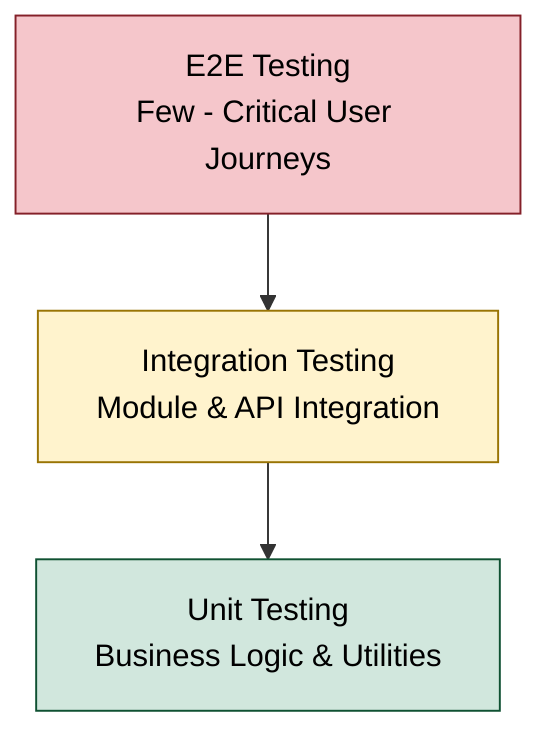
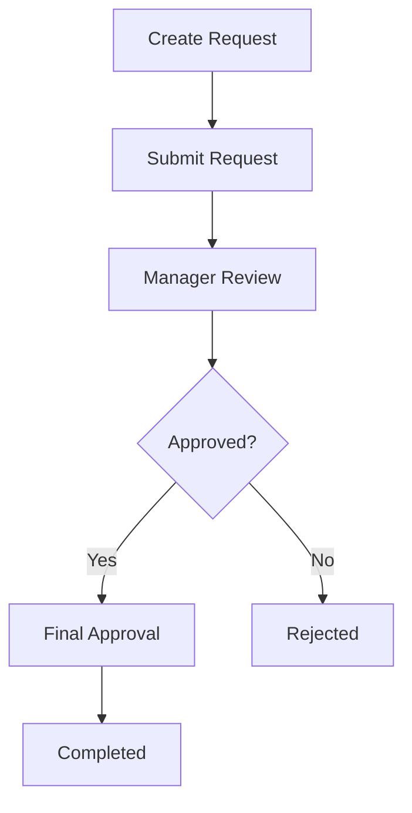
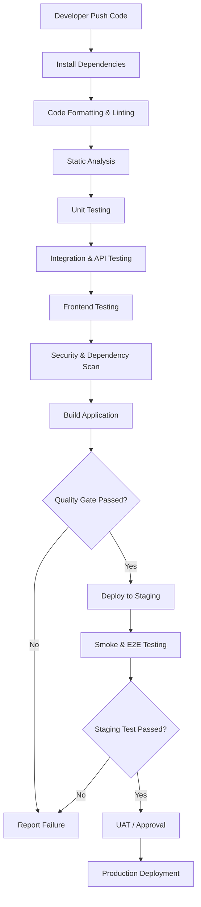

# TESTING_STRATEGY.md

# Enterprise System Starter Kit
## Testing Strategy

**Document Type:** Technical Testing Standard  
**Architecture:** Modular Monolith  
**Backend:** Laravel 13.x / PHP 8.4.x  
**Frontend:** React + TypeScript  
**Database:** MySQL 8.x  
**Cache & Queue:** Redis  
**Backend Testing:** Pest / PHPUnit  
**Frontend Testing:** Vitest / React Testing Library  
**E2E Testing:** Playwright  
**Security Baseline:** OWASP ASVS Level 2

---

> **Base v1:** Standar minimum pengujian tahap awal tercantum di `README.md`.

# 1. Introduction

## 1.1 Purpose

Dokumen ini mendefinisikan strategi, standar, dan prosedur pengujian untuk Enterprise System Starter Kit.

Tujuan utama:

- Memastikan fitur berjalan sesuai requirement.
- Memvalidasi business logic.
- Memastikan integritas data.
- Menguji authentication dan authorization.
- Mencegah regresi pada fitur yang sudah berjalan.
- Memastikan integrasi antar-module berjalan dengan benar.
- Mengidentifikasi risiko keamanan sejak tahap development.
- Menjaga kualitas sistem sebelum deployment ke production.

## 1.2 Testing Principles

| Principle | Description |
|---|---|
| Early Testing | Testing dilakukan sejak awal development |
| Risk-Based Testing | Prioritas berdasarkan risiko dan dampak bisnis |
| Automation First | Pengujian berulang diotomatisasi |
| Repeatability | Test harus menghasilkan hasil yang konsisten |
| Isolation | Test tidak bergantung pada data production |
| Traceability | Test dapat ditelusuri ke requirement |
| Security First | Authentication dan authorization wajib diuji |
| Regression Prevention | Perubahan tidak boleh merusak fitur existing |

## 1.3 Testing Scope

Testing mencakup:

1. Backend testing.
2. Frontend testing.
3. API testing.
4. Database testing.
5. Authentication testing.
6. Authorization testing.
7. Integration testing.
8. Workflow testing.
9. File upload testing.
10. Security testing.
11. Performance testing.
12. End-to-End testing.
13. Regression testing.
14. User Acceptance Testing.

---

# 2. Testing Architecture

## 2.1 Testing Layers

Sistem menggunakan pendekatan layered testing.

| Layer | Testing Type | Objective |
|---|---|---|
| Unit | Unit Testing | Menguji logic secara terisolasi |
| Component | Component Testing | Menguji komponen frontend |
| API | API Testing | Menguji endpoint dan response |
| Integration | Integration Testing | Menguji interaksi antar-komponen |
| System | System Testing | Menguji sistem secara menyeluruh |
| E2E | End-to-End Testing | Menguji alur pengguna dari awal hingga akhir |
| Acceptance | UAT | Memvalidasi kesesuaian kebutuhan bisnis |

## 2.2 Testing Pyramid



Prinsip:

- Unit test harus menjadi lapisan dengan jumlah test terbanyak.
- Integration test memvalidasi interaksi antar-komponen.
- E2E test difokuskan pada alur bisnis yang kritis.
- Jangan menggunakan E2E untuk menggantikan seluruh unit dan integration test.

---

# 3. Testing Tools & Technology

## 3.1 Backend Testing Tools

| Tool | Purpose |
|---|---|
| Pest | Backend automated testing |
| PHPUnit | Testing framework yang mendasari Pest |
| Laravel Testing | HTTP, database, queue, event, dan authentication testing |
| Larastan / PHPStan | Static analysis |
| Laravel Pint | Code formatting |
| Composer Audit | Dependency vulnerability checking |

## 3.2 Frontend Testing Tools

| Tool | Purpose |
|---|---|
| Vitest | Unit dan component testing |
| React Testing Library | React component behavior |
| MSW | Mock API request |
| Playwright | Browser automation dan E2E |
| ESLint | Code linting |
| TypeScript | Static type checking |

## 3.3 Supporting Tools

| Tool | Purpose |
|---|---|
| MySQL | Database testing |
| Redis | Cache dan queue testing |
| Docker Compose | Test environment |
| Postman / Bruno | Manual API testing |
| OpenAPI | API contract validation |
| CI/CD Pipeline | Automated test execution |
| OWASP ZAP | Dynamic security testing |

Versi dan kompatibilitas setiap tool harus dikonfirmasi saat implementasi.

---

# 4. Testing Environment

## 4.1 Environment Separation

Testing harus menggunakan environment terpisah dari production.

| Environment | Purpose |
|---|---|
| Local | Development dan debugging |
| Testing | Automated test |
| Staging | Integration dan UAT |
| Production | Live application |

## 4.2 Testing Database

Gunakan database khusus testing.

Contoh konfigurasi:

```env
APP_ENV=testing

DB_CONNECTION=mysql
DB_HOST=127.0.0.1
DB_PORT=3306
DB_DATABASE=enterprise_system_test
DB_USERNAME=test_user
DB_PASSWORD=test_password

CACHE_STORE=array
QUEUE_CONNECTION=sync
```

Catatan:

- Gunakan credential khusus testing.
- Jangan menggunakan database production.
- Pastikan test dapat menjalankan migration dan rollback.
- Gunakan database MySQL yang mendekati konfigurasi production.
- Gunakan Redis terpisah jika test memerlukan perilaku cache atau queue yang sebenarnya.

## 4.3 Test Data Management

Gunakan:

- Laravel Model Factory.
- Laravel Seeder khusus testing.
- Factory states.
- Data fixture untuk skenario tertentu.

Contoh:

```php
User::factory()->create([
    'name' => 'Test User',
    'email' => 'test@example.com',
]);
```

Rules:

1. Test harus menyiapkan data yang dibutuhkan sendiri.
2. Jangan bergantung pada urutan eksekusi test.
3. Hindari shared mutable test data.
4. Bersihkan data setelah test.
5. Jangan menggunakan data pribadi atau data production tanpa proses anonimisasi yang sesuai.

---

# 5. Backend Testing Strategy

## 5.1 Unit Testing

Unit testing digunakan untuk menguji logic secara terisolasi.

Fokus pengujian:

- Business rules.
- Calculation.
- Validation helper.
- Service logic.
- Action logic.
- Enum behavior.
- Utility functions.
- State transition.

Contoh:

```php
use App\Modules\Workflow\Enums\WorkflowTaskStatus;

it('identifies approved workflow task status', function () {
    $status = WorkflowTaskStatus::APPROVED;

    expect($status->value)->toBe('approved');
});
```

Contoh business logic:

```php
class PurchaseRequestCalculator
{
    public function calculateTotal(array $items): float
    {
        return collect($items)->sum(
            fn ($item) => $item['quantity'] * $item['unit_price']
        );
    }
}
```

Test:

```php
it('calculates purchase request total', function () {
    $calculator = new PurchaseRequestCalculator();

    $total = $calculator->calculateTotal([
        ['quantity' => 2, 'unit_price' => 100000],
        ['quantity' => 3, 'unit_price' => 50000],
    ]);

    expect($total)->toBe(350000.0);
});
```

Contoh di atas hanya menunjukkan struktur test. Implementasi perhitungan uang tidak boleh memakai `float`; gunakan BCMath atau nilai satuan terkecil agar konsisten dengan `DECIMAL(18,2)`.

## 5.2 Feature Testing

Feature testing digunakan untuk menguji perilaku aplikasi melalui HTTP request atau interaksi application layer.

Contoh skenario:

- Create user.
- Update user.
- Delete user.
- Create role.
- Assign role.
- Submit workflow.
- Approve request.
- Upload document.

Contoh:

```php
it('can create a role', function () {
    $user = User::factory()->create();

    $user->givePermissionTo('role.create');

    $response = $this
        ->actingAs($user)
        ->postJson('/api/v1/roles', [
            'name' => 'Auditor',
        ]);

    $response->assertCreated();

    $this->assertDatabaseHas('roles', [
        'name' => 'Auditor',
    ]);
});
```

Test di atas harus menyesuaikan guard dan permission yang diterapkan dalam implementasi aktual.

## 5.3 Repository Testing

Jika Repository Pattern digunakan, pengujian difokuskan pada:

- Query result.
- Filtering.
- Sorting.
- Pagination.
- Relationship loading.
- Data scope.
- Query behavior untuk data kosong.
- Query behavior untuk data besar.

Tidak semua Repository memerlukan unit test tersendiri. Prioritaskan query yang memiliki kompleksitas atau dampak bisnis tinggi.

## 5.4 Database Testing

Pengujian database mencakup:

- Migration.
- Foreign key constraints.
- Unique constraints.
- Index behavior.
- Soft delete.
- Transaction rollback.
- Relationship integrity.
- Concurrent updates.

Contoh:

```php
it('prevents duplicate user email', function () {
    User::factory()->create([
        'email' => 'ani@example.com',
    ]);

    expect(fn () => User::factory()->create([
        'email' => 'ani@example.com',
    ]))->toThrow(QueryException::class);
});
```

Contoh ini mengasumsikan terdapat unique constraint yang sesuai pada database.

---

# 6. API Testing Strategy

## 6.1 API Test Coverage

Setiap endpoint harus diuji berdasarkan:

| Test Scenario | Expected Result |
|---|---|
| Valid request | Request berhasil |
| Invalid payload | Validation error |
| Unauthenticated | HTTP 401 |
| Unauthorized | HTTP 403 |
| Resource not found | HTTP 404 |
| Duplicate data | HTTP 409 atau validation error sesuai kontrak |
| Invalid relationship | Validation error |
| Outside data scope | HTTP 404 |
| Pagination | Response sesuai pagination contract |
| Filtering | Data sesuai filter |
| Sorting | Data sesuai urutan |

## 6.2 CRUD API Testing

Setiap module CRUD setidaknya memiliki test:

- List resource.
- Show resource.
- Create resource.
- Update resource.
- Delete resource.
- Validation.
- Authorization.
- Data scope.

Tidak semua endpoint harus memiliki seluruh operasi CRUD. Test mengikuti kemampuan bisnis yang benar-benar tersedia.

## 6.3 API Contract Testing

Pastikan response API konsisten dengan API Specification dan OpenAPI.

Validasi:

- Endpoint path.
- HTTP method.
- Request schema.
- Response schema.
- Status code.
- Required fields.
- Data types.
- Error response.
- Pagination metadata.

Perubahan API yang breaking harus melalui proses versioning atau deprecation.

## 6.4 API Test Example

```php
it('returns paginated users', function () {
    $user = User::factory()->create();

    $user->givePermissionTo('user.view');

    User::factory()->count(25)->create();

    $response = $this
        ->actingAs($user)
        ->getJson('/api/v1/users?per_page=20');

    $response
        ->assertOk()
        ->assertJsonStructure([
            'data',
            'meta',
        ]);
});
```

Sesuaikan struktur response dengan kontrak API yang telah ditetapkan.

---

# 7. Authentication & Authorization Testing

Bagian ini termasuk prioritas tinggi karena kesalahan access control dapat menyebabkan kebocoran data antar-user.

## 7.1 Authentication Testing

Test scenario:

| Scenario | Expected Result |
|---|---|
| Valid login | Authentication berhasil |
| Invalid password | Authentication gagal |
| Unknown email | Authentication gagal |
| Logout | Session/token tidak lagi dapat digunakan |
| Expired session | User diminta login kembali |
| Invalid token | HTTP 401 |
| Revoked token | HTTP 401 |
| CSRF validation | Request mengikuti kebijakan CSRF |
| Rate limit login | Request dibatasi sesuai konfigurasi |

## 7.2 Authorization Testing

Setiap permission penting harus diuji.

Contoh matrix:

| Role | View User | Create User | Update User | Delete User |
|---|---:|---:|---:|---:|
| Super Admin | Yes | Yes | Yes | Yes |
| Admin | Yes | Yes | Yes | Yes |
| Manager | Yes | No | No | No |
| Staff | Yes | No | No | No |
| Viewer | Yes | No | No | No |

Matrix tersebut hanya contoh. Gunakan `AUTHORIZATION_MATRIX.md` sebagai sumber aturan akses aktual.

## 7.3 Privilege Escalation Testing

Pastikan user tidak dapat:

- Mengubah role sendiri tanpa otorisasi.
- Memberikan permission kepada dirinya sendiri.
- Mengakses admin endpoint.
- Mengubah data scope sendiri.
- Mengubah ownership resource.
- Mengakses fitur melalui manipulasi request.

---

# 8. Frontend Testing Strategy

## 8.1 Component Testing

Gunakan Vitest dan React Testing Library.

Fokus:

- Component rendering.
- User interaction.
- Props behavior.
- Conditional rendering.
- Form behavior.
- Loading state.
- Error state.
- Empty state.

Contoh:

```tsx
import { render, screen } from '@testing-library/react';
import { UserStatus } from './UserStatus';

describe('UserStatus', () => {
    it('shows active status', () => {
        render(<UserStatus isActive={true} />);

        expect(screen.getByText('Active')).toBeInTheDocument();
    });
});
```

## 8.2 Form Testing

Setiap form penting harus menguji:

- Required field.
- Invalid format.
- Maximum length.
- Valid submission.
- Server validation error.
- Disabled submit button saat proses berlangsung.
- Duplicate submission prevention.
- Successful submission feedback.

## 8.3 State Management Testing

Pengujian state mencakup:

- Initial state.
- State update.
- State reset.
- Async state.
- Error state.
- Cache invalidation.
- Data refetch.

Untuk TanStack Query, gunakan QueryClient khusus test dan hindari berbagi cache antar-test.

## 8.4 Frontend Permission Testing

Pastikan:

- Menu mengikuti permission user.
- Action button mengikuti permission.
- Protected route memiliki guard.
- UI tidak menampilkan data yang tidak boleh diakses.

Namun, frontend permission hanya merupakan kontrol UI. Backend tetap harus memvalidasi seluruh authorization.

---

# 9. Integration Testing

Integration testing memastikan beberapa komponen dapat bekerja sama.

## 9.1 Integration Scope

| Integration | Test Objective |
|---|---|
| Controller + Action | Use case berjalan benar |
| Action + Database | Data tersimpan konsisten |
| Workflow + Approval | Transisi status benar |
| User + Permission | Hak akses diterapkan |
| Document + Storage | File tersimpan dan dapat diakses sesuai izin |
| Notification + Queue | Notifikasi diproses |
| Redis + Cache | Cache bekerja sesuai kebijakan |
| External API | Request dan response ditangani dengan benar |

## 9.2 Workflow Integration Testing

Contoh workflow:



Test scenario:

- Request berhasil dibuat.
- Request dapat disubmit.
- Approver yang benar dapat melakukan approval.
- User tanpa hak akses tidak dapat melakukan approval.
- Request yang sudah selesai tidak dapat di-approve ulang.
- Rejection menghasilkan status yang benar.
- Setiap perubahan status tercatat.
- Concurrent approval tidak menghasilkan double processing.
- Approver dapat meminta revisi dengan alasan wajib.
- Pengajuan ulang menaikkan `submission_number` dan memulai approval dari step pertama.
- User selain requester tidak dapat mengajukan ulang.
- Requester dapat membatalkan sebelum ada keputusan dan ditolak setelah ada keputusan.
- Submit dengan `Idempotency-Key` yang sama tidak membuat instance kedua.

## 9.3 Queue & Event Testing

Test:

- Event dipicu ketika operasi berhasil.
- Listener menerima event yang sesuai.
- Job masuk ke queue.
- Retry berjalan sesuai konfigurasi.
- Failed job tercatat.
- Job aman untuk dijalankan ulang sesuai desain.

Gunakan Laravel fake utilities untuk unit atau feature test yang tidak memerlukan Redis aktual. Tambahkan integration test dengan Redis nyata untuk memastikan konfigurasi dan perilaku infrastrukturnya.

## 9.4 File Upload Testing

Test:

- Upload file valid.
- Upload file dengan extension tidak diizinkan.
- Upload MIME tidak sesuai.
- Upload file melebihi batas.
- Akses download oleh user berizin.
- Akses download oleh user tidak berizin.
- Penghapusan file.
- File metadata dan storage konsisten.

---

# 10. End-to-End Testing

## 10.1 Purpose

E2E testing memastikan alur pengguna berjalan melalui browser dari awal hingga akhir.

Gunakan Playwright.

## 10.2 Critical User Journeys

Prioritas alur E2E:

| Module | Critical User Journey |
|---|---|
| Authentication | Login dan logout |
| User Management | Membuat dan mengubah user |
| Authorization | Mengakses fitur sesuai permission |
| Workflow | Submit, approve, dan reject |
| Document | Upload dan download dokumen |
| Notification | Melihat notifikasi |
| Reporting | Membuka dashboard dan filter data |

## 10.3 Example Playwright Test

```typescript
import { test, expect } from '@playwright/test';

test('user can log in successfully', async ({ page }) => {
    await page.goto('/login');

    await page
        .getByLabel('Email')
        .fill('admin@example.com');

    await page
        .getByLabel('Password')
        .fill('password');

    await page
        .getByRole('button', { name: 'Login' })
        .click();

    await expect(
        page.getByText('Dashboard')
    ).toBeVisible();
});
```

Gunakan akun test khusus. Jangan menggunakan credential production.

## 10.4 Menjalankan E2E

Test Playwright berada di `frontend/e2e` dan dijalankan dengan `npm run test:e2e` di `frontend/`. CI menjalankannya di job `e2e` pada setiap pull request.

- Butuh MySQL dengan database `laravel_base_test` dan Chromium dari `npx playwright install chromium`.
- Playwright menyalakan backend di port 8011 dan frontend hasil build di port 5173, lalu mematikannya setelah selesai.
- Setiap run mengosongkan database dan mengisinya dengan `E2ESeeder`. Database development tidak disentuh.
- Password akun uji diambil dari `E2E_PASSWORD`, dengan nilai bawaan yang hanya berlaku untuk database test.

## 10.5 E2E Best Practices

- Fokus pada critical business journey.
- Gunakan stable locator.
- Hindari hardcoded delay.
- Gunakan isolated test data.
- Pastikan test dapat dijalankan berulang.
- Hindari ketergantungan pada urutan test.
- Simpan screenshot atau trace saat test gagal.
- Gunakan test environment yang stabil.

---

# 11. Security Testing

Security testing mengacu pada risiko OWASP Top 10:2025 dan verification requirement OWASP ASVS Level 2.

## 11.1 Security Test Areas

| Area | Test |
|---|---|
| Authentication | Login abuse dan session handling |
| Access Control | IDOR dan privilege escalation |
| Input Validation | Malformed dan unexpected input |
| SQL Injection | Input injection |
| XSS | Stored dan reflected XSS |
| CSRF | Cross-site request forgery |
| File Upload | Malicious dan invalid file |
| Rate Limiting | Brute force dan request abuse |
| Sensitive Data | Data exposure |
| Configuration | Debug dan security headers |
| Dependencies | Vulnerable package |
| Session Management | Session expiry dan invalidation |

## 11.2 Security Testing Methods

- Automated static analysis.
- Dependency vulnerability scan.
- Dynamic application security testing.
- Manual authorization review.
- API security testing.
- Penetration testing untuk area berisiko tinggi.
- Security configuration review.

## 11.3 Security Acceptance Criteria

- Tidak ada critical atau high severity vulnerability yang belum ditangani tanpa risk acceptance resmi.
- Tidak ada unauthorized access pada resource sensitif.
- Tidak ada credential atau secret yang terekspos.
- File upload dan download mengikuti access control.
- Session dan token mengikuti kebijakan keamanan.
- Security finding memiliki remediation plan.

Status setiap kriteria untuk Base v1 beserta buktinya tercatat di `SECURITY_SPECIFICATION.md` bagian 21.1.

---

# 12. Performance Testing

## 12.1 Purpose

Performance testing digunakan untuk mengukur kemampuan sistem menangani beban kerja.

## 12.2 Testing Scope

| Area | Measurement |
|---|---|
| API | Response time |
| Database | Query execution time |
| Dashboard | Loading time |
| Concurrent Users | Concurrent request handling |
| Queue | Job processing throughput |
| File Upload | Upload processing time |
| Reporting | Report generation time |

## 12.3 Performance Scenarios

Contoh skenario awal:

| Scenario | Initial Target |
|---|---:|
| Lightweight API response | P95 < 500 ms |
| Dashboard initial load | P95 < 3 seconds |
| Concurrent API users | 100 virtual users |
| Queue processing | Diukur berdasarkan job type |
| Large report | Diukur berdasarkan ukuran dataset |

Angka di atas merupakan target awal untuk validasi, bukan jaminan performa atau kapasitas produksi. Target akhir harus ditetapkan berdasarkan infrastruktur, ukuran data, pola akses, dan kebutuhan bisnis.

## 12.4 Performance Testing Tools

- k6.
- Apache JMeter.
- Laravel Telescope untuk development diagnosis.
- Laravel Pulse untuk application monitoring.
- MySQL EXPLAIN.
- Redis monitoring.

## 12.5 Performance Acceptance Criteria

- Tidak terdapat bottleneck kritis.
- Query utama memiliki execution plan yang wajar.
- Tidak terdapat N+1 query.
- Tidak terjadi data corruption pada concurrent operation.
- Error rate dan latency berada dalam target yang disepakati.

---

# 13. Regression Testing

Regression testing dilakukan untuk memastikan perubahan tidak merusak fitur yang sudah berjalan.

## 13.1 Regression Scope

- Authentication.
- User management.
- Role dan permission.
- Workflow.
- Document.
- Notification.
- Reporting.
- API integration.
- Database migration.

## 13.2 Regression Trigger

Regression test wajib dijalankan ketika:

- Ada perubahan business logic.
- Ada perubahan database schema.
- Ada perubahan authorization.
- Ada perubahan API contract.
- Ada perubahan dependency utama.
- Ada perubahan shared component.
- Ada perbaikan bug.
- Sebelum production release.

## 13.3 Regression Levels

| Level | Description |
|---|---|
| Smoke Test | Pemeriksaan fitur utama |
| Targeted Regression | Pengujian area terdampak |
| Full Regression | Pengujian seluruh critical functionality |

---

# 14. User Acceptance Testing (UAT)

## 14.1 Purpose

UAT dilakukan untuk memastikan sistem memenuhi kebutuhan dan proses bisnis pengguna.

UAT berbeda dari automated testing karena validasi dilakukan berdasarkan perspektif pengguna dan acceptance criteria.

## 14.2 UAT Participants

- Business Owner.
- Key User.
- System Administrator.
- Representative User.
- QA / Tester.
- Development Team.

## 14.3 UAT Scenario Template

| Field | Description |
|---|---|
| Test ID | Unique test identifier |
| Module | Module yang diuji |
| Scenario | Skenario pengujian |
| Preconditions | Kondisi sebelum pengujian |
| Test Steps | Langkah pengujian |
| Expected Result | Hasil yang diharapkan |
| Actual Result | Hasil aktual |
| Status | Pass / Fail / Blocked |
| Evidence | Screenshot atau bukti |
| Tester | Nama penguji |
| Date | Tanggal pengujian |

## 14.4 UAT Status

| Status | Meaning |
|---|---|
| Pass | Hasil sesuai requirement |
| Fail | Hasil tidak sesuai requirement |
| Blocked | Test tidak dapat dilakukan |
| Not Tested | Belum dilakukan |

## 14.5 UAT Exit Criteria

- Seluruh critical scenario berstatus Pass.
- Tidak ada blocker yang belum diselesaikan.
- Defect memiliki prioritas dan rencana penyelesaian.
- Business Owner menyetujui hasil UAT.
- Sign-off terdokumentasi sebelum production release.

---

# 15. Test Coverage & Quality Metrics

## 15.1 Code Coverage

Code coverage digunakan sebagai indikator, bukan satu-satunya ukuran kualitas. Pada Base v1, coverage dilaporkan tetapi tidak menjadi gate CI.

Target awal:

| Coverage | Target |
|---|---:|
| Overall Backend Unit Test | 70% |
| Critical Business Logic | 90% |
| Authorization Logic | 90% |
| Frontend Critical Components | 70% |

Coverage dihitung berdasarkan code yang relevan dan dapat diuji. Persentase coverage tinggi tidak otomatis menjamin kualitas test.

## 15.2 Quality Metrics

| Metric | Purpose |
|---|---|
| Test Pass Rate | Mengukur keberhasilan test |
| Code Coverage | Mengukur bagian kode yang diuji |
| Defect Density | Mengukur jumlah defect |
| Defect Leakage | Mengukur defect yang lolos ke production |
| Mean Time to Detect | Waktu menemukan masalah |
| Mean Time to Resolve | Waktu penyelesaian masalah |
| Regression Failure Rate | Mengukur dampak regresi |

## 15.3 Defect Severity

| Severity | Description | Example |
|---|---|---|
| Critical | Sistem atau proses bisnis utama tidak dapat digunakan, atau terjadi risiko keamanan/data sangat serius | Data corruption, unauthorized access masif |
| High | Fungsi penting gagal dan tidak tersedia workaround yang layak | Approval transaksi gagal |
| Medium | Fungsi terganggu tetapi masih ada workaround | Filter report tidak berfungsi |
| Low | Masalah minor dengan dampak terbatas | Alignment UI tidak konsisten |

---

# 16. CI/CD Testing Pipeline

## 16.1 Automated Testing Flow



## 16.2 Pull Request Quality Gate

Sebelum merge, minimal:

- Backend formatting passed.
- Backend static analysis passed.
- Backend automated tests passed.
- Frontend lint passed.
- TypeScript check passed.
- Frontend automated tests passed.
- Build passed.
- Security dependency scan reviewed.
- Code review approved.

## 16.3 Production Release Gate

Sebelum release:

- Staging smoke test passed.
- Critical E2E test passed.
- UAT approved jika termasuk ruang lingkup release.
- Migration reviewed.
- Backup dan rollback plan tersedia.
- No unresolved critical security finding.
- Monitoring siap digunakan.

---

# 17. Test Case Management

## 17.1 Test Case Naming

Gunakan format:

```text
TC-{MODULE}-{NUMBER}
```

Contoh:

```text
TC-AUTH-001
TC-USER-001
TC-WORKFLOW-001
TC-DOCUMENT-001
```

## 17.2 Test Case Classification

| Category | Example |
|---|---|
| Positive | Valid request |
| Negative | Invalid request |
| Boundary | Minimum dan maximum input |
| Security | Unauthorized access |
| Integration | Cross-module process |
| Regression | Existing functionality |
| Performance | High-volume request |

## 17.3 Requirement Traceability

Setiap requirement penting harus dapat ditelusuri ke test case.

Contoh:

| Requirement ID | Requirement | Test Case |
|---|---|---|
| REQ-AUTH-001 | User dapat login | TC-AUTH-001 |
| REQ-USER-001 | Admin dapat membuat user | TC-USER-001 |
| REQ-WF-001 | User dapat submit approval | TC-WORKFLOW-001 |
| REQ-DOC-001 | User dapat upload dokumen | TC-DOCUMENT-001 |

---

# 18. Test Execution Strategy

## 18.1 During Development

Setiap developer bertanggung jawab:

1. Menulis unit test untuk business logic.
2. Menulis feature test untuk behavior endpoint atau use case.
3. Menguji skenario valid dan invalid.
4. Menguji authorization.
5. Memastikan perubahan tidak merusak fitur terkait.

## 18.2 Before Pull Request

Jalankan:

```bash
# Backend
php artisan test

# Backend static analysis
vendor/bin/phpstan analyse

# Backend formatting
vendor/bin/pint --test

# Frontend
npm run lint
npm run type-check
npm run test
npm run build
```

Perintah harus disesuaikan dengan script dan konfigurasi project aktual.

## 18.3 Before Release

Jalankan:

- Full automated test suite.
- Integration test.
- Critical E2E test.
- Smoke test.
- Security review.
- Migration validation.
- UAT jika diperlukan.

---

# 19. Recommended Test Directory Structure

## 19.1 Backend

```text
tests/
├── Unit/
│   ├── Modules/
│   │   ├── UserManagement/
│   │   └── Workflow/
│   │
│   └── Shared/
│
├── Feature/
│   ├── Authentication/
│   ├── UserManagement/
│   ├── Authorization/
│   ├── Workflow/
│   └── Document/
│
├── Integration/
│   ├── Workflow/
│   ├── Notification/
│   └── Document/
│
└── TestCase.php
```

## 19.2 Frontend

```text
src/
├── features/
│   └── users/
│       ├── components/
│       │   ├── UserTable.tsx
│       │   └── UserTable.test.tsx
│       │
│       ├── hooks/
│       │   ├── useUsers.ts
│       │   └── useUsers.test.ts
│       │
│       └── schemas/
│           ├── userSchema.ts
│           └── userSchema.test.ts
│
└── test/
    ├── setup.ts
    ├── mocks/
    └── utils/
```

## 19.3 E2E

```text
e2e/
├── authentication/
│   ├── login.spec.ts
│   └── logout.spec.ts
│
├── user-management/
│   └── user-crud.spec.ts
│
├── workflow/
│   └── approval-flow.spec.ts
│
└── document/
    └── document-upload.spec.ts
```

---

# 20. Testing Priority Matrix

Prioritas pengujian ditentukan berdasarkan dampak bisnis dan risiko.

| Feature / Area | Priority | Testing Focus |
|---|---|---|
| Authentication | Critical | Login, session, token |
| Authorization | Critical | RBAC, Policies, data scope |
| Database Transaction | Critical | Consistency, rollback, concurrency |
| Workflow | Critical | State transition, approval |
| Document Management | High | Upload, download, access control |
| User Management | High | CRUD, role assignment |
| Notification | Medium | Queue dan delivery |
| Reporting | Medium | Calculation dan filtering |
| UI Components | Medium | Rendering dan interaction |

Prioritas ini merupakan baseline dan dapat berubah mengikuti risiko masing-masing module.

---

# 21. Definition of Done for Testing

Sebuah fitur dinyatakan memenuhi testing requirement jika:

## Functional Testing
- [ ] Happy path berhasil.
- [ ] Negative scenario diuji.
- [ ] Boundary condition diuji.
- [ ] Business rule tervalidasi.

## Security Testing
- [ ] Authentication diuji.
- [ ] Authorization diuji.
- [ ] Data scope diuji.
- [ ] Sensitive data tidak terekspos.

## Technical Testing
- [ ] Unit test tersedia sesuai kebutuhan.
- [ ] Feature test tersedia sesuai kebutuhan.
- [ ] Integration test tersedia sesuai kebutuhan.
- [ ] Tidak ada test penting yang gagal.
- [ ] Static analysis dan linting lulus.

## UI Testing
- [ ] Loading state diuji.
- [ ] Error state diuji.
- [ ] Empty state diuji.
- [ ] Form validation diuji.
- [ ] Critical user interaction diuji.

## Release Testing
- [ ] Regression test dilakukan.
- [ ] Smoke test dilakukan.
- [ ] E2E critical flow berhasil.
- [ ] UAT disetujui jika diperlukan.
- [ ] Evidence testing terdokumentasi.

---

# 22. Conclusion

Testing Strategy merupakan standar pengujian untuk menjaga kualitas dan stabilitas Enterprise System Starter Kit.

Pendekatan pengujian dilakukan secara berlapis, mulai dari unit testing, feature testing, integration testing, security testing, hingga end-to-end dan UAT.

Pengujian harus menjadi bagian dari siklus development, bukan hanya aktivitas yang dilakukan menjelang production release.

Dokumen berikutnya yang direkomendasikan:

1. `SECURITY_SPECIFICATION.md` — Spesifikasi keamanan secara teknis.
2. `DEPLOYMENT_GUIDE.md` — Panduan deployment Docker dan production.
3. `CI_CD_GUIDELINE.md` — Standar pipeline automation.
4. `DEVELOPMENT_ROADMAP.md` — Tahapan implementasi Enterprise System Starter Kit.
